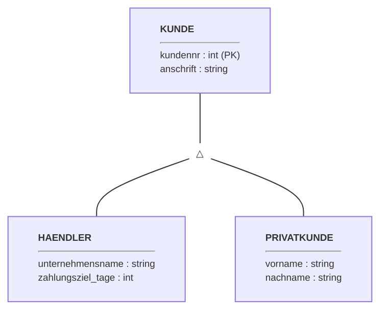
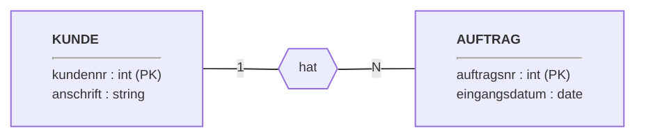
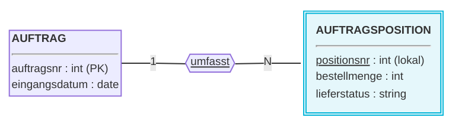
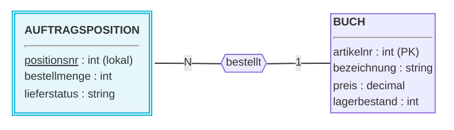
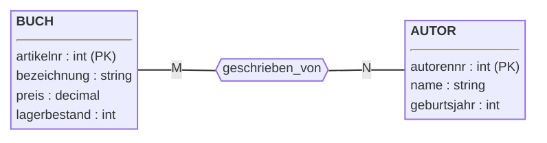

<!--
Dozenten-Skript (Zettel für die Übung) zu docs/02-theoriephase/termin-01/block-01.md.
Wird NICHT von MkDocs veröffentlicht (exclude_docs) und das PDF nicht versioniert.
Bauen: docs/02-theoriephase/_skript-werkzeuge/build-skripte.ps1
Box-Typen: aufgabe | loesung | hinweis | warnung | ergaenzung | bs
-->

```{=latex}
{\Large\bfseries\color{cUebung} Termin 1, Block 01 -- Übung: ER-Modell aufstellen}\hfill{\color{black!65}45 Min.}\par
\vspace{-2pt}{\color{cUebung}\rule{\linewidth}{1.6pt}}\par\vspace{2pt}
{\small\textbf{Fallstudie:} eLibri (Lehrbrief 3.5.2, S. 34) \quad|\quad \textbf{KI-Einsatz:} keiner \quad|\quad \textbf{Werkzeug:} Tafel/draw.io, Live-Modellierung}
```

::: hinweis
**Ziel:** Aus einer Textbeschreibung Schritt für Schritt ein ER-Modell mit
Spezialisierung, abhängigem Entity-Typ und mehreren Beziehungen ableiten;
begründen, warum etwas am Subtyp statt am Supertyp hängt.
:::

| Phase | Zeit |
|:--------------------------------------------|----------:|
| Kurzer Rückblick (3 Fragen)                  | 5 Min.  |
| Szenario eLibri                              | 5 Min.  |
| ER-Modell erstellen (Kunde, Auftrag, Position, Buch) | 20 Min. |
| Gesamtergebnis                               | 5 Min.  |
| Erweiterung: Autor:innen                     | 10 Min. |

::: warnung
Musterlösungen live **schrittweise** aufdecken -- nicht vorab zeigen.
Studierende kennen alle Bausteine aus Praxisphase Woche 2 und 3.
:::

# Kurzer Rückblick [ca. 5 Min.]{.zeit}

::: aufgabe
**Frage 1:** Wozu dient ein ER-Diagramm?
:::

::: loesung
Zentrales Werkzeug des **konzeptuellen Entwurfs**: technikfernes Modell,
mit dem man sich mit Anwender:innen über die Daten verständigt -- *bevor*
Tabellen und SQL kommen.
:::

::: aufgabe
**Frage 2:** Was macht einen Entity-Typ zu einem **abhängigen** Entity-Typ?
:::

::: loesung
Kein eigener Schlüssel, Existenz hängt an einem identifizierenden
Entity-Typ. Eindeutig erst durch **lokales Attribut + Beziehung** zu diesem.
:::

::: aufgabe
**Frage 3:** Was "erbt" ein Subtyp vom Supertyp?
:::

::: loesung
**Alle** Attribute und Beziehungen des Supertyps, zusätzlich zu den eigenen.
:::

# Das Szenario: eLibri [ca. 5 Min.]{.zeit}

Einkaufsgenossenschaft von Buchhändlern **plus** eigene Plattform für Privatkunden;
über beide Kanäle werden Bücher bestellt. *(Lehrbrief Kap. 3.5.2, S. 34)*

| Objekt | Eigenschaften laut Text |
|:------------------|:-------------------------------------------------------|
| **Kunde** (2 Arten) | gemeinsam: fortlaufende Kundennr., Anschrift |
| Buchhändler | Mitglied der Genossenschaft; Unternehmensname, Zahlungsziel (Tage) |
| Privatkunde | Vorname, Nachname |
| **Auftrag** | eindeutige Auftragsnr., Eingangsdatum; gehört zu **genau 1** Kunde |
| **Auftragsposition** | fortlaufende Positionsnr. *im Auftrag*, Bestellmenge, Lieferstatus (in Bearbeitung / nicht lieferbar / ausgeliefert); bezieht sich auf **genau 1** Buch |
| **Buch** | Artikelnr., Bezeichnung, Preis, Lagerbestand |

::: ergaenzung
**Whiteboard: Text → Modell lesen.** Hilft beim Entwickeln der Struktur
vor dem ersten Kasten.

| Im Text | Wird im ER-Modell zu |
|:------------------------------|:------------------------------|
| Substantiv mit eigenen Eigenschaften | Entity-Typ |
| Eigenschaft ("mit Preis ...") | Attribut |
| Verb / "gehört zu", "besteht aus" | Beziehungstyp |
| "genau ein" / "mehrere" | Kardinalität (1 / N) |
| "zwei Arten von ..." mit gemeinsamen Daten | Spezialisierung |
| Nummer gilt "im Auftrag" fortlaufend | abhängiger Entity-Typ |
:::

# ER-Modell erstellen [ca. 20 Min.]{.zeit}

Anforderung für Anforderung; jedes Teildiagramm zeigt nur das **Neue**
(nicht kumulativ).

## Kunde und Spezialisierung

::: aufgabe
Händler und Privatkunden als **Spezialisierung** von `KUNDE` modellieren.
Welche Attribute gehören an den Supertyp, welche an die Subtypen?
:::

::: warnung
Gemeinsame Attribute (**Kundennr., Anschrift**) an den Supertyp -- nicht
doppelt an beide Subtypen. Kundennr. = Schlüssel von `KUNDE` (gemeinsamer
Nummernkreis).
:::

::: hinweis
`anschrift` bleibt **ein** Attribut (eigentlich Straße, Nr., PLZ, Ort).
Aufteilen kommt in **Termin 2** (Normalisierung).
:::

::: loesung

:::

## Auftrag

::: aufgabe
Beziehung zwischen Kunde und Auftrag modellieren (Kardinalität!).
Hängt sie am Supertyp oder an den Subtypen?
:::

::: warnung
Beziehung am **Supertyp `KUNDE`** -- beide Subtypen können Aufträge
aufgeben. Genau das ist das "Erben".
:::

::: hinweis
Auftrag → genau **1** Kunde. Kunde → **mehrere** Aufträge, aber (noch)
keiner nötig.
:::

::: loesung

:::

## Auftragsposition (abhängiger Entity-Typ)

::: aufgabe
Positionen eines Auftrags modellieren. Warum ist `AUFTRAGSPOSITION` ein
**abhängiger** Entity-Typ? Welche Kardinalität hat die Beziehung aus
Sicht der Position?
:::

::: hinweis
Positionsnr. nur **innerhalb** des Auftrags eindeutig. Aus Sicht der
Position **immer 1** (wie jeder abhängige Entity-Typ). Bekannt aus
Woche 3 (Fertigungsauftrag/Position), nur neue Domäne.
:::

::: loesung

:::

## Buch

::: aufgabe
Beziehung der Position zum Buch modellieren. Wohin gehören
**Bestellmenge** und **Lieferstatus**? Ist "Lieferstatus" ein eigener
Entity-Typ?
:::

::: warnung
Bestellmenge und Lieferstatus gehören an `AUFTRAGSPOSITION` -- nicht an
`BUCH`, nicht an die Beziehung (pro Position verschieden).
:::

::: hinweis
Lieferstatus = **kein** Entity-Typ: fester Wertebereich, kein Objekt mit
eigener Existenz. Position → genau **1** Buch; Buch → in vielen Positionen.
:::

::: loesung

:::

```{=latex}
\clearpage
```

# Gesamtergebnis [ca. 5 Min.]{.zeit}

Kern-Modell komplett: Spezialisierung, zwei normale Beziehungen, ein
abhängiger Entity-Typ. *(Diagramm für den Druck in zwei Ausschnitten, `AUFTRAG` ist dazu doppelt gezeichnet -- Inhalt wie auf der Webseite.)*

::: loesung
```{.mermaid maxh=6cm}
%%{init: {'flowchart': {'padding': 1}, 'themeVariables': {'fontSize': '0.6rem'}}}%%
graph LR
KUNDE["<div style='text-align:left; font-size: 0.6rem;'><b>KUNDE</b><hr/>kundennr : int (PK)<br/>anschrift : string</div>"]
spez((△))
style spez fill:transparent,stroke:none
HAENDLER["<div style='text-align:left; font-size: 0.6rem;'><b>HAENDLER</b><hr/>unternehmensname : string<br/>zahlungsziel_tage : int</div>"]
PRIVATKUNDE["<div style='text-align:left; font-size: 0.6rem;'><b>PRIVATKUNDE</b><hr/>vorname : string<br/>nachname : string</div>"]
KUNDE --- spez
spez --- HAENDLER
spez --- PRIVATKUNDE
AUFTRAG["<div style='text-align:left; font-size: 0.6rem;'><b>AUFTRAG</b><hr/>auftragsnr : int (PK)<br/>eingangsdatum : date</div>"]
hat{{hat}}
KUNDE -- "1" --- hat
hat -- "N" --- AUFTRAG
```

*Ausschnitt 2 (`AUFTRAG` zur Anschlussstelle wiederholt):*

```{.mermaid maxh=6cm}
%%{init: {'flowchart': {'padding': 1}, 'themeVariables': {'fontSize': '0.6rem'}}}%%
graph LR
AUFTRAG["<div style='text-align:left; font-size: 0.6rem;'><b>AUFTRAG</b><hr/>auftragsnr : int (PK)<br/>eingangsdatum : date</div>"]
AUFTRAGSPOSITION["<div style='text-align:left; font-size: 0.6rem; border: 3px double rgb(0, 180, 216); background: rgba(0, 180, 216, 0.1); padding: 8px;'><b>AUFTRAGSPOSITION</b><hr/><u>positionsnr</u> : int (lokal)<br/>bestellmenge : int<br/>lieferstatus : string</div>"]
style AUFTRAGSPOSITION fill:transparent,stroke:none
umfasst{{"<u>umfasst</u>"}}
AUFTRAG -- "1" --- umfasst
umfasst -- "N" --- AUFTRAGSPOSITION
BUCH["<div style='text-align:left; font-size: 0.6rem;'><b>BUCH</b><hr/>artikelnr : int (PK)<br/>bezeichnung : string<br/>preis : decimal<br/>lagerbestand : int</div>"]
bestellt{{bestellt}}
AUFTRAGSPOSITION -- "N" --- bestellt
bestellt -- "1" --- BUCH
```

| Beziehung | Sicht von | Kardinalität |
|:----------------------------|:----------------------|:-----------|
| `KUNDE` -- `AUFTRAG` | `AUFTRAG` | 1..1 |
| | `KUNDE` | 0..\* |
| `AUFTRAG` -- `AUFTRAGSPOSITION` (identifizierend) | `AUFTRAGSPOSITION` | 1..1 |
| | `AUFTRAG` | 1..\* (Annahme: mind. 1 Position) |
| `AUFTRAGSPOSITION` -- `BUCH` | `AUFTRAGSPOSITION` | 1..1 |
| | `BUCH` | 0..\* |
:::

::: hinweis
Mermaid/Chen zeigt nur 1/N -- die genauen Ober-/Untergrenzen (Tabelle)
**mündlich ergänzen**. Optional: Modell auf der Webseite als draw.io
öffnen (`code/uebung-01-elibri-kern-modell.drawio`, Blatt "Kern-Modell").
:::

# Erweiterung: Autor:innen ergänzen [ca. 10 Min.]{.zeit}

::: aufgabe
eLibri will **Autor:innen** (inkl. Geburtsjahr) erfassen. Ein Buch kann
mehrere Autor:innen haben, eine Autorin/ein Autor mehrere Bücher.
**Was ändert sich am Diagramm?**

Zusatzfrage: Wann bekommt etwas einen eigenen Entity-Typ, wann bleibt es
"nur" ein Attribut?
:::

::: ergaenzung
**Whiteboard: Warum N:M?** Beispielinstanzen (frei gewählt, nicht aus der
Vorlage):

| Buch | Autor:in |
|:------|:--------|
| B1 | A1 |
| B1 | A2 |
| B2 | A2 |
| B3 | A1 |

B1 hat zwei Autor:innen, A2 hat zwei Bücher → beide Seiten "mehrere".

**Entity-Typ oder Attribut?**

| Eigener Entity-Typ, wenn ... | Attribut, wenn ... |
|:----------------------------|:----------------------------|
| eigene Eigenschaften (Autor: Name, Geburtsjahr) | einfacher Wert (Preis) |
| von mehreren Seiten referenziert (N:M) | fester Wertebereich (Lieferstatus) |
| eigene Existenz, auch ohne Partner | kein Objekt mit eigener Existenz |
:::

::: loesung


Neuer Entity-Typ `AUTOR`. Neu: erste **N:M**-Beziehung im Modell (bisher
nur 1:N). Weiterführend: Reihenfolge auf dem Cover →
Beziehungsattribut `reihenfolge`.
:::

::: warnung
N:M wird bei der **Transformation** (Block 02) zu einer eigenen Relation
-- nicht vorwegnehmen, nur als Ausblick erwähnen.
:::

```{=latex}
\clearpage
```

::::: bs
**Betreutes Selbststudium (45 Min.): Aufgabe 01 -- eLibri erweitern.**
Einzeln oder zu zweit; Ausgangspunkt ist das gemeinsam entwickelte
Kern-Diagramm.

| Teil | Auftrag | Kernpunkt der Lösung |
|:-----|:------------------------------|:-----------------------------|
| **A** Kreditkarte | `KREDITKARTE` (Kartennr., Unternehmen, Ablaufdatum) ergänzen; Privatkunde hat ≥ 1 Karte, Karte von mehreren Kunden nutzbar | **N:M nur an `PRIVATKUNDE`** (nicht Supertyp, nicht Händler); Subtyp darf eigene Beziehungen haben |
| **B** Versandkopplung | Aufträge desselben Kunden zusammen versenden; Beziehung auf `AUFTRAG` + Rollennamen | **Rekursive M:N**, symmetrisch; Rollen z. B. "eigener" / "mitversendeter Auftrag" |
| **C** Bewertungen (optional) | Sterne (1--5) + optionaler Kommentar je Buch | **Zwei gültige Modelle**: (1) Kunde--Buch N:M mit Beziehungsattributen, (2) `BEWERTUNG` 1:1 an `AUFTRAGSPOSITION`; mit anderer Gruppe vergleichen |
| **D** Lagerstandorte (optional) | Jeder Standort vergibt Positionsnr. eigenständig | `AUFTRAGSPOSITION` mit **zwei** identifizierenden Beziehungen (Auftrag + Standort); Schlüssel = auftragsnr + standortnr + positionsnr |

::: warnung
**Moderation:** Teil C lebt vom Vergleich -- Unterschiede zwischen den
Gruppen bewusst zeigen und benennen ("Spezifikation lässt es offen →
mit Anwender:innen klären"). Schließt den Kreis zu Rückblick-Frage 1.
:::
:::::
