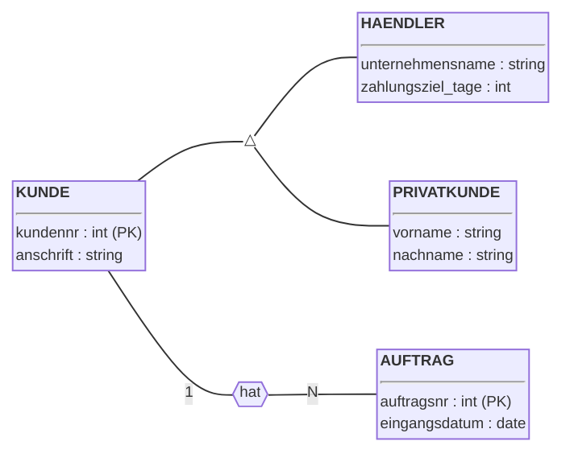
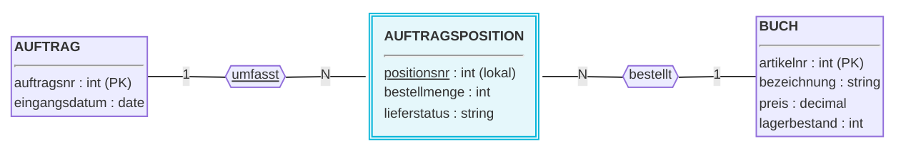

<!--
Dozenten-Skript (Zettel für die Übung) zu docs/02-theoriephase/termin-01/block-02.md.
Wird NICHT von MkDocs veröffentlicht (exclude_docs) und das PDF nicht versioniert.
Bauen: docs/02-theoriephase/_skript-werkzeuge/build-skripte.ps1
Box-Typen: aufgabe | loesung | hinweis | warnung | ergaenzung | bs
-->

```{=latex}
{\Large\bfseries\color{cUebung} Termin 1, Block 02 -- Übung: Transformation ins Relationenmodell}\hfill{\color{black!65}45 Min.}\par
\vspace{-2pt}{\color{cUebung}\rule{\linewidth}{1.6pt}}\par\vspace{2pt}
{\small\textbf{Fallstudie:} eLibri (Fortsetzung Block 01) \quad|\quad \textbf{KI-Einsatz:} keiner \quad|\quad \textbf{Werkzeug:} Tafel, Tabellen von Hand; drawDB nur als Ausblick}
```

::: hinweis
**Ziel:** Das eben gebaute eLibri-ER-Modell mit den Regeln aus
Praxisphase Woche 4--6 systematisch ins Relationenschema überführen;
begründen, warum N:M eine eigene Relation braucht, 1:N dagegen nicht.
:::

| Phase | Zeit |
|:--------------------------------------------|----------:|
| Kurzer Rückblick (4 Fragen)                  | 7 Min.  |
| Ausgangspunkt: eLibri-Modell                 | 3 Min.  |
| Relationenmodell erstellen (Spezialisierung, einfache, abhängiger Entity-Typ) | 30 Min. |
| Gesamtergebnis                               | 5 Min.  |

::: ergaenzung
**Whiteboard: Die sechs Regeln auf einen Blick.** (Steht auf der
Termin-Übersichtsseite, nicht in dieser Übung.)

| Regel | Fall | Ergebnis |
|:--|:--------------------|:----------------------------------------|
| 1 | Einfacher Entity-Typ | eigene Relation, Schlüsselattribut = PK |
| 2 | N:M-Beziehung | **neue** Relation; PK = beide FKs zusammen |
| 3 | 1:N-Beziehung | verschmilzt mit N-Seite; FK auf die 1-Seite |
| 4 | 1:1-Beziehung | wie Regel 3, FK zusätzlich UNIQUE |
| 5 | Abhängiger Entity-Typ | PK = lokales Attribut + FK zum identifizierenden Typ |
| 6 | Spezialisierung | je Relation für Super- und Subtyp; Subtyp-PK = FK auf Supertyp |
:::

# Kurzer Rückblick [ca. 7 Min.]{.zeit}

::: aufgabe
**Frage 1:** Warum reicht das ER-Modell allein nicht aus, um eine
Datenbank zu implementieren?
:::

::: loesung
Es fehlt eine **Sprachkomponente** zum Abfragen/Ändern von Daten. Darum
Relationenmodell, ergänzt um **SQL**.
:::

::: aufgabe
**Frage 2:** Was unterscheidet die Transformation einer 1:N- von einer
N:M-Beziehung?
:::

::: loesung
**1:N:** Beziehung verschmilzt mit der N-Seite, ein FK genügt.
**N:M:** immer eine **eigene dritte Relation** -- ein einzelner FK kann
nicht auf mehrere Datensätze zugleich verweisen.
:::

::: aufgabe
**Frage 3:** Woraus setzt sich der Primärschlüssel einer Relation aus
einem abhängigen Entity-Typ zusammen?
:::

::: loesung
**Lokales Schlüsselattribut + Fremdschlüssel** zum identifizierenden
Entity-Typ. Das lokale Attribut allein ist nur innerhalb des Eigentümers
eindeutig.
:::

::: aufgabe
**Frage 4:** In welcher Reihenfolge transformiert man ein vollständiges
ER-Diagramm am besten?
:::

::: loesung
1. Einfache Entity-Typen (Regel 1)
2. Spezialisierung, vom Supertyp nach unten (Regel 6)
3. Abhängige Entity-Typen (Regel 5)
4. Beziehungen: erst N:M, dann 1:N, zuletzt 1:1

Beziehungen erst, wenn alle beteiligten Relationen existieren.
Empfehlung für große Diagramme, **keine Pflicht**.
:::

# Ausgangspunkt: eLibri-Modell [ca. 3 Min.]{.zeit}

Das Kern-Modell aus der vorherigen Übung -- das wird jetzt transformiert.



*Ausschnitt 2 (`AUFTRAG` zur Anschlussstelle wiederholt):*



*(Für den Druck in zwei Ausschnitte geteilt -- Inhalt wie auf der Webseite.)*

::: hinweis
**Heutige Reihenfolge** (jede Relation nur **einmal** schreiben):
Spezialisierung → einfache Entity-Typen → abhängiger Entity-Typ.
Beziehungen sofort als FK einarbeiten, sobald die Ziel-Relation existiert.
:::

# Relationenmodell erstellen [ca. 30 Min.]{.zeit}

## Spezialisierung transformieren (Regel 6)

::: aufgabe
Transformiere `KUNDE`, `HAENDLER`, `PRIVATKUNDE` nach Regel 6. Welchen
Schlüssel bekommen die Subtyp-Relationen?
:::

::: hinweis
Subtyp-Relation erhält `kundennr` als **FK** -- und weil pro Kunde
höchstens ein Datensatz in `HAENDLER`/`PRIVATKUNDE` existieren darf, ist
dieser FK zugleich der **PK**.
:::

::: loesung
**Relation `KUNDE`**

| Schlüssel | Attribut | Wertebereich | optional? |
|:--|:--------------|:------|:--|
| PK | kundennr | int | nein |
| – | anschrift | string | nein |

**Relation `HAENDLER`**

| Schlüssel | Attribut | Wertebereich | optional? |
|:--|:--------------|:------|:--|
| PK, FK | kundennr | int | nein |
| – | unternehmensname | string | nein |
| – | zahlungsziel_tage | int | nein |

**Relation `PRIVATKUNDE`**

| Schlüssel | Attribut | Wertebereich | optional? |
|:--|:--------------|:------|:--|
| PK, FK | kundennr | int | nein |
| – | vorname | string | nein |
| – | nachname | string | nein |

Beide FKs verweisen auf `KUNDE.kundennr`. Ein Kunde kann höchstens
einmal Händler und höchstens einmal Privatkunde sein, aber auch in
keiner der beiden stehen (laut Szenario ausgeschlossen: jeder Kunde ist
Händler **oder** Privatkunde).
:::

## Einfache Entity-Typen transformieren (Regel 1 und 3)

::: aufgabe
Transformiere `AUFTRAG` und `BUCH`. Wo landet die Beziehung `hat`
(1:N)? Ist der FK optional?
:::

::: hinweis
`AUFTRAG` = N-Seite von `hat`. `KUNDE` existiert schon → FK `kundennr`
**gleich mit einarbeiten** (Regel 3), `AUFTRAG` muss später nicht noch
mal angefasst werden.
:::

::: warnung
FK `kundennr` ist **nicht optional**: Jeder Auftrag gehört laut Szenario
zu genau einem Kunden (verpflichtende Teilnahme).
:::

::: loesung
**Relation `AUFTRAG`**

| Schlüssel | Attribut | Wertebereich | optional? |
|:--|:--------------|:------|:--|
| PK | auftragsnr | int | nein |
| FK | kundennr | int | nein |
| – | eingangsdatum | date | nein |

**Relation `BUCH`**

| Schlüssel | Attribut | Wertebereich | optional? |
|:--|:--------------|:------|:--|
| PK | artikelnr | int | nein |
| – | bezeichnung | string | nein |
| – | preis | decimal | nein |
| – | lagerbestand | int | nein |
:::

## Abhängigen Entity-Typ transformieren (Regel 5 und 3)

::: aufgabe
Transformiere `AUFTRAGSPOSITION` samt `umfasst` und `bestellt`. Woraus
besteht der Primärschlüssel?
:::

::: hinweis
`positionsnr` nur innerhalb eines Auftrags eindeutig → Regel 5: PK =
`positionsnr` + FK `auftragsnr`. `BUCH` existiert schon → FK `artikelnr`
direkt dazu (Regel 3). Vgl. Fertigungsauftrag-Beispiel aus Woche 6.
:::

::: warnung
FK `artikelnr` ist **nicht optional**: jede Position bezieht sich auf
genau ein Buch.
:::

::: loesung
**Relation `AUFTRAGSPOSITION`**

| Schlüssel | Attribut | Wertebereich | optional? |
|:--|:--------------|:------|:--|
| PK, FK1 | auftragsnr | int | nein |
| PK | positionsnr | int | nein |
| FK2 | artikelnr | int | nein |
| – | bestellmenge | int | nein |
| – | lieferstatus | string | nein |

FK1 → `AUFTRAG`, FK2 → `BUCH`. Erst die Kombination aus `auftragsnr` und
`positionsnr` identifiziert eine Position eindeutig.
:::

# Gesamtergebnis [ca. 5 Min.]{.zeit}

Das Kern-Modell liegt vollständig im Relationenmodell vor: **sechs
Relationen**.

::: ergaenzung
**Whiteboard: alle Relationen im Überblick** (Kurznotation: **PK** fett,
*FK* kursiv).

| Relation | Attribute |
|:----------------|:-------------------------------------------------|
| `KUNDE` | **kundennr**, anschrift |
| `HAENDLER` | **kundennr** (*FK→KUNDE*), unternehmensname, zahlungsziel_tage |
| `PRIVATKUNDE` | **kundennr** (*FK→KUNDE*), vorname, nachname |
| `AUFTRAG` | **auftragsnr**, *kundennr*, eingangsdatum |
| `BUCH` | **artikelnr**, bezeichnung, preis, lagerbestand |
| `AUFTRAGSPOSITION` | **auftragsnr** (*FK→AUFTRAG*), **positionsnr**, *artikelnr*, bestellmenge, lieferstatus |
:::

::: warnung
**Nicht vergessen -- Informationsverlust:** Im ER-Modell hat jeder
Auftrag **mindestens eine** Position. Diese Untergrenze lässt sich im
Relationenmodell **nicht erzwingen** (Informationskapazität, Woche 6): Ein
Auftrag ohne Position wäre möglich.
:::

::: hinweis
**Ausblick:** Das Relationenmodell liegt als drawDB-Datei vor
(`code/uebung-02-elibri-relationenmodell.ddb`; Datei → Importieren → JSON,
in leerem **MSSQL**-Diagramm). Das Werkzeug nutzen die Studierenden ab dem
nächsten Termin.
:::

```{=latex}
\clearpage
```

::::: bs
**Betreutes Selbststudium (45 Min.): Aufgabe 02 -- eLibri-Erweiterungen
transformieren.** Einzeln oder zu zweit; Grundlage sind die eigenen
Ergebnisse (Teil A/B) aus dem betreuten Selbststudium zu Block 01.

| Teil | Auftrag | Kernpunkt der Lösung |
|:-----|:------------------------------|:-----------------------------|
| **A** Kreditkarte | `KREDITKARTE` nach Regel 1; Beziehung `nutzt` (N:M) nach Regel 2 | Neue Relation `KARTENNUTZUNG`: PK = **kundennr (FK→PRIVATKUNDE) + kartennr (FK→KREDITKARTE)**; FK auf `PRIVATKUNDE`, nicht `KUNDE` |
| **B** Versandkopplung | Rekursive M:N nach Regel 2, sprechender Name; Rollennamen für beide FKs | `VERSANDKOPPLUNG(auftragsnr_eigen, auftragsnr_mitversendet)`; beide FK → `AUFTRAG`, gleiche Namen unmöglich; Symmetrie: zwei Datensätze **oder** Konvention (kleinere Nr. zuerst) |
| **C** (optional) | Variante 1:N: Auftrag höchstens einem Sammel-Auftrag zugeordnet; Regel 3, rekursiv | In `AUFTRAG` optionaler FK `sammelauftragsnr` → `auftragsnr`; **Kardinalität entscheidet**, nicht Rekursivität |
| **D** (optional) | Beispieldaten `KUNDE`/`HAENDLER`/`PRIVATKUNDE`: Was fällt bei Kunde 3 auf? Idee, nur über die Tabellenstruktur abzusichern | Kunde 3 in `KUNDE`, aber in keinem Subtyp → verletzt vollständige Spezialisierung. Lösung: `KUNDE` weglassen, `anschrift` in beide Subtypen. **Preis:** `anschrift` doppelt definiert, "alle Kunden" nur per `UNION`. Sauber erst mit CHECK/Trigger/Transaktionen (späterer Termin) |

::: warnung
**Moderation:** Zu Teil D keine Constraint-Lösung vorwegnehmen (Trigger,
CHECK kommen später). Kernbotschaft: **Nicht jede Eigenschaft des
ER-Modells überträgt sich automatisch** -- hier geht die verpflichtende
Teilnahme an der Spezialisierung verloren. drawDB-Datei mit Teil A/B
liegt bei der Musterlösung (`code/aufg-02-elibri-erweiterung.ddb`).
:::
:::::
