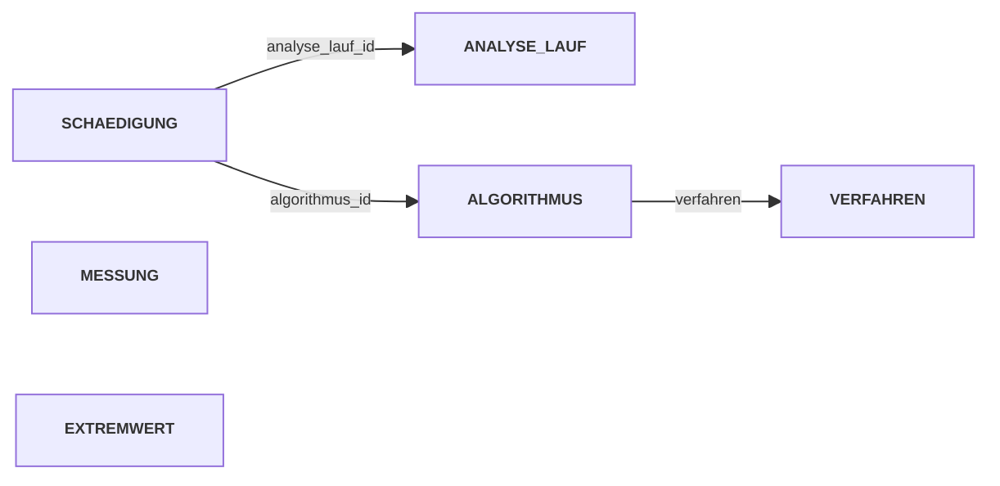

<!--
Dozenten-Skript (Zettel für die Übung) zu docs/02-theoriephase/termin-02/block-03.md.
Wird NICHT von MkDocs veröffentlicht (exclude_docs) und das PDF nicht versioniert.
Bauen: docs/02-theoriephase/_skript-werkzeuge/build-skripte.ps1
Box-Typen: aufgabe | loesung | hinweis | warnung | ergaenzung | bs
-->

```{=latex}
{\Large\bfseries\color{cUebung} Termin 2, Block 03 -- Übung: Normalisierung anwenden}\hfill{\color{black!65}45 Min.}\par
\vspace{-2pt}{\color{cUebung}\rule{\linewidth}{1.6pt}}\par\vspace{2pt}
{\small\textbf{Fallstudie:} Kompressor-Zustandsüberwachung (Übung), Schnüffel GmbH (bS) \quad|\quad \textbf{KI-Einsatz:} Stufe 2 (erst im bS ab Teil B) \quad|\quad \textbf{Werkzeug:} Tafel, Tabellen von Hand}
```

::: hinweis
**Ziel:** Relationen systematisch auf 1NF/2NF/3NF-Verletzungen prüfen und
zerlegen; erkennen, wann bewusste Redundanz (abgeleitete Daten) eine
gute Entwurfsentscheidung ist.
:::

| Phase | Zeit |
|:--------------------------------------------|----------:|
| Kurzer Rückblick (5 Fragen)                  | 6 Min.  |
| Szenario Kompressor                          | 5 Min.  |
| Normalisierung anwenden (1NF, 2NF, 3NF)      | 22 Min. |
| Gesamtergebnis                               | 4 Min.  |
| Praxisfall: bewusster Verzicht auf Normalform | 8 Min. |

::: ergaenzung
**Whiteboard: Normalformen als Prüffragen.**

| NF | Prüffrage | Typisches Symptom |
|:--|:-----------------------------|:----------------------------|
| 1NF | Ist jedes Attribut **atomar**? | Tupel/Liste/Bündel in einer Zelle |
| 2NF | Hängt jedes Nichtschlüsselattribut vom **ganzen** Schlüssel ab? | Attribut hängt nur an einem **Teil** des zusammengesetzten PK |
| 3NF | Hängt jedes Nichtschlüsselattribut **direkt** (nicht über ein anderes Nichtschlüsselattribut) am Schlüssel? | Attribut A bestimmt Attribut B (transitiv) |

Vorgehen: **von 1NF nach oben prüfen**, bei Verletzung zerlegen --
abhängige Attribute wandern mit dem Schlüsselteil/Attribut, von dem sie
abhängen, in eine neue Relation.
:::

# Kurzer Rückblick [ca. 6 Min.]{.zeit}

::: aufgabe
**Frage 1:** Wozu dient Normalisierung grundsätzlich?
:::

::: loesung
Qualitätsprüfung eines **bereits transformierten** Schemas: deckt
**Redundanz** auf, die zu Inkonsistenzen führen kann. 1NF--3NF =
konkrete, prüfbare Kriterien; Beseitigung durch **Zerlegung**.
:::

::: aufgabe
**Frage 2:** Was verlangt die erste Normalform?
:::

::: loesung
Jedes Attribut hat einen **atomaren** Wertebereich -- keine Tupel, keine
Listen in einer Zelle.
:::

::: aufgabe
**Frage 3:** Was ist eine funktionale Abhängigkeit zwischen zwei
Attributen?
:::

::: loesung
Wert von A legt Wert von B **eindeutig** fest: gleiche A-Werte →
zwingend gleiche B-Werte.
:::

::: aufgabe
**Frage 4:** Wann verletzt eine Relation die zweite Normalform?
:::

::: loesung
Ein Nichtschlüsselattribut hängt nur von einem **Teil** eines
zusammengesetzten Schlüssels ab.
:::

::: aufgabe
**Frage 5:** Wann verletzt eine Relation die dritte Normalform -- und
wie unterscheidet sich das von 2NF?
:::

::: loesung
Ein Nichtschlüsselattribut hängt nur **transitiv** über ein *anderes*
Nichtschlüsselattribut vom Schlüssel ab. 2NF: Verhältnis Attribut ↔
**Schlüssel**; 3NF: Verhältnis zweier **Nichtschlüsselattribute**.
:::

# Das Szenario: Kompressor-Zustandsüberwachung [ca. 5 Min.]{.zeit}

Pustefix & Co., Topmodell-Kompressor wird "intelligent" (vorausschauende
Instandhaltung). Datenhaltung auf einem **Industrie-PC am Kompressor**.

| Baustein | Inhalt laut Text |
|:----------------|:-----------------------------------------------|
| **Messung** | minütlich 5 Größen: Eingangsdruck, Ausgangsdruck, Volumenstrom, Temperatur, Luftfeuchtigkeit |
| **Analyse-Lauf** | täglich; findet lokale Maxima/Minima der Druckdifferenz, verarbeitet unverarbeitete Extremwerte, markiert sie als verarbeitet |
| **Algorithmus** | mehrere je Lauf; eindeutig durch **Verfahren** ("DIN"/"PFIX", künftig mehr) + **Version**, dazu Freigabedatum, Status; liefert je Lauf einen **Schädigungswert** (0--100 %) |
| **Grenzwerte** | Melde- und Alarmgrenze **je Verfahren**, unabhängig von der Version |

::: warnung
Verfahren + Version **zusammen** legen einen Algorithmus fest -- die
Versionsnummer allein nicht (DIN/PFIX werden unabhängig versioniert).
Grenzwerte gelten fürs **ganze Verfahren**. Beides ist später der Schlüssel
zur 2NF-/3NF-Lösung.
:::

# Normalisierung anwenden [ca. 22 Min.]{.zeit}

## Erste Normalform: Messwerte atomar speichern

**Relation `MESSUNG`** (erste Version)

| Schlüssel | Attribut | Wertebereich | optional? |
|:--|:--------------|:------------------------|:--|
| PK | zeitstempel | datetime | nein |
| – | druckwerte | Tupel (Eingangsdruck, Ausgangsdruck) | nein |
| – | volumenstrom | decimal | nein |
| – | temperatur | decimal | nein |
| – | luftfeuchtigkeit | decimal | nein |

::: aufgabe
Prüfen: Hat jedes Attribut einen atomaren Wertebereich?
:::

::: loesung
`druckwerte` bündelt **zwei** unabhängige Messgrößen → **1NF verletzt**.
Zerlegung trivial: zwei Attribute.

**Relation `MESSUNG`** (1NF-konform)

| Schlüssel | Attribut | Wertebereich | optional? |
|:--|:--------------|:------|:--|
| PK | zeitstempel | datetime | nein |
| – | druck_eingang | decimal | nein |
| – | druck_ausgang | decimal | nein |
| – | volumenstrom | decimal | nein |
| – | temperatur | decimal | nein |
| – | luftfeuchtigkeit | decimal | nein |
:::

## Zweite Normalform: Schädigungsauswertung prüfen

**Relation `SCHAEDIGUNG_NAIV`**, zusammengesetzter PK aus
`analyse_lauf_id` + `algorithmus_id` (mehrere Algorithmen je Lauf)

| Schlüssel | Attribut | Wertebereich | optional? |
|:--|:--------------|:------------------------|:--|
| PK | analyse_lauf_id | int | nein |
| PK | algorithmus_id | int | nein |
| – | schädigungswert | int (0--100) | nein |
| – | zeitstempel | datetime | nein |
| – | verfahren | string | nein |
| – | version | string | nein |
| – | release_datum | date | nein |
| – | status | string (alpha/beta/stable) | nein |
| – | grenzwert_meldung | int (0--100) | nein |
| – | grenzwert_alarm | int (0--100) | nein |

::: aufgabe
Prüfen: Hängt jedes Nichtschlüsselattribut vom **vollständigen**
Schlüssel ab -- oder nur von einem Teil?
:::

::: ergaenzung
**Whiteboard: Abhängigkeiten sortieren.** Frage je Attribut: "Was
bestimmt mich?"

| Attribut | hängt ab von | Ergebnis |
|:----------------------|:--------------------------|:----------------------|
| `schädigungswert` | Lauf **und** Algorithmus | bleibt in `SCHAEDIGUNG` |
| `zeitstempel` | nur `analyse_lauf_id` | → `ANALYSE_LAUF` |
| `verfahren`, `version`, `release_datum`, `status`, `grenzwert_*` | nur `algorithmus_id` | → `ALGORITHMUS` |
:::

::: loesung
`schädigungswert` = voller Schlüssel (Ergebnis dieses Algorithmus in
diesem Lauf). **2NF auf beiden Seiten verletzt:**

- `zeitstempel` → nur von `analyse_lauf_id` (ein Lauf = ein Abschlusszeitpunkt)
- `verfahren`, `version`, `release_datum`, `status`, Grenzwerte → nur von
  `algorithmus_id` ("DIN 1.01" bleibt derselbe Algorithmus in jedem Lauf)

**Relation `ANALYSE_LAUF`**

| Schlüssel | Attribut | Wertebereich | optional? |
|:--|:--------------|:------|:--|
| PK | analyse_lauf_id | int | nein |
| – | zeitstempel | datetime | nein (UNIQUE) |

**Relation `SCHAEDIGUNG`**

| Schlüssel | Attribut | Wertebereich | optional? |
|:--|:--------------|:------|:--|
| PK, FK | analyse_lauf_id | int | nein |
| PK, FK | algorithmus_id | int | nein |
| – | schädigungswert | int (0--100) | nein |

**Relation `ALGORITHMUS`** (vorläufig, vor 3NF)

| Schlüssel | Attribut | Wertebereich | optional? |
|:--|:--------------|:------|:--|
| PK | algorithmus_id | int | nein |
| – | verfahren | string | nein |
| – | version | string | nein |
| – | release_datum | date | nein |
| – | status | string | nein |
| – | grenzwert_meldung | int (0--100) | nein |
| – | grenzwert_alarm | int (0--100) | nein |

`verfahren` + `version` gemeinsam **UNIQUE**; PK bleibt `algorithmus_id`,
weil `version` allein nicht eindeutig ist (vgl. PK vs. Unique Key,
Woche 4).
:::

## Dritte Normalform: Grenzwerte prüfen

::: aufgabe
Prüfen an `ALGORITHMUS`: Hängen `grenzwert_meldung` und `grenzwert_alarm`
**direkt** von `algorithmus_id` ab -- oder indirekt über ein anderes
Nichtschlüsselattribut?
:::

::: loesung
Grenzwerte beschreiben das **Verfahren**, nicht den einzelnen Algorithmus
→ nur **transitiv** über `verfahren` abhängig (DIN 1.00 und DIN 1.01
haben identische Grenzwerte) → **3NF verletzt**.

**Relation `ALGORITHMUS`** (vollständig)

| Schlüssel | Attribut | Wertebereich | optional? |
|:--|:--------------|:------|:--|
| PK | algorithmus_id | int | nein |
| – | version | string | nein |
| – | release_datum | date | nein |
| – | status | string | nein |
| FK | verfahren | string | nein |

(weiterhin `verfahren` + `version` gemeinsam UNIQUE)

**Relation `VERFAHREN`**

| Schlüssel | Attribut | Wertebereich | optional? |
|:--|:--------------|:------|:--|
| PK | verfahren | string | nein |
| – | grenzwert_meldung | int (0--100) | nein |
| – | grenzwert_alarm | int (0--100) | nein |
:::

# Gesamtergebnis [ca. 4 Min.]{.zeit}

Fünf Relationen aus der Normalisierung **plus** `EXTREMWERT` (tägliche
lokale Maxima/Minima der Druckdifferenz).

**Relation `EXTREMWERT`**

| Schlüssel | Attribut | Wertebereich | optional? |
|:--|:--------------|:------------------------|:--|
| PK | zeitstempel | datetime | nein |
| – | typ | string (Maximum/Minimum) | nein |
| – | wert | decimal | nein |
| – | verarbeitet | boolean | nein |

::: ergaenzung
**Whiteboard: Beziehungen zwischen den sechs Relationen** (Pfeil = FK
verweist auf). `MESSUNG` und `EXTREMWERT` hängen über den Zeitstempel
zusammen, haben aber **keinen FK**.


:::

::: loesung
Das normalisierte Kompressor-Modell besteht aus **sechs Relationen**:
`MESSUNG`, `EXTREMWERT`, `ANALYSE_LAUF`, `SCHAEDIGUNG`, `ALGORITHMUS`,
`VERFAHREN`. Jede Redundanz, die sich über funktionale Abhängigkeiten
begründen ließ, ist beseitigt.
:::

# Praxisfall: bewusster Verzicht auf Normalform [ca. 8 Min.]{.zeit}

::: aufgabe
`EXTREMWERT.wert` = `druck_ausgang − druck_eingang` am selben Zeitstempel
→ aus `MESSUNG` berechenbar, wird aber **zusätzlich gespeichert**.

**Diskutieren:** Ist das ein Normalform-Verstoß? Ist es sinnvoll, die
Druckdifferenz an ausgewählten Zeitpunkten zu speichern?
:::

::: loesung
**Kein 2NF-/3NF-Verstoß:** Diese prüfen Abhängigkeiten *innerhalb* einer
Relation über deren Schlüssel -- `wert` hängt korrekt vom PK
`zeitstempel` ab. Die Redundanz liegt **zwischen** zwei Relationen:
**abgeleitete Daten** -- von 1NF--3NF nicht erfasst.

**Warum bewusst speichern:** Extrema finden = Scan über die gesamte,
evtl. monatelange Messreihe → bei jedem Lauf neu rechnen ist teuer →
einmal **materialisieren**; Flag `verarbeitet` verhindert doppelte
Verarbeitung. Gut begründete **Entwurfsentscheidung**, kein Fehler.
:::

::: warnung
Botschaft: Normalisierung ist ein **Prüfwerkzeug, kein Dogma**. Bewusste
Redundanz **begründen** können -- im Gegensatz zu den 1NF-/2NF-/3NF-Fehlern
von vorhin.
:::

```{=latex}
\clearpage
```

::::: bs
**Betreutes Selbststudium (45 Min.): Aufgabe 03 -- Prozessdatenbank der
Schnüffel GmbH.** Einzeln oder zu zweit; direkt im **Relationenmodell**
(kein ER-Diagramm), Schema in **drawDB** (Datenbank **MSSQL**), am Ende
sichern: Datei → Exportieren als → JSON.

| Teil | Auftrag | Kernpunkt der Lösung |
|:-----|:------------------------------|:-----------------------------|
| **A** ca. 15 Min. **ohne KI** | Bestandstabelle `PROZESSWERT_ALT` (PK: charge_nr + zeitstempel) auf 1NF/2NF/3NF prüfen, sauberes Schema in drawDB; Beispieldaten **mitlesen** | **1NF:** `rezept_parameter` = Bündel in einer Zelle → `REZEPT_PARAMETER`. **2NF:** `reaktor_id`, `rezept_id` nur von `charge_nr` → `CHARGE`. **3NF:** `saeureresistent` über `reaktor_id` → `REAKTOR`. Ziel: 5 Relationen (`PROZESSWERT`, `CHARGE`, `REAKTOR`, `REZEPT`, `REZEPT_PARAMETER`) |
| **B** ca. 10 Min. **KI erlaubt** | Erweitern um (1) Ereignisdokumentation Leitwarte, (2) Qualitätsdaten aus Excel; prüfen, ob alles gleichzeitig geht, sonst begründet entscheiden | **Widerspruch:** Zuordnung über Prozessdatenpunkt (30-s-Raster) **vs.** sekundengenau nachtragen → FK hätte kein Ziel. **Lösung:** `EREIGNIS` mit eigenem Zeitpunkt, Zuordnung über `charge_nr`. Qualität: `QUALITAETSERGEBNIS` + `KENNZAHL` (Einheit/Prüfverfahren gehören zur Kennzahl, 2NF) |
| **C** ca. 20 Min. **Nachtrag** | Kunde will Wareneingangs-Analysewerte je Los: erst **ohne KI** einschätzen, dann **mit KI** umsetzen, KI-Beitrag dokumentieren | Nicht "eine Tabelle mehr": N:M **`CHARGE_EINSATZ`** fehlt bisher; dazu `EINSATZSTOFF`, `LIEFERLOS`, `WE_ANALYSEWERT`. Folge für Teil B: Ereignistyp "alternativer Einsatzstoff" doppelt abgedeckt. Typischer KI-Fehler: Analysewerte als Spalten an `LIEFERLOS`, Verknüpfung vergessen |

::: warnung
**Teil C ist auf der Kurswebseite ausgeblendet** (Überraschungseffekt).
Ablauf: Studierende bearbeiten Teil A + B (ca. 25 Min.) → sobald erste
Gruppen eine vollständige Version haben: im Frontmatter
**`nachtrag_sichtbar: true`**, committen, pushen (Actions baut neu).
`musterloesungen_sichtbar` bleibt `false`, erst **nach** der Besprechung
aller Teile auf `true` (eigener Commit).
:::

::: hinweis
KI nur ab Teil B; Teil A ohne KI ("nach der Übung bekommt ihr das selbst
hin"). Musterlösungen als drawDB-Dateien: `code/aufg-03-prozessdatenbank-teil-a/-b/-c.ddb`.
:::
:::::
