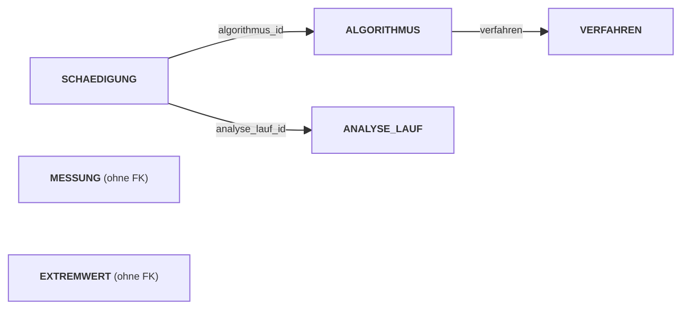

<!--
Dozenten-Skript (Zettel für die Übung) zu docs/02-theoriephase/termin-02/block-04.md.
Wird NICHT von MkDocs veröffentlicht (exclude_docs) und das PDF nicht versioniert.
Bauen: docs/02-theoriephase/_skript-werkzeuge/build-skripte.ps1
Box-Typen: aufgabe | loesung | hinweis | warnung | ergaenzung | bs
Code-Musterlösungen werden per "--8<-- "pfad"" aus docs/ eingelesen (Filter).
-->

```{=latex}
{\Large\bfseries\color{cUebung} Termin 2, Block 04 -- Übung: Relationenschema in SQL Server anlegen}\hfill{\color{black!65}45 Min.}\par
\vspace{-2pt}{\color{cUebung}\rule{\linewidth}{1.6pt}}\par\vspace{2pt}
{\small\textbf{Fallstudie:} Kompressor-Datenbank (Übung), Schnüffel GmbH (bS) \quad|\quad \textbf{KI-Einsatz:} Stufe 2 (erst im bS ab Teil B) \quad|\quad \textbf{Werkzeug:} SSMS, SQL Server 2025 Express (T-SQL)}
```

::: hinweis
**Ziel:** Relationenschema in T-SQL umsetzen (Datenbank, Tabellen,
Datentypen, PK/FK, Reihenfolge); Regeln der Anwendungswelt als
Constraints (UNIQUE, CHECK, DEFAULT) ableiten und vorhersagen, was die
Datenbank ablehnt.
:::

| Phase | Zeit |
|:--------------------------------------------|----------:|
| Kurzer Rückblick (3 Fragen)                  | 4 Min.  |
| Szenario Kompressor wird real                | 2 Min.  |
| Datenbank und Tabellen anlegen (6 Tabellen)  | 19 Min. |
| Constraints: die Regeln der Datenbank        | 16 Min. |
| Gesamtergebnis                               | 3 Min.  |

::: warnung
Live-Coding in **SSMS**, jede Lösung erst nach Eigenversuch der Gruppe
aufdecken. **Dialekt:** T-SQL, kein Standard-SQL (`BIT`, `DATETIME2`,
`IDENTITY`, `GO`).
:::

# Kurzer Rückblick [ca. 4 Min.]{.zeit}

::: aufgabe
**Frage 1:** Was passiert in der letzten Phase des Datenbankentwurfs, der
Datendefinition?
:::

::: loesung
Das logische Schema (Relationenschema) wird in die Datenstrukturen einer
Datenbanksprache umgesetzt -- bei uns **SQL-Anweisungen**, die die
Tabellen im Datenbanksystem anlegen.
:::

::: aufgabe
**Frage 2:** Wie erkennt man im Relationenschema einen Primär- und einen
Fremdschlüssel -- wofür sind sie da?
:::

::: loesung
**PK:** Attribut(kombination), die jeden Datensatz **eindeutig**
identifiziert. **FK:** verweist auf den Schlüssel einer anderen Relation
und bildet so die **Beziehung** ab.
:::

::: aufgabe
**Frage 3:** `AUFTRAG` hat einen FK auf `KUNDE`. Was muss gelten, damit
ein Auftrag eingetragen werden kann -- und was heißt das für die
Reihenfolge beim Eintragen?
:::

::: loesung
**Fremdschlüsselintegrität:** Der Kunde muss in `KUNDE` **schon
existieren**. Erst in die Tabelle, auf die verwiesen wird (`KUNDE`),
dann in die verweisende (`AUFTRAG`).
:::

# Das Szenario: Kompressor-Datenbank wird real [ca. 2 Min.]{.zeit}

Modell aus der Normalisierungs-Übung (Pustefix & Co.): **sechs
Relationen** -- `MESSUNG`, `VERFAHREN`, `ALGORITHMUS`, `ANALYSE_LAUF`,
`SCHAEDIGUNG`, `EXTREMWERT`. Heute werden sie auf dem eigenen Rechner in
SQL Server angelegt.

::: ergaenzung
**Whiteboard: Reihenfolge ergibt sich aus den Fremdschlüsseln.** Pfeil =
"verweist auf" → Ziel muss **vorher** existieren.



Anlegen: **Ziele zuerst** (`VERFAHREN`, `ANALYSE_LAUF`, `MESSUNG`,
`EXTREMWERT`) → `ALGORITHMUS` → `SCHAEDIGUNG`. Löschen: **umgekehrt**.
:::

# Datenbank und Tabellen anlegen [ca. 19 Min.]{.zeit}

## Die Datenbank

::: aufgabe
Welche Anweisung legt eine **neue Datenbank** an? Wie sagt ihr SQL
Server danach, dass die folgenden Anweisungen *in dieser* Datenbank
laufen?
:::

::: loesung
```sql
--8<-- "02-theoriephase/termin-02/code/uebung-04-datenbank.sql"
```

- `CREATE DATABASE` legt die Datenbank an.
- `GO` = **kein SQL**, sondern SSMS-Kommando: trennt das Skript in
  **Batches**. Ohne `GO` würde `USE` in eine noch nicht existierende
  Datenbank wechseln.
- `USE` wechselt in die Datenbank; alles Folgende gilt dort.
:::

## Erste Tabelle: MESSUNG

| Relation | Attribute (Wertebereich) |
|:----------|:--------------------------------------------------|
| `MESSUNG` | **zeitstempel** (datetime), druck_eingang, druck_ausgang, volumenstrom, temperatur, luftfeuchtigkeit (je decimal); alle nicht optional |

::: aufgabe
SQL Server will es genauer wissen als "decimal"/"datetime": Wie viele
Stellen braucht ein Druckwert in bar, wie viele Nachkommastellen sind
sinnvoll? Wie genau muss der Zeitstempel sein?
:::

::: loesung
```sql
--8<-- "02-theoriephase/termin-02/code/uebung-04-messung.sql"
```

- `DATETIME2(0)` = sekundengenau, reicht bei minütlicher Messung.
  `PRIMARY KEY` hinter dem Attribut = Kurzschreibweise (SQL Server
  vergibt den **Namen** selbst; Benennung kommt bei den Constraints).
- `DECIMAL(6,2)`: bis 9999,99 mit 2 Nachkommastellen. `NOT NULL` bei
  jedem Attribut, das im Schema "nicht optional" war.

| Wertebereich im Schema | Datentyp in SQL Server |
|:-------------|:-----------------------------------------------|
| int | `INT` |
| decimal | `DECIMAL(p,s)` -- `p` Stellen gesamt, `s` nach dem Komma |
| string | `VARCHAR(n)` -- höchstens `n` Zeichen |
| date | `DATE` |
| datetime | `DATETIME2(n)` -- `n` Nachkommastellen der Sekunden |
:::

## VERFAHREN und ALGORITHMUS

| Relation | Attribute (Wertebereich) |
|:--------------|:--------------------------------------------------|
| `VERFAHREN` | **verfahren** (string), grenzwert_meldung (int), grenzwert_alarm (int) |
| `ALGORITHMUS` | **algorithmus_id** (int), *verfahren* (string, FK), version (string), release_datum (date), status (string) |

::: aufgabe
In welcher **Reihenfolge** müssen die beiden Tabellen angelegt werden?
`algorithmus_id` ist ein Surrogatschlüssel -- muss man die Nummern bei
jedem neuen Algorithmus selbst vergeben?
:::

::: loesung
```sql
--8<-- "02-theoriephase/termin-02/code/uebung-04-verfahren-algorithmus.sql"
```

- `IDENTITY(1,1)`: SQL Server vergibt die Nummern (Start 1, Schritt 1);
  beim `INSERT` Spalte **weglassen**. Lücken sind normal (z. B. nach
  gescheitertem `INSERT`).
- FK verweist auf `VERFAHREN(verfahren)`; SQL Server prüft schon beim
  Anlegen → `VERFAHREN` **zuerst**. `FOREIGN KEY`-Zeile = ebenfalls
  Kurzschreibweise (Name vom Server).
:::

::: warnung
**Abweichung vom Schema, dokumentieren:** `version` → **`ver`**, `status`
→ **`release_status`** (T-SQL-Schlüsselwörter bzw. belegte Wörter, führen
zu Verwechslungen/Fehlern, ggf. eckige Klammern nötig). Im Relationenschema
stört das nicht (noch kein SQL). Ab hier heißen die Spalten **`ver`** und
**`release_status`**.
:::

## ANALYSE_LAUF, SCHAEDIGUNG und EXTREMWERT

| Relation | Attribute (Wertebereich) |
|:-----------------|:--------------------------------------------------|
| `ANALYSE_LAUF` | **analyse_lauf_id** (int), zeitstempel (datetime) |
| `SCHAEDIGUNG` | **analyse_lauf_id** (FK), **algorithmus_id** (FK), schaedigungswert (int, 0--100) |
| `EXTREMWERT` | **zeitstempel** (datetime), typ (string: Maximum/Minimum), wert (decimal), verarbeitet (boolean) |

::: aufgabe
`SCHAEDIGUNG` hat einen PK aus **zwei** Attributen, die zugleich FK sind
-- wie schreibt man das auf? Welchen Datentyp hat "boolean" in SQL
Server?
:::

::: loesung
```sql
--8<-- "02-theoriephase/termin-02/code/uebung-04-lauf-schaedigung-extremwert.sql"
```

- Zusammengesetzter PK: eigene Zeile `PRIMARY KEY (a, b)` unter den
  Attributen, nicht hinter dem Attribut.
- Beide FKs je als eigene Zeile `FOREIGN KEY (...) REFERENCES ...`.
- Kein `BOOLEAN` in SQL Server → **`BIT`** (0 oder 1).

Tabellen angelegt, aber **nicht abgesichert**: Nichts verhindert 250 %
Schädigung oder den Status "fertig".
:::

# Constraints: die Regeln der Datenbank [ca. 16 Min.]{.zeit}

## Was Constraints leisten

Constraints = Regeln der Anwendungswelt, die die **Datenbank selbst**
durchsetzt -- unabhängig vom eintragenden Programm oder Menschen.

| Constraint | Frage | Beispiel Kompressor |
|:-------------|:-------------------------------|:---------------------|
| `NOT NULL` | Muss ein Wert vorhanden sein? | alle Messwerte |
| `PRIMARY KEY` | Wie wird ein Datensatz eindeutig identifiziert? | `zeitstempel` in `MESSUNG` |
| `FOREIGN KEY` | Muss der Verweis auf einen vorhandenen Datensatz zeigen? | `ALGORITHMUS.verfahren` |
| `UNIQUE` | Darf ein Wert/eine Kombination nur einmal vorkommen (ohne PK zu sein)? | s. u. |
| `CHECK` | Liegt der Wert in einem Bereich/einer Liste? | s. u. |
| `DEFAULT` | Welcher Wert gilt, wenn keiner angegeben wird? | s. u. |

## Regeln aus dem Szenario ableiten und nachrüsten

::: aufgabe
Jeder Regel den passenden Constraint zuordnen und per `ALTER TABLE`
nachrüsten. Sprechende Namen: `PK_` / `FK_` / `UQ_` / `CK_` / `DF_` +
Tabelle + Gegenstand (z. B. `UQ_ANALYSE_LAUF_ZEITSTEMPEL`).

1. Verfahren + Version (`ver`) zusammen legen einen Algorithmus eindeutig fest.
2. Zu jedem Zeitpunkt höchstens ein Analyse-Lauf.
3. Schädigungswerte: Prozent, 0--100.
4. Melde-/Alarm-Grenzwerte eines Verfahrens: ebenfalls 0--100.
5. `release_status` ist `alpha`, `beta` oder `stable`.
6. Extremwert ist `Maximum` oder `Minimum`.
7. Neuer Extremwert gilt zunächst als unverarbeitet.
:::

::: hinweis
Grundform: `ALTER TABLE <Tabelle> ADD CONSTRAINT <Name> <Definition>;`

| Constraint | `<Definition>` |
|:--------------|:------------------------------------------------|
| `UNIQUE` | `UNIQUE (spalte [, spalte ...])` |
| `CHECK` | `CHECK (bedingung)` |
| `DEFAULT` | `DEFAULT wert FOR spalte` |

(PK/FK gibt es schon; für die 7 Regeln nur `UNIQUE`, `CHECK`, `DEFAULT`.)
:::

::: loesung
```sql
--8<-- "02-theoriephase/termin-02/code/uebung-04-constraints.sql"
```

- Regel 1, 2 = `UNIQUE`; Regel 1 gilt über **zwei Spalten gemeinsam**
  (einzeln dürfen sich Verfahren und `ver` wiederholen).
- Regel 3, 4 = `CHECK` mit Bereich (`BETWEEN`, Grenzen eingeschlossen).
- Regel 5, 6 = `CHECK` mit Liste (`IN`).
- Regel 7 = `DEFAULT`: ohne Angabe beim `INSERT` setzt SQL Server `0`.
:::

::: hinweis
**Tabelle und Constraints in einem Schritt:** `ALTER TABLE` nur aus
didaktischen Gründen (jeder Constraint einzeln sichtbar); in der Praxis
alles in **einem** `CREATE TABLE` (siehe Gesamtskript). `ALTER` bleibt
wichtig bei:

- **geänderten Anforderungen** in laufender Datenbank (vorhandene Daten
  werden geprüft; Verstoß → Constraint abgelehnt; vgl. Nachtrag Aufgabe 03)
- **gegenseitigen Verweisen** zweier Tabellen (2. FK nachträglich)
- **Massenimport** (Constraints vorübergehend entfernt/deaktiviert)
:::

```{=latex}
\clearpage
```

## Vorhersage-Test: Wer lehnt was ab?

::: aufgabe
Zuerst Ausgangsdaten laden (frische Tabellen: Algorithmen bekommen die
Nummern 1 und 2, Lauf die Nummer 1):

```sql
INSERT INTO VERFAHREN (verfahren, grenzwert_meldung, grenzwert_alarm) VALUES
    ('DIN', 60, 80),
    ('PFIX', 50, 75);

INSERT INTO ALGORITHMUS (verfahren, ver, release_datum, release_status) VALUES
    ('DIN', '1.00', '2025-03-01', 'stable'),
    ('DIN', '1.01', '2025-09-15', 'beta');

INSERT INTO ANALYSE_LAUF (zeitstempel) VALUES ('2026-10-26 02:00:00');
```

**Sechs Anweisungen: vorher vorhersagen** -- läuft durch oder
abgelehnt? Von **welchem Constraint**? Danach einzeln ausführen,
vergleichen.

```sql
-- 1
INSERT INTO SCHAEDIGUNG VALUES (1, 1, 45);
-- 2
INSERT INTO SCHAEDIGUNG VALUES (1, 2, 120);
-- 3
INSERT INTO ALGORITHMUS (verfahren, ver, release_datum, release_status)
    VALUES ('DIN', '1.01', '2026-01-10', 'alpha');
-- 4
INSERT INTO ALGORITHMUS (verfahren, ver, release_datum, release_status)
    VALUES ('XYZ', '1.00', '2026-01-10', 'stable');
-- 5
INSERT INTO EXTREMWERT (zeitstempel, typ, wert)
    VALUES ('2026-10-25 13:42:00', 'Maximum', 3.2);
-- 6
INSERT INTO SCHAEDIGUNG VALUES (1, 1, 50);
```
:::

::: loesung
| Nr. | Ergebnis | Begründung |
|:--|:----------|:------------------------------------------------|
| 1 | durch | Lauf 1 und Algorithmus 1 existieren, 45 in 0--100 |
| 2 | **abgelehnt** | `CK_SCHAEDIGUNG_WERT`: 120 außerhalb 0--100 |
| 3 | **abgelehnt** | `UQ_ALGORITHMUS_VERFAHREN_VER`: DIN 1.01 gibt es schon |
| 4 | **abgelehnt** | FK von `ALGORITHMUS`: Verfahren `XYZ` fehlt in `VERFAHREN` |
| 5 | durch | `verarbeitet` fehlt → `DEFAULT` setzt `0` (`SELECT * FROM EXTREMWERT`) |
| 6 | **abgelehnt** | PK von `SCHAEDIGUNG`: (1, 1) gibt es seit Nr. 1 |

**Fehlermeldungen lesen:** Bei Nr. 2 und 3 steht **euer** Constraint-Name
in der Meldung. Bei Nr. 4 und 6 ein **vom Server erzeugter** Name
(`FK__ALGORITHM__verfa__...`, `PK__SCHAEDIG__...`) -- Kurzschreibweise →
schlecht lesbar. Lösung: nächster Abschnitt.
:::

::: {.ergaenzung platz=14}
**Live-Zusatz: erzeugte Namen sichtbar machen** (statt nur im Object
Explorer unter *Keys* zu klicken):

```sql
-- PK/UNIQUE-Namen der Tabelle ALGORITHMUS
SELECT name, type_desc FROM sys.key_constraints
WHERE parent_object_id = OBJECT_ID('ALGORITHMUS');

-- FK-Namen
SELECT name FROM sys.foreign_keys
WHERE parent_object_id = OBJECT_ID('ALGORITHMUS');

-- CHECK-/DEFAULT-Namen aller Tabellen
SELECT name, parent_object_id FROM sys.check_constraints;
```

Zeigt: eigene Namen (`UQ_...`, `CK_...`) vs. generierte (`PK__ALGORITH__...`).
:::

## Primär- und Fremdschlüssel mit eigenem Namen

Kurzform = SQL Server vergibt den Namen; Langform mit `CONSTRAINT <Name>`
= ihr bestimmt ihn. Constraints stehen dann als eigene Zeilen unter den
Attributen (`NOT NULL`/`IDENTITY` bleiben unverändert).

```sql
-- Kurzform: SQL Server vergibt die Namen selbst
algorithmus_id  INT IDENTITY(1,1)  NOT NULL PRIMARY KEY,
FOREIGN KEY (verfahren) REFERENCES VERFAHREN(verfahren)

-- Langform: ihr vergebt die Namen selbst
CONSTRAINT PK_ALGORITHMUS PRIMARY KEY (algorithmus_id),
CONSTRAINT FK_ALGORITHMUS_VERFAHREN
    FOREIGN KEY (verfahren) REFERENCES VERFAHREN(verfahren)
```

## Reihenfolge und Fremdschlüssel

::: aufgabe
Experiment: `DROP TABLE VERFAHREN;` -- was erwartet ihr? In welcher
**Reihenfolge** müsste man löschen, um die ganze Datenbank sauber
abzubauen?
:::

::: loesung
SQL Server **verweigert** das Löschen: `ALGORITHMUS` hat einen FK auf
`VERFAHREN`. Abbau **umgekehrt zum Aufbau**: erst die verweisenden
Tabellen (`SCHAEDIGUNG`, dann `ALGORITHMUS`), danach die Ziele
(`VERFAHREN`, `ANALYSE_LAUF`).
:::

::: ergaenzung
**Abbau-Skript als Ergänzung** (zum Live-Zeigen, falls gewünscht):

```sql
DROP TABLE SCHAEDIGUNG;
DROP TABLE ALGORITHMUS;
DROP TABLE VERFAHREN;
DROP TABLE ANALYSE_LAUF;
DROP TABLE EXTREMWERT;
DROP TABLE MESSUNG;
```
:::

# Gesamtergebnis [ca. 3 Min.]{.zeit}

Vollständiges Skript (`uebung-04-gesamt.sql` im Code-Ordner): Tabellen **und**
Constraints in einem Schritt, **alle Constraints benannt** → jede
Fehlermeldung nennt die verletzte Regel im Klartext. (Code steht im Skript
abschnittsweise oben, hier nur die Merkhilfe.)

::: loesung
**Vom Relationenschema zum SQL-Skript:**

| Im Relationenschema | In SQL Server |
|:------------------------|:----------------------------------------------|
| Wertebereich | Datentyp: `INT`, `DECIMAL(p,s)`, `VARCHAR(n)`, `DATE`, `DATETIME2(n)`, `BIT` |
| "nicht optional" | `NOT NULL` |
| PK (auch zusammengesetzt) | `PRIMARY KEY (...)` |
| FK | `FOREIGN KEY (...) REFERENCES ...` -- Zieltabelle zuerst |
| Surrogatschlüssel | `IDENTITY(1,1)` |
| Unique Key | `UNIQUE (...)` |
| Regel zu Wertebereich/Liste | `CHECK (...)` |
| Vorbelegter Wert | `DEFAULT ...` |
:::

```{=latex}
\clearpage
```

::::: bs
**Betreutes Selbststudium (45 Min.): Aufgabe 04 -- Prozessdatenbank der
Schnüffel GmbH anlegen.** Einzeln oder zu zweit; setzt das Schema aus
Aufgabe 03 in **SQL Server** um (Datenbank `Schnueffel`).

| Teil | Auftrag | Kernpunkt der Lösung |
|:-----|:------------------------------|:-----------------------------|
| **A** ca. 15 Min. **KI nur als Nachschlagewerk** | Datenbank `Schnueffel` + 5 Tabellen (`REAKTOR`, `REZEPT`, `REZEPT_PARAMETER`, `CHARGE`, `PROZESSWERT`); Datentypen selbst wählen; Reihenfolge begründen; Füllstand 0--100 absichern; mit Testdaten-Skript prüfen | Reihenfolge: `REAKTOR`/`REZEPT` → `REZEPT_PARAMETER`/`CHARGE` → `PROZESSWERT`. `VARCHAR(10)`/`(20)`, `DECIMAL(6,1)`/`(5,1)`, boolean → `BIT`, `CHECK (fuellstand BETWEEN 0 AND 100)` direkt im `CREATE TABLE` |
| **B** ca. 15 Min. **KI erlaubt** | KI-Skript für `EREIGNIS`, `QUALITAETSERGEBNIS`, `KENNZAHL` läuft **fehlerfrei**, enthält aber **Logikfehler** (einer gegeben: `wert` als `FLOAT`); 5 weitere finden: wo, Auswirkung, Korrektur; korrigiertes Skript ausführen | (1) kein FK auf `KENNZAHL`; (2) PK nur `charge_nr` statt (`charge_nr`, `kennzahl`); (3) `kommentar` `NOT NULL` obwohl optional; (4) `zeitpunkt` als `DATE` → `DATETIME2(0)`; (5) `pruefdatum` als `VARCHAR` → `DATE`. **Muster:** Server meldet nur, was er nicht ausführen kann -- nicht, was fachlich falsch ist |
| **C** ca. 5 Min. | Zwei Kennzahlen anlegen, 5 `INSERT`s **vorhersagen**; Zusatz: wo wäre das Ergebnis mit dem fehlerhaften KI-Skript anders? | Nr. 1, 3, 4 durch; Nr. 2 abgelehnt (FK auf `CHARGE`, Charge 9999), Nr. 5 abgelehnt (PK: (4711, Glanzgrad) doppelt). Fehlerhaftes Skript: Nr. 1 (`kommentar NOT NULL`) und Nr. 4 (PK) scheitern |
| **D** ca. 10 Min. | Gegenprobe: drawDB-Export (Datei → SQL exportieren) mit eigenem Skript vergleichen; 3 Unterschiede bewerten; Recherche `DATETIME` vs. `DATETIME2` | Export enthält nur, was im Diagramm steht (kein `CHECK`, keine eigenen Namen); FKs evtl. am Ende; "Startpunkt, kein Ersatz für Prüfung". `DATETIME2`: größerer Bereich, wählbare Genauigkeit, von Microsoft empfohlen |

::: hinweis
Musterlösungen: `aufg-04-schnueffel-teil-a.sql`, `aufg-04-schnueffel-teil-b.sql`
(Code-Ordner Termin 2); KI-Skript mit den Fehlern: `aufg-04-ki-skript.sql`.
:::

::: warnung
**Moderation:** Teil B ist der Kern -- Botschaft: **jedes** generierte
Skript mit gezielten Fehlversuchen prüfen (Teil C zeigt, dass schon
5 Tests zwei der Fehler aufdecken).
:::
:::::
