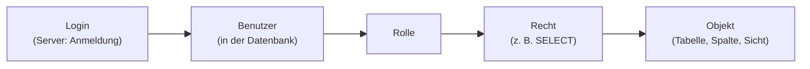

# Zugriffsrechte und Benutzerverwaltung (17.11.2026)

## Übung { .modus-uebung }

### Worum geht es?

Bisher habt ihr in SQL Server als Administrator gearbeitet: Ihr durftet
alles lesen, ändern und löschen. In einem echten Betrieb darf das nur
eine einzige Person. Alle anderen — die Personalabteilung, die
Projektleiter, das Controlling und sogar eine Maschine wie ein
SPS-gesteuerter Prüfstand — sollen genau das dürfen, was sie für ihre
Arbeit brauchen, und nicht mehr. Heute entwerft ihr dafür ein
Rechtekonzept, setzt es in SQL Server um und prüft, ob es wirklich
wirkt. Erst das Konzept, dann die Syntax. Wir arbeiten wieder mit
BestTec.

!!! abstract "Lernziele"
    - Ihr könnt erklären, was ein Login, ein Benutzer und eine Rolle
      unterscheidet, und das Prinzip der minimalen Rechte begründen.
    - Ihr könnt ein Rechtekonzept als Matrix entwerfen und mit
      `CREATE ROLE`, `GRANT`, `DENY` und `REVOKE` umsetzen.
    - Ihr könnt erklären, wie eine Sicht sensible Spalten schützt, und
      die Wirkung von Rechten mit `EXECUTE AS` prüfen.

### Kurzer Rückblick <span class="zeitangabe">ca. 4 Min.</span> { data-toc-label="Kurzer Rückblick" }

**1.** Ein Datenbankmanagementsystem (DBMS) speichert nicht nur Daten.
Welche weiteren Aufgaben übernimmt es, und welche davon hat mit dem
heutigen Thema zu tun?

<!-- MUSTERLOESUNG-START -->
??? note "Musterlösung anzeigen"
    Ein DBMS verwaltet den gleichzeitigen Zugriff mehrerer Nutzer, hält
    die Daten widerspruchsfrei (Integrität), sichert sie gegen Verlust
    und kontrolliert, wer auf welche Daten zugreifen darf. Der
    Zugriffsschutz ist das heutige Thema. Auch die externe Ebene der
    Drei-Ebenen-Architektur gehört dazu: Sie zeigt jeder Nutzergruppe
    nur den Ausschnitt der Daten, den sie braucht — in SQL Server
    heißen solche Ausschnitte Sichten (Views).
<!-- MUSTERLOESUNG-ENDE -->

**2.** Was passiert, wenn jemand ein `UPDATE` oder `DELETE` ohne
`WHERE` ausführt? Und wer sollte so etwas überhaupt ausführen dürfen?

<!-- MUSTERLOESUNG-START -->
??? note "Musterlösung anzeigen"
    Ohne `WHERE` sind alle Zeilen der Tabelle betroffen, und die
    Datenbank fragt nicht zurück. Ein solcher Fehler ist deshalb vor
    allem dann gefährlich, wenn viele Personen schreiben dürfen. Nur wer
    Daten ändern muss, sollte dazu berechtigt sein — alle anderen
    können ihn gar nicht erst machen. Genau das regeln Zugriffsrechte.
<!-- MUSTERLOESUNG-ENDE -->

---

### Ausgangslage: BestTec <span class="zeitangabe">ca. 2 Min.</span> { data-toc-label="Ausgangslage: BestTec" }

BestTec hat einen Prüfstand angeschafft: Eine SPS führt Testläufe an
den Steuerungssystemen durch und meldet jedes Ergebnis zu einem Projekt
an die Datenbank. Dafür gibt es die neue Tabelle `testlauf` mit den
Spalten `testnr`, `prjnr` (Fremdschlüssel auf `prj`), `zeitpunkt` und
`ergebnis` (`bestanden` oder `fehlerhaft`). Der Datenbestand der
bisherigen Tabellen steht auf der Seite
[BestTec: Datenbestand](../termin-03/besttec-daten.md){ target="_blank" rel="noopener" }.

Stellt den Ausgangszustand mit diesen Skripten her, in dieser
Reihenfolge:

1. [uebung-07-aufraeumen.sql](code/uebung-07-aufraeumen.sql) (entfernt
   Reste einer früheren Übung, bei der ersten Durchführung nicht nötig)
2. [uebung-05-besttec-datenbank.sql](../termin-03/code/uebung-05-besttec-datenbank.sql)
3. [uebung-05-besttec-testdaten.sql](../termin-03/code/uebung-05-besttec-testdaten.sql)
4. [uebung-07-besttec-testlauf.sql](code/uebung-07-besttec-testlauf.sql)

Vier Nutzer sollen mit der Datenbank arbeiten:

| Nutzer | Aufgabe | Was er braucht |
|---|---|---|
| Personalsachbearbeiter | pflegt die Mitarbeiterdaten | Mitarbeiter komplett (auch Gehalt, Provision); Abteilungen |
| Projektleiter | verwaltet die Projekte | Projekte ändern; von den Mitarbeitern nur Name, Tätigkeit und Abteilung — **nicht** Gehalt und Provision; Testergebnisse lesen |
| Controller | wertet aus | alles lesen, nichts ändern |
| Prüfstand (SPS) | meldet Testläufe | Testläufe eintragen; Projektnummer und Titel nachschlagen — die Kundennummer ist vertraulich |

---

### Warum Zugriffsschutz? <span class="zeitangabe">ca. 4 Min.</span> { data-toc-label="Warum Zugriffsschutz?" }

Ein Zugriffsschutz beantwortet zwei getrennte Fragen. Die erste lautet:
*Wer ist das?* — das ist die **Authentifizierung**: Der Nutzer weist sich
mit einem Login und einem Passwort aus. Die zweite lautet: *Was darf
dieser Nutzer?* — das ist die **Autorisierung**. Heute geht es um die
zweite Frage. SQL Server unterscheidet dafür drei Begriffe:



- Ein **Login** gehört zum Server und ermöglicht die Anmeldung.
- Ein **Benutzer** gehört zu einer Datenbank und ist mit einem Login
  verknüpft. Erst als Benutzer kann man dort etwas tun.
- Eine **Rolle** bündelt Rechte. Benutzer werden in Rollen aufgenommen
  und erben deren Rechte.

Ein **Recht** erlaubt eine Operation (`SELECT`, `INSERT`, `UPDATE`,
`DELETE`) auf einem Objekt — einer Tabelle, einer einzelnen Spalte oder
einer Sicht. Alles, was nicht ausdrücklich erlaubt ist, bleibt
verboten. Dazu gehört das **Prinzip der minimalen Rechte**: Jeder
bekommt nur die Rechte, die er für seine Aufgabe braucht. So bleibt der
Schaden klein, wenn ein Fehler passiert oder ein Zugang in falsche Hände
gerät. Rechte vergibt man an Rollen, nicht an einzelne Personen: Kommt
ein neuer Kollege hinzu, wird er nur in die passende Rolle aufgenommen.

---

### Rechtekonzept entwerfen <span class="zeitangabe">ca. 8 Min.</span> { data-toc-label="Rechtekonzept entwerfen" }

Legt für jede der vier Rollen fest, welche Operationen sie auf welchen
Tabellen braucht. Orientiert euch an der Tabelle oben. Tragt in jedes
Feld `S` (SELECT), `I` (INSERT), `U` (UPDATE), `D` (DELETE) ein oder
einen Strich, wenn die Rolle auf die Tabelle nicht zugreifen soll.
Gilt ein Recht nur für einen Teil der Spalten, notiert, welche.

| Rolle | `abt` | `ma` | `prj` | `testlauf` |
|---|---|---|---|---|
| `r_personal` (Personalsachbearbeiter) | | | | |
| `r_projekt` (Projektleiter) | | | | |
| `r_controlling` (Controller) | | | | |
| `r_pruefstand` (Prüfstand) | | | | |

<!-- MUSTERLOESUNG-START -->
!!! quote musterloesung-hervorgehoben "Lösung"
    | Rolle | `abt` | `ma` | `prj` | `testlauf` |
    |---|---|---|---|---|
    | `r_personal` | S | S, I, U, D | – | – |
    | `r_projekt` | S | S, aber **ohne** `gehalt` und `prov` | S, I, U, D | S |
    | `r_controlling` | S | S | S | S |
    | `r_pruefstand` | – | – | S, nur `prjnr` und `titel` | I |

    Die Matrix folgt dem Prinzip der minimalen Rechte: Der Controller
    darf alles lesen, aber nichts schreiben. Die Projektleiter können
    Projekte verwalten, bekommen aber von den Mitarbeitern nur
    Ausschnitte. Der Prüfstand darf Testläufe eintragen, aber nicht
    lesen, was andere eingetragen haben, und sieht auch die
    vertrauliche Kundennummer nicht. Wie man „`ma` ohne `gehalt` und
    `prov`“ technisch umsetzt, klären wir in den nächsten Abschnitten.
<!-- MUSTERLOESUNG-ENDE -->

---

### Konzept umsetzen <span class="zeitangabe">ca. 7 Min.</span> { data-toc-label="Konzept umsetzen" }

#### Logins, Benutzer und Rollen anlegen

Wie legt ihr in SQL Server die vier Zugänge an, so dass jeder Nutzer
einer Rolle angehört? Überlegt, in welcher Reihenfolge die Objekte
entstehen müssen.

<!-- MUSTERLOESUNG-START -->
!!! quote musterloesung-hervorgehoben "Lösung"
    ```sql
    --8<-- "02-theoriephase/termin-04/code/uebung-07-anlegen.sql"
    ```

    1. `CREATE LOGIN` legt die Anmeldung auf Serverebene an. Die Passwörter
       gelten nur für diese Übung; im Betrieb gelten Passwortrichtlinien oder
       die Anmeldung über Windows.
    2. `CREATE USER … FOR LOGIN` verknüpft das Login mit der Datenbank
       BestTec.
    3. `CREATE ROLE` erzeugt die Rolle.
    4. `ALTER ROLE … ADD MEMBER` nimmt den Benutzer in die Rolle auf.

    Zum Zusammenhang von Login und Benutzer:

    - Hinter einem Login steht in der Regel **eine Person oder ein
      Gerät**, hier z. B. der Personalsachbearbeiter oder die SPS des
      Prüfstands. So bleibt nachvollziehbar, wer etwas getan hat, und
      ein Zugang lässt sich gezielt entziehen. In Ausnahmefällen steht
      hinter einem Login eine **Gruppe**: Ein Login kann z. B. für die
      Windows-Gruppe „Anlagenfahrer“ eingerichtet werden. Dann melden
      sich alle Mitglieder der Gruppe mit ihrem eigenen Windows-Konto
      an, und ein neuer Anlagenfahrer braucht keinen eigenen Eintrag.
    - Einem Login können **mehrere Benutzer** zugeordnet sein,
      typischerweise in verschiedenen Datenbanken: Ein Login erhält in
      jeder Datenbank, in der die Person arbeitet, einen eigenen
      Benutzer mit eigenen Rechten. In einer einzelnen Datenbank hat ein
      Login aber höchstens einen Benutzer. In unserem Beispiel gibt es
      nur BestTec, deshalb gehört hier zu jedem Login genau ein
      Benutzer.
<!-- MUSTERLOESUNG-ENDE -->

#### Rechte vergeben

Setzt jetzt die Matrix um. Mit welcher Anweisung erlaubt ihr einer
Rolle eine Operation auf einer Tabelle? Wie beschränkt ihr das Recht des
Prüfstands auf die Spalten `prjnr` und `titel`? Für die Projektleiter
vergebt ihr zunächst das Leserecht auf die ganze Tabelle `ma`.

<!-- MUSTERLOESUNG-START -->
!!! quote musterloesung-hervorgehoben "Lösung"
    ```sql
    --8<-- "02-theoriephase/termin-04/code/uebung-07-rechte.sql"
    ```

    1. `GRANT <Operation> ON <Objekt> TO <Rolle>` erteilt ein Recht. Alle
       Rechte gehen an Rollen, nie an einzelne Benutzer.
    2. Eine Spaltenliste hinter dem Objekt beschränkt das Recht auf diese
       Spalten.

    Das Leserecht der Projektleiter auf ganz `ma` ist eine erste,
    bewusst einfache Fassung, die wir gleich prüfen.
<!-- MUSTERLOESUNG-ENDE -->

---

### Wirkung prüfen <span class="zeitangabe">ca. 6 Min.</span> { data-toc-label="Wirkung prüfen" }

Ein Rechtekonzept ist erst fertig, wenn man seine Wirkung getestet hat.
Mit `EXECUTE AS USER = '…'` führt ihr Anweisungen aus, als wäret ihr
dieser Benutzer; `REVERT` kehrt zu euch zurück. Was erwartet ihr, wenn
der Controller ein Gehalt ändern will? Was, wenn der Prüfstand ein
Testergebnis einträgt und danach liest? Und was sehen die Projektleiter
in der Tabelle `ma`?

<!-- MUSTERLOESUNG-START -->
!!! quote musterloesung-hervorgehoben "Lösung"
    ```sql
    --8<-- "02-theoriephase/termin-04/code/uebung-07-pruefen.sql"
    ```

    Der Controller kann lesen, aber nicht ändern: SQL Server meldet
    Fehler 229 („UPDATE-Berechtigung verweigert“). Der Prüfstand trägt
    einen Testlauf ein, darf `testlauf` aber nicht lesen (ebenfalls
    Fehler 229). Auf die Spalte `kdnr` darf er nicht zugreifen: Fehler
    230 meldet eine verweigerte Spalte. Fehler 229 betrifft ein ganzes
    Objekt, Fehler 230 eine einzelne Spalte.

    Das Konzept hat aber eine Lücke: Die Projektleiter sehen
    `gehalt` und `prov`. Die Matrix verlangt das Gegenteil.
<!-- MUSTERLOESUNG-ENDE -->

---

### GRANT, DENY und REVOKE <span class="zeitangabe">ca. 5 Min.</span> { data-toc-label="GRANT, DENY und REVOKE" }

Die Projektleiter dürfen `gehalt` und `prov` nicht sehen. Wie sperrt ihr
genau diese beiden Spalten? Was passiert danach bei `SELECT *`?

<!-- MUSTERLOESUNG-START -->
!!! quote musterloesung-hervorgehoben "Lösung"
    ```sql
    --8<-- "02-theoriephase/termin-04/code/uebung-07-deny.sql"
    ```

    1. `DENY` verbietet ein Recht ausdrücklich — und das stärker als jedes
       `GRANT`: Auch wenn dieselbe oder eine andere Rolle das Recht erlaubt,
       bleibt es gesperrt.

    Die gesperrten Spalten lassen sich nicht mehr lesen, schon ein `SELECT *`
    scheitert (Fehler 230). Mit Spaltenliste ohne `gehalt` und `prov`
    funktioniert die Abfrage.

    | Anweisung | Wirkung |
    |---|---|
    | `GRANT` | erlaubt eine Operation |
    | `DENY` | verbietet sie, stärker als jedes `GRANT` |
    | `REVOKE` | nimmt eine frühere Vergabe zurück (`GRANT` oder `DENY`); danach gilt weder Erlaubnis noch Verbot |

    Die Lösung hat einen Haken: Das Konzept ist eine Sperrliste. Kommt
    später eine weitere sensible Spalte in `ma` hinzu, ist sie für die
    Projektleiter zunächst frei zugänglich, bis jemand daran denkt, sie
    zu sperren. Besser ist eine Freigabeliste: erlauben, was
    gebraucht wird, und sonst nichts.
<!-- MUSTERLOESUNG-ENDE -->

---

### Sensible Daten über eine Sicht schützen <span class="zeitangabe">ca. 5 Min.</span> { data-toc-label="Sensible Daten über eine Sicht schützen" }

Eine **Sicht** (View) ist eine gespeicherte Abfrage, die sich wie eine
Tabelle verwenden lässt. Wie könnt ihr den Projektleitern genau die
Spalten freigeben, die sie brauchen, ohne etwas zu sperren? Was bekommt
die Rolle `r_projekt` dann auf `ma` — und was auf die Sicht?

<!-- MUSTERLOESUNG-START -->
!!! quote musterloesung-hervorgehoben "Lösung"
    ```sql
    --8<-- "02-theoriephase/termin-04/code/uebung-07-view.sql"
    ```

    1. Die Sicht `v_ma_projekt` wählt nur `manr`, `name`, `job`, `vorgnr` und
       `abtnr` aus.
    2. `REVOKE` nimmt die frühere Vergabe und das `DENY` zurück. Auf die
       Tabelle `ma` selbst hat `r_projekt` danach gar nichts mehr.
    3. `r_projekt` bekommt `SELECT` auf die Sicht. Das reicht, weil Sicht und
       Tabelle demselben Besitzer gehören: SQL Server prüft dann nur das
       Recht auf die Sicht. Die Tabelle bleibt für die Projektleiter
       unsichtbar.

    Wird `ma` später um eine Spalte erweitert, taucht sie in der Sicht
    nicht auf, die Freigabe bleibt also minimal. Eine Sicht kann außerdem
    Zeilen filtern (mit `WHERE`), was Spaltenrechte nicht können.
<!-- MUSTERLOESUNG-ENDE -->

---

### Gesamtergebnis <span class="zeitangabe">ca. 2 Min.</span> { data-toc-label="Gesamtergebnis" }

<!-- MUSTERLOESUNG-START -->
!!! quote musterloesung-hervorgehoben "Lösung"
    Das fertige Rechtekonzept von BestTec:

    | Rolle | `abt` | `ma` | `prj` | `testlauf` |
    |---|---|---|---|---|
    | `r_personal` | S | S, I, U, D | – | – |
    | `r_projekt` | S | nur über Sicht `v_ma_projekt` (S) | S, I, U, D | S |
    | `r_controlling` | S | S | S | S |
    | `r_pruefstand` | – | – | S (`prjnr`, `titel`) | I |

    Das vollständige Skript steht in
    [uebung-07-besttec-rechte-gesamt.sql](code/uebung-07-besttec-rechte-gesamt.sql).
    Es setzt voraus, dass die Datenbank mit der Tabelle `testlauf`
    vorliegt. Mit
    [uebung-07-aufraeumen.sql](code/uebung-07-aufraeumen.sql) lässt sich
    der Zustand wieder zurücksetzen.

    **Faustregeln.**

    - Rechte gehen an Rollen, nicht an Personen.
    - Erst das Konzept (Matrix), dann die Syntax.
    - Freigeben, was gebraucht wird (Rolle + Sicht) statt zu sperren, was
      nicht gebraucht wird (`DENY`).
    - Auch der technische Nutzer einer Maschine bekommt eine eigene Rolle
      mit minimalen Rechten, nie Administratorrechte.
    - Jedes Konzept testen: mit `EXECUTE AS` die Rolle wechseln und
      erlaubte wie verbotene Zugriffe ausprobieren.
<!-- MUSTERLOESUNG-ENDE -->

---

## Betreutes Selbststudium { .modus-selbststudium }

### Worum geht es?

Rechtekonzepte ändern sich: Eine neue Abteilung kommt hinzu, eine
Anforderung wandelt sich. Dann stellt sich die Frage, ob man bestehende
Rollen und Sichten anpasst oder neue anlegt, ohne dass andere Nutzer
plötzlich mehr sehen als bisher. Wie bei den Abfragen entstehen solche
Skripte heute oft mit KI-Unterstützung — und sehen meist plausibel aus.
Ob sie das Richtige tun und nicht zu viel erlauben, entscheidet ihr.
Dazu gehört auch die Frage, welche Daten ihr überhaupt in einen
KI-Prompt schreibt.

!!! abstract "Lernziele"
    - Ihr könnt ein Rechtekonzept an eine neue Anforderung anpassen und
      begründen, ob dafür eine Sicht geändert oder neu angelegt wird.
    - Ihr könnt gegebene Rechteskripte beurteilen und ihre Wirkung
      vorhersagen.
    - Ihr könnt beurteilen, welche Informationen in einen KI-Prompt
      gehören.

### Aufgabe 07: Rechtekonzept erweitern, prüfen und bewerten

??? info "Bezug zu Lehrinhalten"
    Die Übung oben und Lehrbuch (Kleuker), Kapitel 11 (Rechte und
    Views). <br>
    SQL-Server-Besonderheiten: [SQL Server und Lehrbuch/Lehrbrief: Abweichungen](../../info/sql-server-vs-lehrbrief.md). <br>
    Typische Fehlerbilder: [Fehlerbildkatalog](../../info/fehlerbildkatalog.md) (F13–F15). <br>
    KI-Einsatz gem. [KI-Nutzungsrichtlinie](../../03-ki-erweiterungsaufgaben/ki-nutzungsrichtlinie.md)
    (Stufe 2, KI als Pair Programmer): KI darf aktiv helfen, ihr müsst
    jeden Vorschlag aber erklären und prüfen können.

Alle Aufgaben beziehen sich auf BestTec mit dem Rechtekonzept am Ende
der Übung. Stellt diesen Zustand mit den folgenden Skripten her, in
dieser Reihenfolge:
[uebung-07-aufraeumen.sql](code/uebung-07-aufraeumen.sql),
[uebung-05-besttec-datenbank.sql](../termin-03/code/uebung-05-besttec-datenbank.sql),
[uebung-05-besttec-testdaten.sql](../termin-03/code/uebung-05-besttec-testdaten.sql),
[uebung-07-besttec-testlauf.sql](code/uebung-07-besttec-testlauf.sql),
[uebung-07-besttec-rechte-gesamt.sql](code/uebung-07-besttec-rechte-gesamt.sql).

#### Teil A — Neue Rolle für den Vertrieb <span class="zeitangabe">ca. 13 Min.</span> { data-toc-label="Teil A — Neue Rolle für den Vertrieb" }

BestTec möchte, dass der Vertrieb seine Provisionen im Blick behält.
Ein neuer Nutzer `u_vertrieb` soll deshalb **Name, Tätigkeit und
Provision der Vertriebsmitarbeiter** (Tätigkeit `Vertrieb`) lesen
können, aber **nicht das Grundgehalt** und nichts anderes. Die Sicht
`v_ma_projekt` aus der Übung enthält die Provision nicht und eignet
sich dafür nicht ohne Weiteres.

1\. Entscheidet, ob ihr `v_ma_projekt` für den Vertrieb erweitert oder
eine neue Sicht anlegt. Haltet eure Entscheidung in zwei bis drei
Sätzen fest und begründet sie, bevor ihr die KI befragt.

<!-- MUSTERLOESUNG-START -->
???+ note "Musterlösung A.1 anzeigen"
    ```sql
    --8<-- "02-theoriephase/termin-04/code/aufg-07-besttec-teil-a.sql:a-sicht"
    ```

    Es braucht eine **neue Sicht** `v_ma_vertrieb`. Würdet ihr
    `v_ma_projekt` um `prov` erweitern, sähen auch die Projektleiter
    plötzlich alle Provisionen. Beide Nutzergruppen brauchen
    unterschiedliche Ausschnitte, also bekommen sie unterschiedliche
    Sichten. Die neue Sicht filtert mit `WHERE job = 'Vertrieb'` auch die
    Zeilen, denn der Vertrieb soll nur seine eigenen Kollegen sehen.
<!-- MUSTERLOESUNG-ENDE -->

2\. Lasst euch von der KI das Skript erstellen: Login `l_vertrieb`,
Benutzer `u_vertrieb`, Rolle `r_vertrieb`, falls nötig eine Sicht,
und die Rechte. Gebt im Prompt das Schema (`CREATE TABLE` der
Tabelle `ma`), die Definition von `v_ma_projekt`, die vorhandenen
Rollen, den Dialekt „Microsoft SQL Server (T-SQL)“ und die
Anforderung an.

<!-- MUSTERLOESUNG-START -->
???+ note "Musterlösung A.2 anzeigen"
    ```sql
    --8<-- "02-theoriephase/termin-04/code/aufg-07-besttec-teil-a.sql:a-login"
    --8<-- "02-theoriephase/termin-04/code/aufg-07-besttec-teil-a.sql:a-sicht"
    --8<-- "02-theoriephase/termin-04/code/aufg-07-besttec-teil-a.sql:a-rolle"
    ```

    Das Skript legt Login, Sicht, Benutzer und Rolle an und vergibt das
    Recht nur auf die Sicht und nur an die Rolle.

    Achtet darauf, dass folgende Fehler nicht passieren:

    - `GRANT SELECT ON ma (name, job, prov) TO r_vertrieb`: Ein
      Spaltenrecht blendet keine Zeilen aus. Der Vertrieb sähe alle 20
      Mitarbeiter, nicht nur die drei Vertriebler (Fehlerbild F14).
    - Rechte direkt an `u_vertrieb` statt an `r_vertrieb`.
    - Zu große Rechte wie `db_datareader` oder `GRANT SELECT ON ma`
      (Fehlerbild F13).
    - `v_ma_projekt` wird erweitert und gibt so den Projektleitern die
      Provision frei.
<!-- MUSTERLOESUNG-ENDE -->

3\. Ergänzt die Rechtematrix aus der Übung um die Zeile `r_vertrieb`.

<!-- MUSTERLOESUNG-START -->
???+ note "Musterlösung A.3 anzeigen"
    | Rolle | `abt` | `ma` | `prj` | `testlauf` |
    |---|---|---|---|---|
    | `r_vertrieb` | – | nur über Sicht `v_ma_vertrieb` (S) | – | – |

    `r_vertrieb` hat auf `abt`, `prj` und `testlauf` kein Recht und auf
    `ma` nur über die Sicht `v_ma_vertrieb`.
<!-- MUSTERLOESUNG-ENDE -->

4\. Führt das Skript aus und prüft es mit `EXECUTE AS`:

| Prüfpunkt | Eure Notiz |
|---|---|
| Sieht `u_vertrieb` genau die erwarteten Zeilen (Kontrolle: 3 Zeilen, Langer, Kurt und Schulte) und kein Grundgehalt? | |
| Kommt `u_vertrieb` an `ma` oder an `v_ma_projekt` heran? | |
| Sehen die Projektleiter weiterhin keine Provision? | |
| Hat die KI Rechte an Rollen oder an einzelne Benutzer vergeben? Hat sie mehr erlaubt als nötig? | |
| Was habt ihr am Vorschlag der KI geändert oder verworfen? | |

<!-- MUSTERLOESUNG-START -->
???+ note "Musterlösung A.4 anzeigen"
    ```sql
    --8<-- "02-theoriephase/termin-04/code/aufg-07-besttec-teil-a.sql:a-pruefen"
    ```

    `u_vertrieb` sieht in der Sicht genau die drei Vertriebler Langer,
    Kurt und Schulte mit ihrer Provision, aber ohne Grundgehalt. Auf die
    Tabelle `ma` und auf die Sicht der Projektleiter hat er keinen
    Zugriff (Fehler 229). Umgekehrt sehen die Projektleiter weiterhin
    keine Provision: Die Spalte `prov` gibt es in ihrer Sicht nicht
    (Fehler 207), und auf `v_ma_vertrieb` haben sie kein Recht
    (Fehler 229).
<!-- MUSTERLOESUNG-ENDE -->

---

#### Teil B — Gegebene Rechteskripte prüfen <span class="zeitangabe">ca. 12 Min.</span> { data-toc-label="Teil B — Gegebene Rechteskripte prüfen" }

Zu vier Anforderungen liegt jeweils ein Skript vor. Alle laufen ohne
Fehlermeldung durch — aber nicht jedes tut, was gefragt war. Ihr müsst
sie nicht ausführen. Beantwortet für jedes Skript: Was dürfen die
Betroffenen danach? Erfüllt es die Anforderung? Wenn nein: Was ist
falsch, wie lautet die Korrektur, und welches Fehlerbild liegt vor?

1\. Der Controller `u_controller` soll alle Tabellen **lesen**, aber
nichts ändern dürfen.

```sql
GRANT CONTROL ON DATABASE::BestTec TO u_controller;
```

<!-- MUSTERLOESUNG-START -->
???+ note "Musterlösung B.1 anzeigen"
    ```sql
    --8<-- "02-theoriephase/termin-04/code/aufg-07-besttec-teil-b.sql:b1"
    ```

    **Erfüllt die Anforderung nicht** (Fehlerbild F13). `CONTROL` auf die
    Datenbank erlaubt dem Controller fast alles: lesen, ändern, löschen,
    sogar Tabellen entfernen. Außerdem geht das Recht an eine Person
    statt an eine Rolle. Korrektur: nichts hinzufügen, denn
    `r_controlling` hat bereits `SELECT` auf alle Tabellen.
<!-- MUSTERLOESUNG-ENDE -->

2\. Der Prüfstand (`r_pruefstand`) soll Testläufe eintragen und die
Projekte nachschlagen können (nur Projektnummer und Titel).

```sql
GRANT INSERT ON testlauf TO r_pruefstand;
GRANT SELECT ON prj      TO r_pruefstand;
```

<!-- MUSTERLOESUNG-START -->
???+ note "Musterlösung B.2 anzeigen"
    ```sql
    --8<-- "02-theoriephase/termin-04/code/aufg-07-besttec-teil-b.sql:b2"
    ```

    **Erfüllt die Anforderung nicht** (Fehlerbild F14). Der Prüfstand
    sähe die ganze Tabelle `prj`, auch die vertrauliche Kundennummer
    `kdnr`. Korrektur: das Leserecht auf die Spalten `prjnr` und `titel`
    beschränken.
<!-- MUSTERLOESUNG-ENDE -->

3\. Die Projektleiter (`r_projekt`) sollen `testlauf` nicht mehr
lesen dürfen. Der Controller, der die Projektleiter vertritt und
deshalb zusätzlich Mitglied von `r_projekt` ist, soll `testlauf` aber
weiterhin lesen können.

```sql
DENY SELECT ON testlauf TO r_projekt;
```

<!-- MUSTERLOESUNG-START -->
???+ note "Musterlösung B.3 anzeigen"
    ```sql
    --8<-- "02-theoriephase/termin-04/code/aufg-07-besttec-teil-b.sql:b3"
    ```

    **Erfüllt die Anforderung nicht** (Fehlerbild F15). Ein `DENY`
    gilt für alle Mitglieder der Rolle und schlägt jedes `GRANT`, auch
    das aus `r_controlling`. Der Controller ist über `r_projekt`
    mitgesperrt (Fehler 229). Korrektur: kein `DENY`, sondern das
    Leserecht der Rolle `r_projekt` mit `REVOKE` zurücknehmen. Dann hat
    der Projektleiter kein Recht mehr, der Controller liest weiter über
    `r_controlling`.
<!-- MUSTERLOESUNG-ENDE -->

4\. Ein neuer Mitarbeiter im Personalwesen soll dieselben Rechte
bekommen wie `u_personal`.

```sql
CREATE LOGIN l_personal2 WITH PASSWORD = 'Kurs#2026-Pers2';
CREATE USER u_personal2 FOR LOGIN l_personal2;
ALTER ROLE r_personal ADD MEMBER u_personal2;
```

<!-- MUSTERLOESUNG-START -->
???+ note "Musterlösung B.4 anzeigen"
    ```sql
    --8<-- "02-theoriephase/termin-04/code/aufg-07-besttec-teil-b.sql:b4"
    ```

    **Erfüllt die Anforderung.** Login, Benutzer und Rollenmitgliedschaft
    genügen: Der neue Mitarbeiter erbt alle Rechte von `r_personal`, ohne
    dass einzelne Rechte vergeben werden.
<!-- MUSTERLOESUNG-ENDE -->


---

#### Teil C — Rechte bewerten <span class="zeitangabe">ca. 8 Min.</span> { data-toc-label="Teil C — Rechte bewerten" }

Leitet die Antwort jeweils zuerst von Hand her, bevor ihr wählt. Gegeben
ist dieses Skript. Der Benutzer `u_anna` ist Mitglied der Rollen `r_a`
und `r_b`; es gibt keine weiteren Rechte.

```sql
GRANT SELECT ON abt TO r_a;
GRANT SELECT ON ma  TO r_a;
GRANT SELECT ON prj TO r_b;
DENY  SELECT ON ma (gehalt, prov) TO r_b;
```

<quiz>
Was dürfen `u_anna` und die beiden Rollen aufgrund dieses Skripts?

- [ ] `u_anna` kann die Tabelle `ma` vollständig lesen, weil `r_a` das Recht erteilt und `r_b` nur ein Teilverbot enthält.
  > Falsch: Ein `DENY` schlägt jedes `GRANT`, auch das aus einer anderen Rolle. Für `gehalt` und `prov` gilt das Verbot.
- [x] `u_anna` kann `abt`, `prj` und die Spalten von `ma` außer `gehalt` und `prov` lesen. Ein `SELECT *` auf `ma` scheitert.
  > Richtig: `r_a` erlaubt `abt` und `ma`, `r_b` erlaubt `prj`. Das `DENY` auf zwei Spalten von `ma` wirkt für `u_anna` über `r_b`; schon ein `SELECT *` berührt diese Spalten und schlägt fehl.
- [ ] `u_anna` kann nur `prj` lesen, weil die Rolle `r_b` ein `DENY` enthält.
  > Falsch: Das `DENY` bezieht sich nur auf die Spalten `gehalt` und `prov` der Tabelle `ma`, nicht auf die Rolle als Ganzes.
- [ ] `u_anna` kann `ma` überhaupt nicht lesen, weil sich `GRANT` und `DENY` aufheben.
  > Falsch: Sie heben sich nicht auf. Das `DENY` gilt nur für zwei Spalten; die übrigen Spalten bleiben freigegeben.
- [ ] `u_anna` kann `prj` ändern, weil sie in zwei Rollen ist.
  > Falsch: Beide Rollen erteilen nur `SELECT`. Mehrere Rollen erweitern die Rechte nur um das, was die Rollen erlauben.
</quiz>

<quiz>
Welche Abfrage führt `u_anna` ohne Fehlermeldung aus?

- [ ] `SELECT * FROM ma;`
  > Falsch: `*` enthält `gehalt` und `prov`. Beide sind gesperrt (Fehler 230).
- [ ] `SELECT name, prov FROM ma;`
  > Falsch: `prov` ist gesperrt (Fehler 230).
- [x] `SELECT m.name, a.bezeichnung FROM ma m, abt a WHERE m.abtnr = a.abtnr;`
  > Richtig: Die beteiligten Spalten `name`, `abtnr` und `bezeichnung` sind erlaubt, `abt` ist über `r_a` lesbar. Das Ergebnis hat 20 Zeilen.
- [ ] `SELECT AVG(gehalt) FROM ma;`
  > Falsch: Auch eine Aggregatfunktion liest die Spalte `gehalt`. Das Verbot gilt trotzdem (Fehler 230).
- [ ] `INSERT INTO prj (prjnr, abtnr, kdnr, titel) VALUES (999, 10, 'X1', 'Test');`
  > Falsch: `u_anna` hat auf `prj` nur das Leserecht (Fehler 229, INSERT verweigert).
</quiz>

<!-- MUSTERLOESUNG-START -->
???+ note "Musterlösung Teil C anzeigen"
    ```sql
    --8<-- "02-theoriephase/termin-04/code/aufg-07-besttec-teil-c.sql"
    ```

    Das Skript legt einen Testbenutzer an und führt alle Abfragen aus,
    deshalb könnt ihr die Antworten nachprüfen. Merkregel: Die Rechte
    aller Rollen eines Benutzers addieren sich — ein `DENY` in einer
    davon gewinnt aber immer.
<!-- MUSTERLOESUNG-ENDE -->

---

#### Teil D — Was gehört in einen KI-Prompt? <span class="zeitangabe">ca. 10 Min.</span> { data-toc-label="Teil D — Was gehört in einen KI-Prompt?" }

Für Teil A habt ihr der KI Informationen über die Datenbank gegeben. Das
war bequem, wirft aber eine Frage auf: Was darf in einen Prompt, wenn die
KI ein Cloud-Dienst ist, dessen Server nicht im Unternehmen stehen?

1\. Beurteilt jede Angabe: Darf sie in einen Prompt an eine Cloud-KI
(ja / nein / nur nach Prüfung)? Begründet kurz.

| Angabe | Darf in den Prompt? |
|---|---|
| a) Das `CREATE TABLE`-Skript der Tabellen (nur Struktur) | |
| b) Ein Ausschnitt der Tabelle `ma` mit echten Namen, Gehältern und Provisionen | |
| c) Das echte Passwort eines Logins aus eurem Skript | |
| d) Die Beschreibung der Rollen („Controller darf alles lesen, nichts ändern“) | |
| e) Messwerte und Testergebnisse aus der Anlage eines Kunden | |
| f) Die Fehlermeldung von SQL Server, inklusive Server- und Datenbankname | |

<!-- MUSTERLOESUNG-START -->
???+ note "Musterlösung D.1 anzeigen"
    | Angabe | Darf in den Prompt? |
    |---|---|
    | a) Struktur der Tabellen | ja — enthält keine Daten und reicht der KI als Kontext |
    | b) Echte Namen und Gehälter | nein — personenbezogene Daten von Beschäftigten unterliegen der DSGVO; die Weitergabe an einen Cloud-Dienst braucht eine Rechtsgrundlage und in der Regel einen Auftragsverarbeitungsvertrag. Stattdessen erfundene Beispieldaten verwenden. |
    | c) Echtes Passwort | nein — Zugangsdaten gehören nie in einen Prompt; wer sie dort eingibt, muss sie als offengelegt betrachten |
    | d) Rollenbeschreibung | ja — enthält keine vertraulichen Daten, nur das Konzept |
    | e) Anlagen- und Messdaten eines Kunden | nur nach Prüfung — oft durch Verträge zur Geheimhaltung geschützt; ohne Freigabe nicht weitergeben |
    | f) Fehlermeldung mit Server- und Datenbankname | nur nach Prüfung — Namen vorher unkenntlich machen, sie verraten Aufbau der Umgebung |
<!-- MUSTERLOESUNG-ENDE -->

2\. Wann würdet ihr ein lokal betriebenes KI-Modell einem Cloud-Dienst
vorziehen?

<!-- MUSTERLOESUNG-START -->
???+ note "Musterlösung D.2 anzeigen"
    Ein lokales Modell vermeidet, dass Daten das Unternehmen
    verlassen. Es lohnt sich bei vertraulichen Anlagendaten,
    Personendaten oder wenn Kundenverträge eine Weitergabe ausschließen.
    Der Preis: meist geringere Qualität und mehr Betriebsaufwand.
<!-- MUSTERLOESUNG-ENDE -->

3\. Ab Termin 7 meldet sich nicht mehr ein Mensch an, sondern die SPS
selbst als technischer Nutzer. Welche Regeln aus dieser Einheit sind
für diesen Nutzer besonders wichtig?

<!-- MUSTERLOESUNG-START -->
???+ note "Musterlösung D.3 anzeigen"
    Die SPS bekommt einen eigenen Login und eine eigene Rolle (kein
    gemeinsamer Zugang mit Menschen), nur minimale Rechte (hier:
    `INSERT` auf `testlauf`, nie Administratorrechte wie `sa`), und das
    Passwort liegt in der Konfiguration, nicht im Programmcode. Ist der
    Zugang kompromittiert, kann ein Angreifer höchstens Testläufe
    einfügen — mehr nicht.

    Wer ein von der KI erstelltes Rechteskript einsetzt, **verantwortet**
    es. Deshalb gehört zu jedem Vorschlag der Test mit `EXECUTE AS`, den
    ihr in Teil A durchgeführt habt.
<!-- MUSTERLOESUNG-ENDE -->
