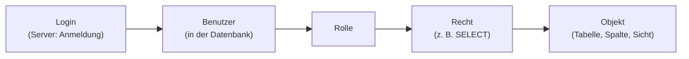

<!--
Dozenten-Skript (Zettel für die Übung) zu docs/02-theoriephase/termin-04/block-07.md.
Wird NICHT von MkDocs veröffentlicht (exclude_docs) und das PDF nicht versioniert.
Bauen: docs/02-theoriephase/_skript-werkzeuge/build-skripte.ps1
Box-Typen: aufgabe | loesung | hinweis | warnung | ergaenzung | bs
Code-Musterlösungen werden per "--8<-- "pfad"" aus docs/ eingelesen (Filter).
-->

```{=latex}
{\Large\bfseries\color{cUebung} Termin 4, Block 07 -- Übung: Zugriffsrechte und Benutzerverwaltung}\hfill{\color{black!65}45 Min.}\par
\vspace{-2pt}{\color{cUebung}\rule{\linewidth}{1.6pt}}\par\vspace{2pt}
{\small\textbf{Fallstudie:} BestTec + Tabelle \texttt{testlauf} \quad|\quad \textbf{KI-Einsatz:} Stufe 2 (im bS) \quad|\quad \textbf{Werkzeug:} SSMS, SQL Server 2025 Express (T-SQL)}
```

::: hinweis
**Ziel:** Login / Benutzer / Rolle unterscheiden, **Prinzip der minimalen
Rechte**, Rechtekonzept als **Matrix** entwerfen und mit `CREATE ROLE`,
`GRANT`, `DENY`, `REVOKE` umsetzen, Sichten als Spaltenschutz,
Wirkung mit `EXECUTE AS` prüfen. **Erst Konzept, dann Syntax.**
:::

| Phase | Zeit |
|:--------------------------------------------|----------:|
| Kurzer Rückblick (2 Fragen)                  | 4 Min.  |
| Ausgangslage BestTec (+ Skripte)             | 2 Min.  |
| Warum Zugriffsschutz?                        | 4 Min.  |
| Rechtekonzept entwerfen                      | 8 Min.  |
| Konzept umsetzen (Logins/Benutzer/Rollen, Rechte) | 7 Min. |
| Wirkung prüfen                               | 6 Min.  |
| GRANT, DENY und REVOKE                       | 5 Min.  |
| Sensible Daten über eine Sicht schützen      | 5 Min.  |
| Gesamtergebnis                               | 2 Min.  |

::: warnung
**Reihenfolge der Vorbereitungs-Skripte** (Code-Ordner Termin 4 und 3):
`uebung-07-aufraeumen.sql` (nur bei Wiederholung) →
`uebung-05-besttec-datenbank.sql` → `uebung-05-besttec-testdaten.sql` →
`uebung-07-besttec-testlauf.sql`. **Logins gehören zum Server** und
bleiben sonst nach dem Neuanlegen von BestTec erhalten -- deshalb das
Aufräumen.
:::

# Kurzer Rückblick [ca. 4 Min.]{.zeit}

::: aufgabe
**Frage 1:** Ein DBMS speichert nicht nur Daten. Welche weiteren Aufgaben
hat es -- und welche hat mit dem heutigen Thema zu tun?
:::

::: loesung
Gleichzeitiger Zugriff mehrerer Nutzer, **Integrität**, Datensicherung
und **Zugriffsschutz** (= heutiges Thema). Auch die **externe Ebene** der
Drei-Ebenen-Architektur: jede Nutzergruppe sieht nur ihren Ausschnitt →
in SQL Server **Sichten (Views)**.
:::

::: aufgabe
**Frage 2:** Was passiert bei `UPDATE`/`DELETE` ohne `WHERE`? Und wer
sollte so etwas überhaupt ausführen dürfen?
:::

::: loesung
Alle Zeilen betroffen, die Datenbank fragt nicht zurück. Nur wer Daten
ändern **muss**, darf es -- alle anderen können den Fehler gar nicht
erst machen. Genau das regeln **Zugriffsrechte**.
:::

# Ausgangslage: BestTec [ca. 2 Min.]{.zeit}

Bisher alles als **Administrator**. Neu: Prüfstand -- eine **SPS** führt
Testläufe durch und meldet jedes Ergebnis zu einem Projekt.

**Neue Tabelle `testlauf`:** **testnr**, *prjnr* (FK→`prj`), zeitpunkt,
ergebnis (`bestanden` / `fehlerhaft`). Datenbestand der übrigen Tabellen:
Seite "BestTec: Datenbestand" (Termin 3).

| Nutzer | Aufgabe | Was er braucht |
|:------------|:--------------------|:------------------------------------------|
| Personalsachbearbeiter | pflegt Mitarbeiterdaten | `ma` komplett (auch Gehalt, Provision); Abteilungen |
| Projektleiter | verwaltet Projekte | Projekte ändern; von `ma` nur Name, Tätigkeit, Abteilung -- **nicht** Gehalt/Provision; Testergebnisse lesen |
| Controller | wertet aus | alles lesen, nichts ändern |
| Prüfstand (SPS) | meldet Testläufe | Testläufe eintragen; Projektnummer + Titel nachschlagen -- **Kundennummer vertraulich** |

# Warum Zugriffsschutz? [ca. 4 Min.]{.zeit}

Zwei getrennte Fragen: **Authentifizierung** (*Wer ist das?* Login +
Passwort) und **Autorisierung** (*Was darf er?*) -- heute: Autorisierung.



| Begriff | Bedeutung |
|:------------|:------------------------------------------------------|
| **Login** | gehört zum **Server**, ermöglicht die Anmeldung |
| **Benutzer** | gehört zu einer **Datenbank**, verknüpft mit einem Login; erst als Benutzer kann man dort etwas tun |
| **Rolle** | bündelt Rechte; Benutzer erben sie |
| **Recht** | Operation (`SELECT`, `INSERT`, `UPDATE`, `DELETE`) auf Objekt (Tabelle, Spalte, Sicht) |

::: warnung
**Prinzip der minimalen Rechte:** Alles, was nicht ausdrücklich erlaubt
ist, bleibt verboten; jeder bekommt nur, was er für seine Aufgabe
braucht → kleiner Schaden bei Fehler oder fremdem Zugang. **Rechte an
Rollen, nicht an Personen:** Neuer Kollege = in die Rolle aufnehmen.
:::

# Rechtekonzept entwerfen [ca. 8 Min.]{.zeit}

::: aufgabe
Für jede der vier Rollen festlegen, welche Operationen sie auf welchen
Tabellen braucht: `S` (SELECT), `I` (INSERT), `U` (UPDATE), `D` (DELETE)
oder Strich. Gilt ein Recht nur für Teile der Spalten: notieren, welche.
Orientierung: Tabelle der Ausgangslage.

| Rolle | `abt` | `ma` | `prj` | `testlauf` |
|:--------------------------------|:--|:--|:--|:--|
| `r_personal` (Personal) | | | | |
| `r_projekt` (Projektleiter) | | | | |
| `r_controlling` (Controller) | | | | |
| `r_pruefstand` (Prüfstand) | | | | |
:::

::: loesung
| Rolle | `abt` | `ma` | `prj` | `testlauf` |
|:----------------|:--|:--------------------------------|:------------------|:--|
| `r_personal` | S | S, I, U, D | – | – |
| `r_projekt` | S | S, aber **ohne** `gehalt`, `prov` | S, I, U, D | S |
| `r_controlling` | S | S | S | S |
| `r_pruefstand` | – | – | S, nur `prjnr`, `titel` | I |

Minimale Rechte: Controller liest alles, schreibt nichts; Projektleiter
verwalten Projekte, sehen von `ma` nur Ausschnitte; Prüfstand trägt
Testläufe ein, **liest sie nicht**, sieht `kdnr` nicht. Wie "`ma` ohne
`gehalt`/`prov`" technisch geht: nächste Abschnitte.
:::

# Konzept umsetzen [ca. 7 Min.]{.zeit}

## Logins, Benutzer und Rollen anlegen

::: aufgabe
Wie legt man in SQL Server die vier Zugänge an, so dass jeder Nutzer
einer Rolle angehört? In welcher **Reihenfolge** müssen die Objekte
entstehen?
:::

::: loesung
```sql
--8<-- "02-theoriephase/termin-04/code/uebung-07-anlegen.sql"
```

- `CREATE LOGIN`: Anmeldung auf **Serverebene** (Passwörter nur für die
  Übung; im Betrieb Richtlinien oder Windows-Anmeldung).
- `CREATE USER ... FOR LOGIN`: verknüpft Login mit der Datenbank BestTec.
- `CREATE ROLE`: erzeugt die Rolle.
- `ALTER ROLE ... ADD MEMBER`: nimmt den Benutzer in die Rolle auf.
:::

::: hinweis
**Login ↔ Benutzer:** Hinter einem Login steht meist **eine Person oder
ein Gerät** (nachvollziehbar, gezielt entziehbar); Ausnahme: eine
**Gruppe** (Windows-Gruppe, jeder meldet sich mit eigenem Konto an). Ein
Login kann **mehrere Benutzer** haben (je Datenbank einen), pro Datenbank
aber höchstens einen -- hier: ein Login, ein Benutzer.
:::

## Rechte vergeben

::: aufgabe
Mit welcher Anweisung erlaubt man einer Rolle eine Operation auf einer
Tabelle? Wie beschränkt man das Recht des Prüfstands auf `prjnr` und
`titel`? Projektleiter zunächst: Leserecht auf **ganz** `ma`.
:::

::: loesung
```sql
--8<-- "02-theoriephase/termin-04/code/uebung-07-rechte.sql"
```

- `GRANT <Operation> ON <Objekt> TO <Rolle>` -- Rechte immer an
  **Rollen**, nie an Benutzer.
- **Spaltenliste** hinter dem Objekt beschränkt das Recht auf diese Spalten.

Leserecht der Projektleiter auf ganz `ma` = bewusst einfache erste
Fassung, wird gleich geprüft.
:::

# Wirkung prüfen [ca. 6 Min.]{.zeit}

::: aufgabe
`EXECUTE AS USER = '...'` führt Anweisungen als dieser Benutzer aus,
`REVERT` kehrt zurück. Erwartung: Was passiert, wenn der **Controller ein
Gehalt ändern** will? Wenn der **Prüfstand** ein Testergebnis einträgt
und danach liest? Was sehen die **Projektleiter** in `ma`?
:::

::: ergaenzung
**Whiteboard: Fehlernummern lesen.**

| Fehler | Bedeutung | Beispiel |
|:--|:-----------------------------|:-------------------------------|
| 229 | Recht auf **ganzes Objekt** verweigert | Controller `UPDATE ma`; Prüfstand `SELECT testlauf` |
| 230 | Recht auf **einzelne Spalte** verweigert | Prüfstand `SELECT kdnr`; Projektleiter `SELECT gehalt` |
| 207 | Spaltenname **ungültig** (gibt es für diesen Nutzer/in dieser Sicht nicht) | Projektleiter `SELECT prov FROM v_ma_projekt` |
:::

::: loesung
```sql
--8<-- "02-theoriephase/termin-04/code/uebung-07-pruefen.sql"
```

Controller: lesen ja, ändern **nein** (Fehler **229**). Prüfstand trägt
Testlauf ein, darf `testlauf` nicht lesen (229); `kdnr` gesperrt:
Fehler **230**.

**Lücke im Konzept:** Projektleiter sehen `gehalt` und `prov` -- die
Matrix verlangt das Gegenteil.
:::

# GRANT, DENY und REVOKE [ca. 5 Min.]{.zeit}

::: aufgabe
Projektleiter dürfen `gehalt` und `prov` nicht sehen. Wie sperrt man
genau diese beiden Spalten? Was passiert danach bei `SELECT *`?
:::

::: loesung
```sql
--8<-- "02-theoriephase/termin-04/code/uebung-07-deny.sql"
```

`DENY` verbietet ausdrücklich -- **stärker als jedes `GRANT`**, auch aus
einer anderen Rolle. Gesperrte Spalten nicht mehr lesbar, schon
`SELECT *` scheitert (Fehler 230); mit Spaltenliste ohne `gehalt`/`prov`
funktioniert es.

| Anweisung | Wirkung |
|:----------|:-----------------------------------------------|
| `GRANT` | erlaubt eine Operation |
| `DENY` | verbietet sie, stärker als jedes `GRANT` |
| `REVOKE` | nimmt frühere Vergabe zurück (`GRANT` **oder** `DENY`); danach weder Erlaubnis noch Verbot |
:::

::: warnung
**Haken:** `DENY` = **Sperrliste**. Kommt später eine neue sensible
Spalte in `ma`, ist sie für Projektleiter erst frei, bis jemand sie
sperrt. Besser: **Freigabeliste** -- erlauben, was gebraucht wird, sonst
nichts → nächster Abschnitt.
:::

# Sensible Daten über eine Sicht schützen [ca. 5 Min.]{.zeit}

::: aufgabe
Eine **Sicht (View)** = gespeicherte Abfrage, nutzbar wie eine Tabelle.
Wie gibt man den Projektleitern genau die Spalten frei, die sie brauchen,
**ohne etwas zu sperren**? Was bekommt `r_projekt` dann auf `ma`, was auf
die Sicht?
:::

::: ergaenzung
**Whiteboard: Welche Spalte sieht wer?** (nach Umsetzung mit Sicht)

| Spalte von `ma` | `r_personal` | `r_projekt` (über `v_ma_projekt`) | `r_controlling` |
|:----------|:-:|:-:|:-:|
| manr, name, job, vorgnr, abtnr | ja | ja | ja |
| gehalt, prov | ja | **nein** | ja |
| *später neue Spalte* | ja | **nein** (nicht in der Sicht) | ja |
:::

::: loesung
```sql
--8<-- "02-theoriephase/termin-04/code/uebung-07-view.sql"
```

- Sicht `v_ma_projekt` wählt nur `manr`, `name`, `job`, `vorgnr`, `abtnr`.
- `REVOKE` nimmt Vergabe und `DENY` zurück → auf `ma` selbst hat
  `r_projekt` danach **gar nichts** mehr.
- `r_projekt` bekommt `SELECT` auf die **Sicht**. Reicht, weil Sicht und
  Tabelle **denselben Besitzer** haben: SQL Server prüft nur das Recht auf
  die Sicht; die Tabelle bleibt unsichtbar.

Neue Spalte in `ma` taucht in der Sicht **nicht** auf → Freigabe bleibt
minimal. Eine Sicht kann zusätzlich **Zeilen filtern** (`WHERE`) -- das
können Spaltenrechte nicht.
:::

# Gesamtergebnis [ca. 2 Min.]{.zeit}

::: loesung
**Das fertige Rechtekonzept von BestTec:**

| Rolle | `abt` | `ma` | `prj` | `testlauf` |
|:----------------|:--|:------------------------------|:------------------|:--|
| `r_personal` | S | S, I, U, D | – | – |
| `r_projekt` | S | nur über Sicht `v_ma_projekt` (S) | S, I, U, D | S |
| `r_controlling` | S | S | S | S |
| `r_pruefstand` | – | – | S (`prjnr`, `titel`) | I |

Vollständiges Skript: `uebung-07-besttec-rechte-gesamt.sql`
(Voraussetzung: DB mit `testlauf`); Zurücksetzen mit
`uebung-07-aufraeumen.sql`.

**Faustregeln**

- Rechte an **Rollen**, nicht an Personen.
- Erst **Konzept (Matrix)**, dann Syntax.
- **Freigeben**, was gebraucht wird (Rolle + Sicht), statt zu sperren
  (`DENY`).
- Auch der technische Nutzer einer Maschine: **eigene Rolle, minimale
  Rechte**, nie Administrator.
- Jedes Konzept **testen**: `EXECUTE AS`, erlaubte **und** verbotene
  Zugriffe.
:::

```{=latex}
\clearpage
```

::::: bs
**Betreutes Selbststudium (45 Min.): Aufgabe 07 -- Rechtekonzept
erweitern, prüfen und bewerten.** KI-**Stufe 2**. Start: Zustand am Ende
der Übung herstellen (`uebung-07-aufraeumen.sql`, Termin-3-Skripte,
`uebung-07-besttec-testlauf.sql`, `uebung-07-besttec-rechte-gesamt.sql`).

| Teil | Auftrag | Kernpunkt der Lösung |
|:-----|:------------------------------|:-----------------------------|
| **A** ca. 13 Min. Neue Rolle Vertrieb | `u_vertrieb` liest Name, Tätigkeit, **Provision** der Vertriebler, **kein** Grundgehalt. (1) Sicht erweitern oder neu? **vor** KI-Befragung begründen; (2) KI-Skript (Login `l_vertrieb`, Benutzer, Rolle `r_vertrieb`, Sicht, Rechte; Prompt mit Schema, `v_ma_projekt`, Rollen, Dialekt, Anforderung); (3) Matrix-Zeile; (4) mit `EXECUTE AS` prüfen (3 Zeilen: Langer, Kurt, Schulte) | **Neue Sicht `v_ma_vertrieb`** (mit `WHERE job = 'Vertrieb'`); `v_ma_projekt` erweitern gäbe den Projektleitern die Provision. Fehler vermeiden: Spaltenrecht blendet keine Zeilen aus (20 statt 3, F14); Rechte an Benutzer statt Rolle; zu große Rechte (`db_datareader`, F13). Matrix: `r_vertrieb` nur Sicht `v_ma_vertrieb` (S) |
| **B** ca. 12 Min. Skripte prüfen | 4 Skripte laufen fehlerfrei: Was dürfen die Betroffenen? Erfüllt? Fehler, Korrektur, Fehlerbild | **1** `GRANT CONTROL ON DATABASE` für Controller: fast alles, Recht an Person (F13); `r_controlling` reicht. **2** `GRANT SELECT ON prj` ganz: Prüfstand sieht `kdnr` (F14) → Spaltenliste. **3** `DENY SELECT ON testlauf TO r_projekt`: trifft auch Controller als Mitglied (F15, Fehler 229) → `REVOKE`. **4** Neuer Personal-Mitarbeiter: Login + Benutzer + Rolle **korrekt** |
| **C** ca. 8 Min. Bewerten | `u_anna` in `r_a` und `r_b`; `GRANT SELECT` auf `abt`, `ma` (r_a), `prj` (r_b); `DENY SELECT ON ma (gehalt, prov) TO r_b`. Quiz: Was darf sie? Welche Abfrage läuft? | Liest `abt`, `prj`, `ma` **außer** `gehalt`, `prov`; `SELECT *` auf `ma` scheitert (230); Join `ma`/`abt` ohne diese Spalten läuft (20 Zeilen). **Merkregel:** Rechte mehrerer Rollen **addieren sich** -- ein `DENY` gewinnt immer |
| **D** ca. 10 Min. KI-Prompt | (1) 6 Angaben für Cloud-KI: ja / nein / nur nach Prüfung; (2) wann lokale KI?; (3) SPS als technischer Nutzer | (1) a) Struktur **ja**; b) echte Namen/Gehälter **nein** (DSGVO, AV-Vertrag; erfundene Daten); c) Passwort **nein**; d) Rollenbeschreibung **ja**; e) Kundenanlagendaten **nur nach Prüfung**; f) Fehlermeldung **nur nach Prüfung** (Namen unkenntlich). (2) lokal bei vertraulichen/Personendaten, Vertragsverbot; Preis: Qualität, Aufwand. (3) eigener Login + Rolle, minimale Rechte (`INSERT` auf `testlauf`), Passwort in Konfiguration; **wer KI-Skript einsetzt, verantwortet es** → `EXECUTE AS`-Test |

::: hinweis
Musterlösungen: `aufg-07-besttec-teil-a.sql`, `-teil-b.sql`, `-teil-c.sql`
(Code-Ordner Termin 4; Teil C legt einen Testbenutzer an und führt alle
Abfragen aus). Fehlerbilder: F13--F15 im Fehlerbildkatalog.
:::

::: warnung
**Moderation:** Verbindung zu Termin 7: Die SPS meldet sich später als
technischer Nutzer -- die Regeln dieser Einheit gelten genauso.
Begründung der Sicht-Entscheidung (A.1) **vor** der KI-Befragung
einfordern.
:::
:::::
