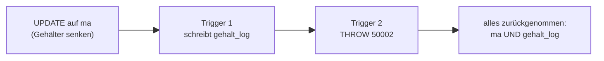

<!--
Dozenten-Skript (Zettel für die Übung) zu docs/02-theoriephase/termin-04/block-08.md.
Wird NICHT von MkDocs veröffentlicht (exclude_docs) und das PDF nicht versioniert.
Bauen: docs/02-theoriephase/_skript-werkzeuge/build-skripte.ps1
Box-Typen: aufgabe | loesung | hinweis | warnung | ergaenzung | bs
Code-Musterlösungen werden per "--8<-- "pfad"" aus docs/ eingelesen (Filter).
-->

```{=latex}
{\Large\bfseries\color{cUebung} Termin 4, Block 08 -- Übung: Prozeduren und Trigger}\hfill{\color{black!65}45 Min.}\par
\vspace{-2pt}{\color{cUebung}\rule{\linewidth}{1.6pt}}\par\vspace{2pt}
{\small\textbf{Fallstudie:} BestTec + \texttt{testlauf}, \texttt{gehalt\_log}, \texttt{prj\_archiv} \quad|\quad \textbf{KI-Einsatz:} Stufe 2 (im bS) \quad|\quad \textbf{Werkzeug:} SSMS, SQL Server 2025 Express (T-SQL)}
```

::: hinweis
**Ziel:** Gespeicherte **Prozedur** lesen/aufrufen, **Trigger**:
Wann feuert er, welche Zeilen verarbeitet er (`inserted`/`deleted`),
Nebenwirkungen; **Entscheidung:** Gehört die Regel in Constraint,
Prozedur, Trigger oder Anwendung? **Lesen und Analysieren statt
Implementieren.** Live-Coding, **kein Rückblick**.
:::

| Phase | Zeit |
|:--------------------------------------------|----------:|
| Ausgangslage BestTec                         | 2 Min.  |
| Prozedur lesen und aufrufen                  | 8 Min.  |
| Prozedur und Rechte                          | 5 Min.  |
| Trigger: Wann feuert er?                     | 10 Min. |
| Trigger verwalten und Nebenwirkungen         | 6 Min.  |
| Wohin mit der Logik?                         | 7 Min.  |
| Gesamtergebnis                               | 2 Min.  |

::: warnung
**Ausgangszustand:** Direkt im Anschluss an Block 07 in derselben DB
genügt Schritt 6. Sonst Reihenfolge: `uebung-07-aufraeumen.sql` →
`uebung-05-besttec-datenbank.sql` → `uebung-05-besttec-testdaten.sql` →
`uebung-07-besttec-testlauf.sql` → `uebung-07-besttec-rechte-gesamt.sql` →
`uebung-08-besttec-gehaltlog.sql`.
:::

# Ausgangslage: BestTec [ca. 2 Min.]{.zeit}

Zwei neue Wünsche:

1. **Prüfstand** soll Testläufe nur über einen **festen Weg** melden, der
   vorher prüft, ob das Projekt existiert.
2. **Personalabteilung** will nachvollziehen: wann welches Gehalt von
   welchem Wert auf welchen geändert wurde.

Neue Tabelle **`gehalt_log`**: **lognr**, manr, gehalt_alt, gehalt_neu,
zeitpunkt, benutzer (ohne FK auf `ma` -- Protokoll bleibt auch erhalten,
wenn ein Mitarbeiter gelöscht wird).

# Eine gespeicherte Prozedur lesen und aufrufen [ca. 8 Min.]{.zeit}

**Gespeicherte Prozedur** = kleines Programm mit Namen in der Datenbank;
Eingabe über **Parameter**, mehrere Schritte (prüfen, rechnen, ändern);
läuft **nur, wenn sie ausdrücklich aufgerufen wird**.

## Die Prozedur anlegen

::: aufgabe
Der Prüfstand soll Testläufe über eine Prozedur melden. Welche Werte
braucht sie als Eingabe? Was soll passieren, wenn es das gemeldete
Projekt **nicht** gibt?
:::

::: loesung
```sql
--8<-- "02-theoriephase/termin-04/code/uebung-08-prozedur.sql"
```

- `CREATE PROCEDURE`; **Parameter** beginnen mit `@` (Eingaben: `@prjnr`,
  `@ergebnis`).
- `SET NOCOUNT ON`: schaltet "(n Zeilen betroffen)" in der Prozedur ab
  (z. B. damit eine SPS nicht durch Zusatzmeldungen gestört wird); Daten
  bleiben unverändert.
- `EXISTS`: fragt nur, ob die Abfrage **mindestens eine Zeile** liefert;
  `SELECT 1` = Platzhalter. `NOT EXISTS`: wahr, wenn es das Projekt
  **nicht** gibt.
- `THROW`: eigener Fehler, beendet die Prozedur. Werte: **Fehlernummer**
  (ab 50000), **Text**, **Status** (0--255, frei wählbar, meist 1).
- `testnr`, `zeitpunkt` füllt die DB selbst (`IDENTITY`/`DEFAULT`) →
  nicht in der Spaltenliste.
:::

## Die Prozedur aufrufen

::: aufgabe
Mit `EXEC` aufrufen. Was erwartet ihr bei diesen drei Aufrufen?

```sql
EXEC p_testlauf_melden @prjnr = 232, @ergebnis = 'bestanden';
EXEC p_testlauf_melden @prjnr = 999, @ergebnis = 'bestanden';
EXEC p_testlauf_melden @prjnr = 232, @ergebnis = 'unklar';
```
:::

::: loesung
```sql
--8<-- "02-theoriephase/termin-04/code/uebung-08-prozedur-aufruf.sql"
```

1. trägt ein. 2. scheitert mit **50001** (Projekt 999 gibt es nicht).
3. Prozedur prüft nichts, aber der **`CHECK`** der Tabelle lehnt ab
(Fehler **547**) → Regeln der Tabelle gelten auch für Änderungen über
eine Prozedur.
:::

# Prozedur und Rechte [ca. 5 Min.]{.zeit}

::: aufgabe
Der Prüfstand soll Testläufe künftig **nur noch über die Prozedur**
melden. Was muss sich am Rechtekonzept aus Block 07 ändern? Wie prüft man,
ob es wirkt?
:::

::: loesung
```sql
--8<-- "02-theoriephase/termin-04/code/uebung-08-prozedur-rechte.sql"
```

`r_pruefstand` verliert `INSERT` auf `testlauf`, bekommt `EXECUTE` auf die
Prozedur. Direkter `INSERT` → Fehler **229**; Prozedur funktioniert
trotzdem: Prozedur und Tabelle haben **denselben Besitzer** → SQL Server
prüft nur das Recht auf die Prozedur (wie bei der Sicht). Prüfstand kann
nur noch tun, was die Prozedur zulässt, **inkl. ihrer Prüfung**.
:::

::: warnung
**Vorgriff Termin 7:** Genau diese Konstruktion -- technischer Nutzer
mit **einziger** Berechtigung `EXECUTE` auf eine Prozedur -- wird für die
echte SPS verwendet.
:::

# Ein Trigger: Wann feuert er? [ca. 10 Min.]{.zeit}

Prozedur schützt **einen** Weg. Gehälter lassen sich aber auch direkt per
`UPDATE` ändern (Anwendung, SSMS, Skript). Soll **jede** Änderung
protokolliert werden, egal wie: **Trigger** = reagiert **automatisch**.

::: ergaenzung
**Whiteboard: Was enthalten `inserted` und `deleted`?** (nur innerhalb
des Triggers vorhanden)

| Auslöser | `inserted` | `deleted` |
|:--------|:-------------------|:--------------------|
| `INSERT` | die neuen Zeilen | leer |
| `UPDATE` | **neue** Zustände der geänderten Zeilen | **alte** Zustände derselben Zeilen |
| `DELETE` | leer | die gelöschten Zeilen |

Beispiel `UPDATE ma SET gehalt = 3000 WHERE manr = 7329` (Frohn):
`deleted`: (7329, **2900**) · `inserted`: (7329, **3000**) → über `manr`
verknüpft ein Paar alt/neu.
:::

## Den Trigger anlegen

::: aufgabe
Wie beschreibt man, dass bei jedem `UPDATE` auf `ma` etwas passieren
soll? Woher weiß der Trigger, **welche Zeilen** sich geändert haben und
wie **alte und neue** Werte lauten?
:::

::: loesung
```sql
--8<-- "02-theoriephase/termin-04/code/uebung-08-trigger.sql"
```

- `AFTER UPDATE`: läuft nach jedem `UPDATE` auf `ma`, **einmal pro
  Anweisung** (nicht pro Zeile); nach dem Anlegen sofort aktiv.
- `SET NOCOUNT ON`: unterdrückt "(n Zeilen betroffen)" des Triggers.
- `UPDATE(gehalt)`: wahr, wenn `gehalt` in der `SET`-Klausel **vorkommt**
  (auch bei gleichem Wert).
- `inserted` = **neue**, `deleted` = **alte** Zustände aller geänderten
  Zeilen.
- Verknüpfung über `manr` führt alt/neu **derselben** Zeile zusammen;
  ohne sie **Kreuzprodukt** (F1).
- Vergleich behält nur Zeilen mit **wirklich geändertem** Gehalt.
:::

## Die Wirkung vorhersagen

::: aufgabe
Wie viele Zeilen stehen nach jeder Anweisung in `gehalt_log`? Vor jeder
Anweisung `TRUNCATE TABLE gehalt_log;`.

- (a) `UPDATE ma SET gehalt = 3000 WHERE manr = 7329;` (Frohn bisher 2900)
- (b) `UPDATE ma SET gehalt = gehalt * 1.05 WHERE abtnr = 20;`
- (c) `UPDATE ma SET job = 'Entwickler' WHERE manr = 7329;`
- (d) `UPDATE ma SET gehalt = gehalt WHERE abtnr = 20;`
- (e) `UPDATE ma SET gehalt = 0 WHERE abtnr = 99;` (gibt es nicht)
:::

::: loesung
```sql
--8<-- "02-theoriephase/termin-04/code/uebung-08-trigger-test.sql"
```

| Anw. | Logzeilen | Begründung |
|:--|:--|:--------------------------------------------------|
| (a) | **1** | eine Zeile geändert, Gehalt anders |
| (b) | **6** | **ein** Trigger-Lauf für **sechs** Zeilen (`inserted`/`deleted` enthalten alle MA der Abt. 20) |
| (c) | **0** | `gehalt` nicht in `SET` → `UPDATE(gehalt)` falsch |
| (d) | **0** | `UPDATE(gehalt)` wahr, aber alt = neu → Vergleich filtert alles |
| (e) | **0** | Trigger läuft (`AFTER UPDATE`), aber `inserted` ist **leer** |

`DELETE`/`INSERT` auf `ma` lösen diesen Trigger **nicht** aus. Darüber
stolpern KI-Trigger: feuern zu oft, zu selten oder verarbeiten nur eine
Zeile (F16, F18).
:::

# Trigger verwalten und Nebenwirkungen [ca. 6 Min.]{.zeit}

::: aufgabe
Ein **zweiter Trigger** soll Gehaltssenkungen verbieten. Was passiert,
wenn ein `UPDATE` sechs Gehälter senkt und der Trigger eingreift? Was
geschieht mit dem Protokoll des ersten Triggers? Wie schaltet man einen
Trigger ab und wieder an?
:::

::: ergaenzung
**Whiteboard: Ablauf in einer Transaktion.**


:::

::: loesung
```sql
--8<-- "02-theoriephase/termin-04/code/uebung-08-trigger-senkung.sql"
```

- `EXISTS`: gibt es mind. eine Zeile mit neuem Gehalt **kleiner** als
  altes? (`SELECT 1` = Platzhalter).
- `THROW` im Trigger bricht die **ganze** `UPDATE`-Anweisung ab, alles
  wird zurückgenommen.

**Kein** Gehalt ändert sich, im Protokoll bleibt nichts: `UPDATE` und alle
ausgelösten Trigger laufen in **einer Transaktion**. Bricht ein Trigger
ab, wird alles zurückgenommen (auch das, was ein anderer Trigger schon
schrieb); steht das `UPDATE` in `BEGIN TRANSACTION`, die ganze
Transaktion. **Fehler im Trigger lässt den auslösenden Zugriff
scheitern.**

**Verwalten:** `DISABLE TRIGGER ... ON ...` (bleibt bestehen) ·
`ENABLE TRIGGER ... ON ...` · `DROP TRIGGER ...` (entfernt) ·
`sys.triggers` zeigt Zustand (`is_disabled`).
:::

::: warnung
**Weitere Nebenwirkungen:** läuft **unsichtbar** mit (zweiter
Schreibvorgang); kostet bei großen Änderungen Zeit; darf in Tabellen
schreiben, auf die der Auslöser **kein Recht** hat; bei mehreren Triggern
an einer Tabelle ist die **Reihenfolge nicht festgelegt** → nicht
voneinander abhängig machen.
:::

# Wohin mit der Logik? [ca. 7 Min.]{.zeit}

::: ergaenzung
**Whiteboard: Entscheidungsweg** (Reihenfolge der Fragen)

```{.mermaid maxh=8cm}
%%{init: {'themeVariables': {'fontSize': '0.6rem'}}}%%
graph LR
A{"Betrifft die Regel<br/>nur Werte?"}
A -- "ja" --> C["Constraint"]
A -- "nein" --> B{"Gehört sie zur<br/>Datenhaltung?"}
B -- "nein" --> N["Anwendung"]
B -- "ja" --> D{"Muss sie bei jeder<br/>Änderung automatisch<br/>laufen, egal wer?"}
D -- "ja" --> T["Trigger"]
D -- "nein: fester Weg<br/>mit mehreren Schritten" --> P["Prozedur"]
```
:::

| Ort | Wann |
|:--------------|:------------------------------------------------------|
| **Constraint** | Regel betrifft nur **Werte** (Bereich, Liste, Eindeutigkeit, FK); **erste Wahl**: einfach, schnell, gilt für jeden Zugriffsweg |
| **Prozedur** | **fester Weg** mit mehreren Schritten (prüfen, dann eintragen), gezielt freigebbar (z. B. für ein Gerät); wirkt nur bei **Aufruf**, wer Tabellenrechte hat, kann sie umgehen |
| **Trigger** | bei jeder Änderung **automatisch**, egal wer/wie; Constraint reicht nicht (Protokollieren, Archivieren); Preis: unsichtbar, Nebenwirkungen, schwer testbar → nur, wenn nichts Einfacheres genügt |
| **Anwendung** | gehört nicht zur Datenhaltung (Darstellung, Oberflächenrechnung, Aktionen außerhalb wie E-Mail); Regel nur für diese Anwendung |

::: {.aufgabe platz=14}
Anforderungen zuordnen und begründen (Konsistenz: gilt für jeden
Zugriffsweg? Wartbarkeit, Testbarkeit):

1. Ein Gehalt darf nie negativ sein.
2. Jede Änderung eines Gehalts soll nachvollziehbar sein, egal wer sie wie ausführt.
3. Der Prüfstand soll Testläufe nur über einen festen Weg melden, der das Projekt prüft.
4. Gehälter sollen in der Oberfläche als "4.800,00 €" angezeigt werden.
5. Bei einem fehlerhaften Testlauf soll der Projektleiter eine E-Mail bekommen.
:::

::: loesung
| Nr. | Wohin? | Begründung |
|:--|:----------------|:-------------------------------------------------|
| 1 | **Constraint** (`CHECK (gehalt > 0)`) | einfache Wertregel, jeder Zugriffsweg, deklarativ, schnell |
| 2 | **Trigger** | muss für jeden Zugriffsweg gelten (Anwendung, SSMS, Skript), darf nicht vergessen werden |
| 3 | **Prozedur** + `EXECUTE`-Recht | definierter Einstieg, zentrale Prüfung; Prüfstand braucht kein Tabellenrecht |
| 4 | **Anwendung** | reine Darstellung |
| 5 | **Anwendung** (oder Dienst) | Aktion außerhalb der DB; im Trigger würde jede Meldung langsamer, ein Mailfehler ließe die Meldung scheitern |
:::

# Gesamtergebnis [ca. 2 Min.]{.zeit}

::: loesung
| Mittel | Wann es greift | Gut für | Worauf achten |
|:-----------|:-------------------|:--------------------|:----------------------|
| **Constraint** | bei jeder Änderung, automatisch | einfache Wertregeln | kann nichts protokollieren/berechnen |
| **Prozedur** | nur bei Aufruf | fester Weg mit Prüfung, Rechte über `EXECUTE` | wird umgangen, wenn Tabellenrechte offen |
| **Trigger** | automatisch bei `INSERT`/`UPDATE`/`DELETE` | Regeln/Protokolle für jeden Zugriffsweg | unsichtbar; **einmal pro Anweisung** für alle Zeilen; Fehler macht Änderung rückgängig |
| **Anwendung** | im Programm | Darstellung, Berechnung, externe Aktionen | gilt nicht für andere Zugriffswege |

**Faustregel:** Was für **jeden Zugriffsweg** gelten muss, gehört in die
Datenbank, **so einfach wie möglich** (erst Constraint, dann Trigger oder
Prozedur). Alles andere in die Anwendung.
:::

::: hinweis
**T-SQL ↔ andere Systeme:** SQL Server: Trigger **einmal pro Anweisung**,
Werte in `deleted`/`inserted`. Andere Systeme: zeilenweise mit `BEFORE`,
`OLD`, `NEW` (siehe Seite "SQL Server und Lehrbuch/Lehrbrief:
Abweichungen"). `INSTEAD OF` (ersetzt die auslösende Anweisung) wird hier
**nicht** gebraucht.
:::

```{=latex}
\clearpage
```

::::: bs
**Betreutes Selbststudium (45 Min.): Aufgabe 08 -- Trigger prüfen, mit KI
erzeugen und einordnen.** KI-**Stufe 2**. Kein Trigger von Grund auf:
**lesen, Wirkung vorhersagen, KI-Vorschlag beurteilen**. Start:
`uebung-05-besttec-datenbank.sql`, `-testdaten.sql`,
`uebung-07-besttec-testlauf.sql`, `uebung-08-besttec-gehaltlog.sql`, für
Teil B zusätzlich `aufg-08-besttec-archiv.sql`.

| Teil | Auftrag | Kernpunkt der Lösung |
|:-----|:------------------------------|:-----------------------------|
| **A** ca. 8 Min. Wirkung vorhersagen | Trigger `tr_ma_gehalt_v2` des Kollegen (nur `AFTER UPDATE`, Verbund über `manr`, **ohne** `IF UPDATE`/Vergleich) anlegen (Übungs-Trigger vorher droppen). Zeilen in `gehalt_log` für (1) `job` ändern, (2) Abt. 20 +2 %, (3) `prov` der Vertriebler, (4) `DELETE` von 8800; (5) erfüllt er die Anforderung? | (1) **1** Zeile (Gehalt gleich!), (2) **6**, (3) **3** (unverändertes Gehalt), (4) **0** (nur für `UPDATE`). (5) Nein: protokolliert Änderungen ohne Gehaltsänderung (F18) → `IF UPDATE(gehalt)` und `i.gehalt <> d.gehalt` |
| **B** ca. 14 Min. Mit KI erzeugen | Gelöschte Projekte in `prj_archiv` sichern (Zeitpunkt, Benutzer). (1) Prompt (Schema, Dialekt, Anforderung); (2) Trigger anlegen, `DELETE ... IN (212, 256)` → **2** Archivzeilen, Prüftabelle; (3) in eigenen Worten erklären, Projekt 232 löschen?; (4) Trigger `DISABLE`/`ENABLE`, `sys.triggers` | `AFTER DELETE`, `deleted` = gelöschte Zeilen, `inserted` leer, alle Zeilen auf einmal. Fehler: nur eine Zeile (`SELECT @prjnr = ... FROM deleted`, F16); fremder Dialekt (`BEFORE`, `FOR EACH ROW`, `OLD`, F17); falsches Ereignis (F18). 232: **FK `fk_testlauf_prj` lehnt ab (547)** → `AFTER`-Trigger läuft gar nicht. Abgeschaltet: 500 ohne Archiv; nach `ENABLE`: 501 archiviert (3 Z.); **vergessenes `ENABLE` = Protokoll fehlt unbemerkt** |
| **C** ca. 11 Min. Fehler erkennen | 4 Trigger "jede Gehaltsänderung protokollieren": 3 fehlerhaft, 1 korrekt; Test (Abt. 20 +5 %: **6 Logzeilen**) | **C.1** Variablen, nur **eine** Zeile (1 statt 6, F16); **C.2** `BEFORE`/`FOR EACH ROW`/`OLD`/`NEW` = anderes System, Syntaxfehler (F17); **C.3** Verbund `inserted`/`deleted` **ohne Bedingung**: 36 statt 6 Zeilen (F1); **C.4 korrekt** (Verbund + `IF UPDATE` + Vergleich) |
| **D** ca. 8 Min. DB oder Anwendung | 4 Anforderungen: Constraint / Prozedur / Trigger / Anwendung + Begründung | **D.1** SPS-Pufferung bei Verbindungsausfall → **Anwendung** (DB nicht erreichbar, Vorgriff Termin 7); **D.2** E-Mail → Anwendung/Dienst; **D.3** Ergebnis nur `bestanden`/`fehlerhaft` → **Constraint** (`ck_testlauf_ergebnis`); **D.4** gelöschte Projekte sichern, egal wer → **Trigger** (`AFTER DELETE`) |

::: hinweis
Musterlösungen: `aufg-08-besttec-teil-a.sql`, `-teil-b.sql`,
`-teil-c.sql` (Code-Ordner Termin 4). Fehlerbilder: F16--F18 im
Fehlerbildkatalog.
:::

::: warnung
**Moderation:** Trigger sind "mächtig und gefährlich": Fehler fallen oft
erst bei **Massenänderungen** auf -- Teil C immer mit **Mehrzeilen-Test**
prüfen lassen. D.1 baut die Brücke zu **Termin 7** (SPS-Anbindung).
:::
:::::
