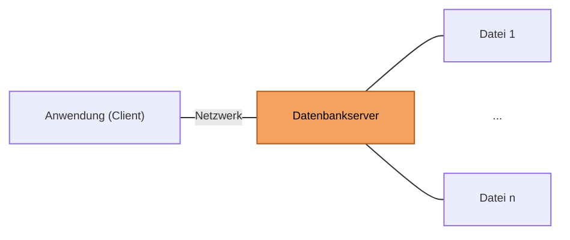
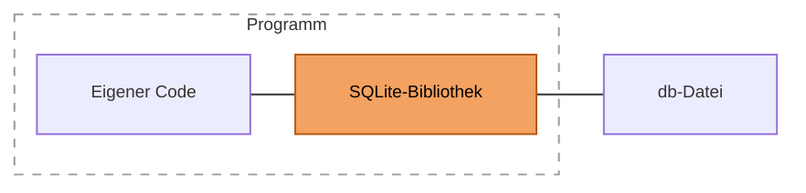

# SQLite auf der Konsole (01.12.2026)

## Übung { .modus-uebung }

### Worum geht es?

Bisher habt ihr nur mit einem Datenbankserver gearbeitet, der Benutzer
und Rechte verwaltet und die Daten schützt. In diesem Teil geht es um
**SQLite**: eine Datenbank in einer einzigen Datei, die ohne Server
auskommt. Ihr bedient sie über die Konsole, mit BestTec aus Termin 3,
und seht dabei, was gleich bleibt und was anders ist. Die Unterschiede
sind keine Nebensache: Sie entscheiden, wann SQLite die richtige Wahl
ist und wann nicht.

!!! abstract "Lernziele"
    - Ihr könnt erklären, was eine eingebettete Datenbank ist und wodurch
      sich SQLite von SQL Server unterscheidet.
    - Ihr könnt mit der Konsole `sqlite3` eine Datenbank öffnen, ein
      Skript einlesen und Abfragen ausführen.
    - Ihr könnt vorhersagen, wo sich SQLite anders verhält als SQL Server:
      bei Datentypen, im Dialekt, bei Fremdschlüsseln und bei Triggern.

### Kurzer Rückblick <span class="zeitangabe">ca. 3 Min.</span> { data-toc-label="Kurzer Rückblick" }

1.  Was ist ein Datenbankserver wie SQL Server, und was bedeutet dabei „Client-Server“?

    ??? note "Musterlösung anzeigen"
        Ein Datenbankserver ist ein Programm, das die Daten verwaltet und
        im Hintergrund auf Anfragen wartet. Die Anwendungen und Werkzeuge
        (z. B. SSMS) sind die Clients: Sie schicken ihre SQL-Anweisungen an
        den Server, der sie ausführt, die Rechte prüft und das Ergebnis
        zurückschickt. Der Server ist deshalb die zentrale Stelle, die für
        alle Clients dieselben Regeln durchsetzt.

2.  Was ist der Unterschied zwischen DDL und DML? Nennt je ein Beispiel.

    ??? note "Musterlösung anzeigen"
        DDL (Data Definition Language) legt die Struktur fest, z. B.
        `CREATE TABLE`. DML (Data Manipulation Language) arbeitet mit den
        Daten, z. B. `INSERT`, `UPDATE` oder `DELETE`. Die Abfrage mit
        `SELECT` wird häufig als eigener Teil (DQL) behandelt.

---

### Was ist SQLite? <span class="zeitangabe">ca. 5 Min.</span> { data-toc-label="Was ist SQLite?" }

Bei SQL Server schickt eine Anwendung ihre Anfragen über das Netzwerk an
einen Server, der die Datenbankdateien verwaltet. SQLite geht einen
anderen Weg: Die Datenbank ist eine **Datei**, und das Programm, das sie
braucht, enthält die Datenbank-Software gleich selbst als Bibliothek.
Einen Server gibt es nicht.

**Client-Server-Datenbank (z. B. SQL Server)**



**Eingebettete Datenbank (SQLite)**



In beiden Fällen übernimmt die orange Komponente die eigentliche
Datenbankarbeit. Beim Server läuft sie als eigenes Programm und verwaltet
meist mehrere Dateien. Bei SQLite ist sie eine Bibliothek im Programm und
speichert alles in genau einer Datei.

Was folgt aus diesem Aufbau? Überlegt zu diesen vier Punkten: Installation,
Benutzer und Rechte, Zugriff von mehreren Rechnern aus, Weitergabe der
Daten.

??? quote musterloesung-hervorgehoben "Lösung"
    - **Installation:** Es gibt nichts zu installieren und zu
      konfigurieren, keinen Dienst und keine Anmeldung. Die Bibliothek ist
      Teil des Programms.
    - **Benutzer und Rechte:** SQLite kennt keine Datenbankbenutzer.
      Wer die Datei öffnen darf, darf alles. Geschützt wird nur über die
      Dateirechte des Betriebssystems.
    - **Zugriff:** Mehrere Programme können dieselbe Datei lesen, aber
      Änderungen werden nacheinander geschrieben. Ein Zugriff über das
      Netzwerk von vielen Rechnern gleichzeitig ist nicht vorgesehen.
    - **Weitergabe:** Die ganze Datenbank ist eine einzelne Datei, die
      sich kopieren, sichern und verschicken lässt.

    Deshalb steckt SQLite überall dort, wo eine kleine, wartungsfreie
    Datenhaltung im Programm gebraucht wird: in Smartphone-Apps und
    Browsern, in Anwendungen, die Einstellungen oder Verläufe speichern,
    und in Geräten und Messsystemen. Für viele gleichzeitige Nutzer mit
    Rechtekonzept ist ein Datenbankserver die bessere Wahl.

---

### Die Konsole kennenlernen <span class="zeitangabe">ca. 5 Min.</span> { data-toc-label="Die Konsole kennenlernen" }

Öffnet eine Eingabeaufforderung oder PowerShell in dem Ordner, in dem
`sqlite3.exe` liegt (siehe Vorbereitung), und startet die Konsole mit
einer Datenbankdatei:

```text
sqlite3 besttec.db
```

Gibt es die Datei noch nicht, entsteht sie, sobald ihr etwas speichert.
Danach erscheint die Eingabeaufforderung `sqlite>`. Dort gebt ihr zwei
Arten von Eingaben ein, die ihr unterscheiden müsst: **SQL-Anweisungen**
enden mit einem Semikolon. Vergesst ihr es, wartet die Konsole mit
`...>` auf den Rest. **Punkt-Befehle** gehören zur Konsole selbst, beginnen
mit einem Punkt und brauchen kein Semikolon.

Welchen Befehl braucht ihr, um (a) alle Tabellen aufzulisten, (b) die
`CREATE TABLE`-Anweisung einer Tabelle anzuzeigen, (c) die Ausgabe mit
Spaltenüberschriften und in ausgerichteten Spalten zu bekommen und (d) die
Konsole zu beenden? Mit `.help` seht ihr alle Punkt-Befehle.

??? quote musterloesung-hervorgehoben "Lösung"
    | Aufgabe | Befehl |
    |---|---|
    | (a) Tabellen auflisten | `.tables` |
    | (b) Definition einer Tabelle anzeigen | `.schema ma` (ohne Namen: alle Tabellen) |
    | (c) Überschriften und Spalten | `.headers on` und `.mode column` |
    | (d) Konsole beenden | `.quit` |
    | Skript aus einer Datei ausführen | `.read dateiname.sql` |

    Alle diese Befehle beginnen mit einem Punkt und enden ohne Semikolon.
    Sie sind kein SQL und funktionieren in einem Programm, das SQLite
    verwendet, nicht. Das SQL-Gegenstück zu `.tables` ist eine Abfrage auf
    die Systemtabelle `sqlite_master`.

---

### BestTec in SQLite anlegen <span class="zeitangabe">ca. 5 Min.</span> { data-toc-label="BestTec in SQLite anlegen" }

BestTec kennt ihr aus Termin 3. Wir legen es jetzt in SQLite an. Das
SQL-Server-Skript von damals beginnt mit `USE master;`, `GO`, einer
Prüfung mit `DB_ID`, `CREATE DATABASE BestTec;` und noch einem
`USE BestTec;`. Was davon braucht SQLite, und warum?

??? quote musterloesung-hervorgehoben "Lösung"
    Nichts davon. Die Datenbank ist die Datei, die ihr beim Start der
    Konsole angegeben habt. Es gibt keine Datenbank, die man anlegen oder
    auswählen müsste (`CREATE DATABASE`, `USE`), und `GO` ist ein
    Trennwort der SQL-Server-Werkzeuge, kein SQL. Die `CREATE TABLE`-Anweisungen
    mit ihren Constraints können unverändert bleiben.

Legt die beiden Skripte
[uebung-11-besttec-schema.sql](code/uebung-11-besttec-schema.sql) und
[uebung-11-besttec-testdaten.sql](code/uebung-11-besttec-testdaten.sql)
in den Ordner, in dem ihr die Konsole gestartet habt, und lest sie ein:

```text
.read uebung-11-besttec-schema.sql
.read uebung-11-besttec-testdaten.sql
```

Prüft mit `.tables` und mit `SELECT COUNT(*) FROM ma;`, ob alles da ist
(es sollten 20 Mitarbeiter sein). Seht dann in den Ordner: Wo liegt die
Datenbank jetzt, und was bedeutet das für Sicherung und Weitergabe?

??? quote musterloesung-hervorgehoben "Lösung"
    Im Ordner liegt eine Datei `besttec.db`. In ihr stehen Tabellen,
    Daten und Constraints. Wird die Datei kopiert, ist die ganze
    Datenbank gesichert oder weitergegeben, auch per E-Mail oder auf einem
    USB-Stick. Das geht nur, solange kein Programm gerade in die Datei
    schreibt. Auch bei SQL Server ist eine Sicherung nötig, dort läuft sie
    aber über Befehle des Servers, nicht über das Kopieren einer Datei.

---

### Datentypen sind nur Vorschläge <span class="zeitangabe">ca. 5 Min.</span> { data-toc-label="Datentypen sind nur Vorschläge" }

In SQL Server wehrt sich die Datenbank, wenn ein Wert nicht zur Spalte
passt. In SQLite ist das anders, denn die Typangabe in `CREATE TABLE` ist
nur eine Empfehlung. Legt zum Ausprobieren eine kleine Tabelle an:

```sql
CREATE TABLE typtest (zahl NUMERIC(4), text VARCHAR(5));
INSERT INTO typtest VALUES (1500, 'ok');
INSERT INTO typtest VALUES ('viel', 'dieser Text ist viel laenger als fuenf Zeichen');
INSERT INTO typtest VALUES ('12', 'x');
```

Welche der drei `INSERT`-Anweisungen würde SQL Server mit einem Fehler
abweisen? Was passiert in SQLite? Prüft es, und fragt danach die Tabelle
ab:

```sql
SELECT zahl, typeof(zahl) AS typ, text FROM typtest;
SELECT zahl FROM typtest WHERE zahl > 1000;
```

Außerdem fehlt ein Datums-Typ. Fragt deshalb mit `date('now')` und
`datetime('now')` das aktuelle Datum und die aktuelle Zeit ab, und probiert
auch `datetime('now', 'localtime')` und `date('now', '+7 days')`. Was fällt
an der Uhrzeit auf?

??? quote musterloesung-hervorgehoben "Lösung"
    ```sql
    --8<-- "02-theoriephase/termin-06-sqlite/code/uebung-11-typtest.sql"
    ```

    | Anweisung | SQL Server | SQLite |
    |---|---|---|
    | `(1500, 'ok')` | wird eingefügt | wird eingefügt |
    | `('viel', 'dieser Text …')` | Fehler: Text ist keine Zahl, Text ist zu lang | **wird eingefügt**, `zahl` bleibt der Text `viel`, der lange Text wird nicht gekürzt |
    | `('12', 'x')` | wird eingefügt (Umwandlung) | wird eingefügt, `12` wird als Zahl gespeichert |

    SQLite versucht nur, einen Wert in den vorgeschlagenen Typ
    umzuwandeln (**Typaffinität**). Gelingt das nicht, speichert es ihn
    unverändert. Die Längenangabe `VARCHAR(5)` wird ganz ignoriert. Gefährlich
    wird das bei Vergleichen: Ein Text gilt in SQLite als **größer als jede
    Zahl**, deshalb erscheint `viel` in der Abfrage `zahl > 1000`. Ein
    falscher Wert in `ma.gehalt` würde so in jeder Gehaltsabfrage auftauchen,
    ohne dass es eine Fehlermeldung gibt.

    Wer strenge Typen will, legt die Tabelle als `STRICT`-Tabelle an. Dann
    sind nur die Typen `INTEGER`, `REAL`, `TEXT`, `BLOB` und `ANY` erlaubt,
    und SQLite lehnt falsche Werte ab. `STRICT` ist **kein Standard-SQL**,
    sondern eine SQLite-Besonderheit: Das Schlüsselwort steht hinter der
    schließenden Klammer von `CREATE TABLE` und wird erst seit SQLite 3.37
    (2021) unterstützt. In SQL Server gibt es das nicht, dort ist die
    Typprüfung ohnehin immer aktiv. Alternativ prüft eine `CHECK`-Regel mit
    `typeof(...)` den Typ. Das ist normales SQL und läuft deshalb auch
    in älteren SQLite-Versionen.

    Einen eigenen Datums-Typ gibt es nicht. Datum und Uhrzeit speichert man
    als Text im ISO-Format (`2026-12-01 08:15:00`). Die Funktionen
    `date('now')` und `datetime('now')` liefern das aktuelle Datum bzw. die
    aktuelle Zeit:

    ```sql
    --8<-- "02-theoriephase/termin-06-sqlite/code/uebung-11-abfragen.sql:datum"
    ```

    1. `date('now')` liefert nur das Datum im Format `JJJJ-MM-TT`.
    2. `datetime('now')` liefert Datum und Uhrzeit. Die Zeit ist **UTC**, im
       deutschen Winter also eine Stunde hinter der Wanduhr.
    3. Mit dem Zusatz `'localtime'` rechnet SQLite in die Ortszeit des
       Rechners um.
    4. Zusätze wie `'+7 days'` verschieben das Datum. Weil das Datum ein
       ISO-Text ist, lassen sich Daten mit `<`, `>` und `ORDER BY` sauber
       vergleichen und sortieren.

    Das SQL-Server-Gegenstück ist `GETDATE()`. Als Spaltenvorgabe dient
    `DEFAULT CURRENT_TIMESTAMP` (so auch in `gehalt_log`, siehe unten).

---

### Abfragen aus Termin 3 in SQLite <span class="zeitangabe">ca. 5 Min.</span> { data-toc-label="Abfragen aus Termin 3 in SQLite" }

SQL ist genormt, deshalb laufen die meisten Abfragen aus Termin 3
unverändert. Probiert diese vier aus. Welche funktionieren ohne Änderung,
welche nicht? Und gibt es eine, die zwar läuft, aber etwas anderes
liefert als erwartet?

```sql
-- (a)
SELECT name, gehalt FROM ma WHERE abtnr = 20 ORDER BY gehalt DESC;
-- (b)
SELECT TOP 3 name, gehalt FROM ma ORDER BY gehalt DESC;
-- (c)
SELECT name + ' (' + job + ')' AS beschreibung FROM ma;
-- (d)
SELECT a.bezeichnung, COUNT(*) AS anzahl
FROM abt a JOIN ma m ON a.abtnr = m.abtnr
GROUP BY a.bezeichnung;
```

??? quote musterloesung-hervorgehoben "Lösung"
    Ergebnis in SQLite:

    1. läuft unverändert.
       { .buchstaben }
    2. **Fehler** (`near "3": syntax error`): `TOP` gibt es nicht, stattdessen steht `LIMIT` am Ende der Abfrage.
    3. **kein Fehler, aber falsch:** Jede Zeile liefert `0`, denn `+` rechnet in SQLite immer, auch mit Text. Zeichenketten verbindet man mit zwei senkrechten Strichen.
    4. läuft unverändert.

    ```sql
    --8<-- "02-theoriephase/termin-06-sqlite/code/uebung-11-abfragen.sql:b"
    ```

    1. `LIMIT n` steht am Ende der Abfrage und ersetzt `TOP n`. Zusammen
       mit `ORDER BY` liefert es die ersten `n` Zeilen.

    ```sql
    --8<-- "02-theoriephase/termin-06-sqlite/code/uebung-11-abfragen.sql:c"
    ```

    1. Der Operator `||` verbindet Zeichenketten. `+` wandelt beide Seiten in
       Zahlen um und liefert hier deshalb `0`.

    Die gefährlichste Abweichung ist (c): Es gibt keine Fehlermeldung, nur ein
    falsches Ergebnis. Genau solche Fehler übersieht man bei einer
    KI-Übersetzung, wenn man das Ergebnis nicht prüft.

    Weitere Abweichungen, die ihr kennen solltet:

    | SQL Server | SQLite |
    |---|---|
    | `TOP n` | `LIMIT n` am Ende |
    | `a + b` für Text | `a || b` |
    | `GETDATE()`, `SYSDATETIME()` | `datetime('now')`, `date('now')` (UTC) |
    | `ISNULL(a, b)` | `IFNULL(a, b)` oder `COALESCE(a, b)` |
    | `IDENTITY(1,1)` | `INTEGER PRIMARY KEY` (mit `AUTOINCREMENT`, wenn Nummern nie wiederverwendet werden dürfen) |
    | `GO`, `USE`, `CREATE DATABASE` | entfällt |

---

### Fremdschlüssel: standardmäßig ausgeschaltet <span class="zeitangabe">ca. 7 Min.</span> { data-toc-label="Fremdschlüssel: standardmäßig ausgeschaltet" }

In BestTec verweist jeder Mitarbeiter auf eine Abteilung. Beendet die
Konsole mit `.quit` und startet sie neu mit `sqlite3 besttec.db`. Fragt
dann mit `PRAGMA foreign_keys;` ab, ob die Fremdschlüssel eingeschaltet
sind (0 = aus, 1 = an). Was passiert, wenn ihr einen Mitarbeiter in eine
Abteilung einfügt, die es nicht gibt?

```sql
INSERT INTO ma VALUES (9001, 'Neu', 'Tester', NULL, 3000, NULL, 99);
```

Löscht den Mitarbeiter anschließend wieder (`DELETE FROM ma WHERE manr = 9001;`).
Schaltet dann die Fremdschlüssel mit `PRAGMA foreign_keys = ON;` ein und
wiederholt das `INSERT`. Beendet die Konsole noch einmal und fragt nach dem
Neustart `PRAGMA foreign_keys;` erneut ab.

??? quote musterloesung-hervorgehoben "Lösung"
    ```sql
    --8<-- "02-theoriephase/termin-06-sqlite/code/uebung-11-fremdschluessel.sql"
    ```

    1. `PRAGMA` fragt Einstellungen der Datenbankverbindung ab oder ändert
       sie. Der Wert `0` bedeutet: Fremdschlüssel werden **nicht** geprüft.
    2. Ab jetzt prüft SQLite Fremdschlüssel. Das gilt nur für die aktuelle
       Verbindung, in einer Transaktion ist der Befehl wirkungslos.

    Ohne `PRAGMA` klappt das `INSERT` ohne Fehlermeldung, obwohl es die
    Abteilung 99 nicht gibt. Nach dem Einschalten lehnt SQLite es ab (Fehler
    19, `FOREIGN KEY constraint failed`; SQL Server meldet Fehler 547). Auch
    das Löschen einer Abteilung, zu der noch Mitarbeiter gehören, scheitert
    dann. Nach dem Neustart steht in `PRAGMA foreign_keys;` wieder `0`.

#### Welcher Fremdschlüssel wurde verletzt?

SQL Server nennt in der Fehlermeldung den Namen des verletzten
Fremdschlüssels. In SQLite lassen sich Fremdschlüssel zwar benennen
(in BestTec z. B. `CONSTRAINT fk_ma_abt FOREIGN KEY …`, siehe
`.schema ma`), die Fehlermeldung lautet aber nur `FOREIGN KEY constraint
failed`, ohne Namen. Auch das Programm bekommt nur den Fehlercode (im
C-Programm gleich der erweiterte Code 787). Den Verursacher findet ihr mit
zwei `PRAGMA`-Befehlen. Der erste sucht nach bereits vorhandenen
Verletzungen, der zweite listet die Fremdschlüssel einer Tabelle auf:

??? quote musterloesung-hervorgehoben "Lösung"
    ```sql
    --8<-- "02-theoriephase/termin-06-sqlite/code/uebung-11-fk-name.sql"
    ```

    1. `foreign_key_check` prüft die ganze Datenbank und gibt je Verletzung
       eine Zeile aus: Tabelle, `rowid` der fehlerhaften Zeile, Elterntabelle
       und die Nummer des Fremdschlüssels. Der Befehl funktioniert auch bei
       ausgeschalteten Fremdschlüsseln, eignet sich also, um bestehende
       Daten zu prüfen.
    2. `foreign_key_list(ma)` listet die Fremdschlüssel der Tabelle auf. Die
       erste Spalte ist die Nummer aus `foreign_key_check`, hier `1`:
       Spalte `abtnr` verweist auf `abt`. Der Name `fk_ma_abt` steht nur im
       Schema, die Befehle liefern ihn nicht.
    3. Hier steht bewusst `OFF`: Wir brauchen eine Zeile mit einer
       verletzten Beziehung, die schon in der Tabelle steht. Bei `ON` würde
       SQLite das `INSERT` sofort mit `FOREIGN KEY constraint failed`
       ablehnen. `foreign_key_check` sucht nachträglich nach Verletzungen,
       z. B. in Datenbankdateien, die ohne eingeschaltete Prüfung entstanden
       sind, und hängt nicht von dieser Einstellung ab.

    Der Name hilft also vor allem beim Lesen des Schemas. Bei einer Verletzung
    folgert ihr den Fremdschlüssel aus der Tabelle und der Spalte der
    fehlgeschlagenen Anweisung.

#### Warum sind Fremdschlüssel standardmäßig aus?

Fremdschlüssel sind für eine relationale Datenbank ein zentrales Mittel,
um die Konsistenz zu sichern. Dass SQLite sie nicht von selbst prüft, hat
einen historischen Grund und ist kein Zeichen, dass sie unwichtig wären:

- **Abwärtskompatibilität.** SQLite verstand die Schreibweise für
  Fremdschlüssel schon lange, bevor sie 2009 (Version 3.6.19) auch
  durchgesetzt wurden. Es gab sehr viele Datenbankdateien und
  Anwendungen, die sie nur zur Dokumentation angegeben hatten. Hätte
  SQLite die Prüfung plötzlich standardmäßig eingeschaltet, wären diese
  Programme beim Update auf Fehler gelaufen. Deshalb ist die Prüfung
  freiwillig geblieben.
- **Der Schalter gehört zur Verbindung, nicht zur Datenbank.** Er steht
  nicht in der Datei. Jedes Programm entscheidet bei jedem Öffnen neu und
  muss `PRAGMA foreign_keys = ON;` selbst ausführen. Genau das tun wir
  gleich im C-Programm.
- **Die Anwendung trägt mehr Verantwortung.** Bei SQL Server schützt der
  Server die Daten, egal welcher Client zugreift. Bei SQLite ist die
  Anwendung Teil der Datenbank und muss die Regeln selbst einschalten.
  Das ist dieselbe Frage wie in Termin 4: Was gehört in die Datenbank, was
  in die Anwendung?

In der Praxis gilt: Wer SQLite mit Fremdschlüsseln nutzt, schaltet sie
nach jedem Öffnen der Datenbank ein.

---

### Vertiefung: Trigger ja, Prozeduren nein <span class="zeitangabe">ca. 5 Min.</span> { data-toc-label="Vertiefung: Trigger ja, Prozeduren nein" }

In Termin 4 habt ihr einen Trigger geschrieben, der jede
Gehaltsänderung in `gehalt_log` protokolliert. Zur Erinnerung: Die
Tabelle hält für jede Änderung fest, welcher Mitarbeiter (`manr`) vorher
(`gehalt_alt`) und nachher (`gehalt_neu`) welches Gehalt hatte und wann die
Änderung stattfand (`zeitpunkt`). `lognr` nummeriert die Einträge fortlaufend.
Legt die Protokolltabelle mit
[uebung-11-gehaltlog.sql](code/uebung-11-gehaltlog.sql) an:

```sql
--8<-- "02-theoriephase/termin-06-sqlite/code/uebung-11-gehaltlog.sql"
```

Gegenüber SQL Server fehlt die Spalte `benutzer`, denn SQLite kennt keine
Datenbankbenutzer. Der Zeitpunkt kommt vom Standardwert
`CURRENT_TIMESTAMP` (UTC).

SQLite kennt Trigger, aber ihre Schreibweise ähnelt eher der des
Lehrbuchs als der von SQL Server. Welche Teile der SQL-Server-Fassung
(`ON ma AFTER UPDATE AS BEGIN … inserted … deleted … END`) müssen sich
ändern? Und wie viele Zeilen stehen nach diesen Anweisungen in
`gehalt_log`? (Leert vor jeder Anweisung mit `DELETE FROM gehalt_log;`.)

1. `UPDATE ma SET gehalt = 3000 WHERE manr = 7329;`
   { .buchstaben }
2. `UPDATE ma SET gehalt = gehalt * 1.05 WHERE abtnr = 20;`
3. `UPDATE ma SET job = 'Entwickler' WHERE manr = 7329;`
4. `UPDATE ma SET gehalt = gehalt WHERE abtnr = 20;`
5. `UPDATE ma SET gehalt = 0 WHERE abtnr = 99;`

??? quote musterloesung-hervorgehoben "Lösung"
    ```sql
    --8<-- "02-theoriephase/termin-06-sqlite/code/uebung-11-trigger.sql"
    ```

    1. `AFTER UPDATE OF gehalt` steht im Kopf des Triggers und feuert nur,
       wenn `gehalt` in der `SET`-Klausel vorkommt. Das entspricht
       `IF UPDATE(gehalt)` in SQL Server.
    2. SQLite kennt nur **zeilenweise** Trigger: Er läuft einmal für jede
       betroffene Zeile, nicht einmal pro Anweisung.
    3. `WHEN` filtert Zeilen, bei denen sich das Gehalt nicht wirklich
       geändert hat (in SQL Server der Vergleich `i.gehalt <> d.gehalt`).
    4. Alte und neue Werte der einen Zeile stehen in `OLD` und `NEW`. Die
       Pseudotabellen `inserted` und `deleted` gibt es nicht, und die
       Verknüpfung über die Mitarbeiternummer entfällt.

    ```sql
    --8<-- "02-theoriephase/termin-06-sqlite/code/uebung-11-trigger-test.sql"
    ```

    Die Zeilenzahlen sind dieselben wie in SQL Server, nur der Weg ist ein
    anderer: Bei (b) läuft der Trigger **sechsmal**, einmal je Mitarbeiter.
    Bei (e) läuft er gar nicht, weil keine Zeile betroffen ist (in SQL Server
    läuft er mit leerem `inserted`). Die Spalte `benutzer` fehlt in der
    SQLite-Fassung der Protokolltabelle, denn SQLite kennt keine
    Datenbankbenutzer.

    **Gespeicherte Prozeduren** gibt es in SQLite nicht: kein
    `CREATE PROCEDURE`, kein `EXEC`. Prüfungen übernehmen
    `CHECK`-Regeln, Fremdschlüssel oder Trigger (mit `RAISE(ABORT, 'Text')`
    für eigene Fehler). Ein „fester Weg“, der mehrere Schritte
    zusammenfasst, gehört in das Programm, das die Datenbank benutzt. Genau
    das bauen wir im nächsten Block in C.

---

### Gesamtergebnis <span class="zeitangabe">ca. 3 Min.</span> { data-toc-label="Gesamtergebnis" }

Zum Abschluss stellen wir die Unterschiede zwischen SQL Server und SQLite
zusammen, die ihr in dieser Übung kennengelernt habt. Überlegt zuerst, bei
welchen Themen sich die beiden unterscheiden (Aufbau, Rechte, Datentypen,
Fremdschlüssel, Trigger und Prozeduren) und für welche Einsätze ihr welche
Lösung wählen würdet. Vergleicht dann mit dieser Übersicht:

??? quote musterloesung-hervorgehoben "Lösung"
    | Thema | SQL Server | SQLite |
    |---|---|---|
    | Aufbau | Server-Prozess, Clients über Netzwerk | Bibliothek im Programm, keine Verbindung über das Netzwerk |
    | Speicherung | Datenbankdateien, vom Server verwaltet | eine einzelne Datei |
    | Benutzer und Rechte | Anmeldungen, Rollen, `GRANT`/`DENY` | keine, nur Dateirechte des Betriebssystems |
    | Datentypen | streng, Fehler bei falschen Werten | Typ ist ein Vorschlag, `STRICT` erzwingt ihn |
    | Fremdschlüssel | immer aktiv | aus, bis `PRAGMA foreign_keys = ON;` gesetzt wird (je Verbindung) |
    | Trigger | je Anweisung, `inserted`/`deleted` | je Zeile, `OLD`/`NEW` |
    | Prozeduren | `CREATE PROCEDURE`, `EXEC` | keine, Logik liegt im Programm |
    | Gleichzeitiger Zugriff | viele Benutzer, viele Schreiber | viele Leser, Schreiben nacheinander |
    | Typische Einsätze | Firmendaten mit vielen Nutzern | Apps, Geräte, Messsysteme, lokale Daten |

    Wählt SQL Server, wenn viele Nutzer gleichzeitig über das Netzwerk
    arbeiten und Rechte und Regeln zentral durchgesetzt werden sollen.
    Wählt SQLite, wenn die Daten zu einem Programm oder Gerät gehören, die
    Verwaltung möglichst wartungsfrei sein soll und ein einzelner Zugriff
    genügt.

---

## Betreutes Selbststudium { .modus-selbststudium }

### Worum geht es?

SQLite sieht aus wie das SQL, das ihr kennt, und verhält sich doch an
einigen Stellen anders. Die gefährlichsten Unterschiede sind die, bei
denen es keine Fehlermeldung gibt. In diesem Block prüft ihr deshalb
zuerst ein Skript, das eine KI von SQL Server nach SQLite „übersetzt“ hat,
legt dann selbst eine Datenbank für eine Messreihe an und entscheidet am
Ende, wann SQLite die richtige Wahl ist.

!!! abstract "Lernziele"
    - Ihr könnt ein von einer KI für SQLite übersetztes Skript auf
      typische Fehler prüfen und korrigieren.
    - Ihr könnt in der Konsole `sqlite3` eine Datenbank mit zwei Tabellen
      und einem Fremdschlüssel anlegen und mit ihr arbeiten.
    - Ihr könnt für ein Szenario begründen, ob SQLite oder ein
      Datenbankserver besser passt.

### Aufgabe 10: SQLite auf der Konsole anwenden

??? info "Bezug zu Lehrinhalten"
    Die Übung oben und BestTec aus Termin 3
    ([BestTec: Datenbestand](../termin-03/besttec-daten.md)). <br>
    Trigger und Fremdschlüssel: Termin 2 und Termin 4. <br>
    KI-Einsatz gem. [KI-Nutzungsrichtlinie](../../03-ki-erweiterungsaufgaben/ki-nutzungsrichtlinie.md)
    (Stufe 1, KI als Nachschlagewerk): Ihr dürft Syntax und Fehlermeldungen
    nachschlagen, die Lösungen entwickelt ihr selbst.

#### Teil A — Ein KI-Skript für SQLite prüfen <span class="zeitangabe">ca. 15 Min.</span> { data-toc-label="Teil A — Ein KI-Skript für SQLite prüfen" }

Ein Kollege hat die Erweiterungen aus Termin 4 (Tabelle `testlauf` und
Gehalts-Trigger) mit einer KI „für SQLite übersetzt“. Ihr sollt das
Ergebnis prüfen, bevor es in Betrieb geht.

Legt dazu BestTec in einer neuen Datei an (`sqlite3 aufgabe10.db`) und
lest nacheinander
[uebung-11-besttec-schema.sql](code/uebung-11-besttec-schema.sql),
[uebung-11-besttec-testdaten.sql](code/uebung-11-besttec-testdaten.sql) und
[uebung-11-gehaltlog.sql](code/uebung-11-gehaltlog.sql) ein.

Führt jede der folgenden Anweisungen aus. Sagt vorher, ob SQLite eine
Fehlermeldung liefert, und benennt den Fehler, falls einer vorliegt.
Korrigiert ihn dann für SQLite. Die Anweisungen bauen aufeinander auf.

1\. `USE BestTec;`

<!-- MUSTERLOESUNG-START -->
???+ note "Musterlösung A.1 anzeigen"
    **Fehler** (`near "USE": syntax error`). `USE` gibt es in SQLite nicht.
    Die Datenbank ist die Datei, die beim Start der Konsole angegeben wurde.
    Die Zeile entfällt.
<!-- MUSTERLOESUNG-ENDE -->

2\. Die Tabelle `testlauf`:

```sql
CREATE TABLE testlauf (
    testnr    INTEGER PRIMARY KEY AUTOINCREMENT,
    prjnr     NUMERIC(3)   NOT NULL,
    ergebnis  VARCHAR(20)  NOT NULL,
    zeitpunkt DATETIME     NOT NULL DEFAULT (GETDATE()),
    CONSTRAINT fk_testlauf_prj FOREIGN KEY (prjnr) REFERENCES prj (prjnr),
    CONSTRAINT ck_testlauf_ergebnis CHECK (ergebnis IN ('bestanden', 'fehlerhaft'))
);
```

<!-- MUSTERLOESUNG-START -->
???+ note "Musterlösung A.2 anzeigen"
    ```sql
    --8<-- "02-theoriephase/termin-06-sqlite/code/aufg-10-besttec-teil-a.sql:a2"
    ```

    1. `CURRENT_TIMESTAMP` liefert die aktuelle Zeit in UTC als Text. Mit
       Klammern darf auch `datetime('now')` stehen.

    SQLite legt die Tabelle **ohne Fehlermeldung** an. Dass `GETDATE()`
    nicht existiert, fällt erst beim ersten `INSERT` auf (siehe A.3).
    `GETDATE()` ist eine Funktion von SQL Server. Der Typ `DATETIME` ist
    dagegen harmlos: SQLite nimmt ihn an, behandelt ihn aber nur als
    Vorschlag. Die Zeit wird als Text gespeichert.
<!-- MUSTERLOESUNG-ENDE -->

3\. `INSERT INTO testlauf (prjnr, ergebnis) VALUES (232, 'bestanden');`

<!-- MUSTERLOESUNG-START -->
???+ note "Musterlösung A.3 anzeigen"
    ```sql
    --8<-- "02-theoriephase/termin-06-sqlite/code/aufg-10-besttec-teil-a.sql:a3"
    ```

    Mit der fehlerhaften Tabelle scheitert das `INSERT` mit der
    Meldung, dass die Funktion `GETDATE()` nicht bekannt ist. Der Fehler
    liegt aber in der `CREATE TABLE`-Anweisung (A.2). Legt die Tabelle mit
    der Korrektur neu an (`DROP TABLE testlauf;`), dann klappt das `INSERT`.
    Der Zeitpunkt steht als Text in UTC in der Tabelle.
<!-- MUSTERLOESUNG-ENDE -->

4\. Der Gehalts-Trigger:

```sql
CREATE TRIGGER tr_ma_gehalt_ki
ON ma
AFTER UPDATE
AS
BEGIN
    INSERT INTO gehalt_log (manr, gehalt_alt, gehalt_neu)
    SELECT i.manr, d.gehalt, i.gehalt
    FROM inserted i, deleted d
    WHERE i.manr = d.manr AND i.gehalt <> d.gehalt;
END;
```

<!-- MUSTERLOESUNG-START -->
???+ note "Musterlösung A.4 anzeigen"
    ```sql
    --8<-- "02-theoriephase/termin-06-sqlite/code/aufg-10-besttec-teil-a.sql:a4"
    ```

    1. Die Spalte, die den Trigger auslöst, steht im Kopf (`UPDATE OF
       gehalt`), und der Name der Tabelle folgt mit `ON ma` danach.
       `FOR EACH ROW` und `WHEN` ersetzen den Vergleich über die
       Pseudotabellen.
    2. `OLD` und `NEW` statt `deleted` und `inserted`.

    **Fehler** (`near "ON": syntax error`): Die Reihenfolge im Kopf ist die
    von SQL Server, SQLite erwartet sie anders. Selbst mit korrigiertem Kopf
    hätte der Trigger beim ersten `UPDATE` versagt, denn `inserted` und
    `deleted` gibt es nicht (`no such table`). Dieser zweite Fehler wird erst
    zur Laufzeit sichtbar. Legt zum Prüfen vorher den Trigger aus der Übung
    mit `DROP TRIGGER IF EXISTS tr_ma_gehalt;` aus dem Weg, sonst
    protokollieren zwei Trigger gleichzeitig.
<!-- MUSTERLOESUNG-ENDE -->

5\. `SELECT name + ', ' + job AS info FROM ma WHERE abtnr = 20;`

<!-- MUSTERLOESUNG-START -->
???+ note "Musterlösung A.5 anzeigen"
    ```sql
    --8<-- "02-theoriephase/termin-06-sqlite/code/aufg-10-besttec-teil-a.sql:a5"
    ```

    **Kein Fehler, aber falsch:** Die Abfrage liefert sechs Zeilen, in jeder
    steht `0`. `+` rechnet in SQLite immer; Text wird dabei zu einer Zahl
    umgewandelt. Zeichenketten verbindet man mit `||`.
<!-- MUSTERLOESUNG-ENDE -->

6\. Beendet die Konsole und startet sie neu (`.quit`, dann wieder
`sqlite3 aufgabe10.db`). Prüft, ob in `testlauf` ein Testlauf zum Projekt 232
steht. Löscht dann `DELETE FROM prj WHERE prjnr = 232;`. Was passiert?
Wie findet ihr heraus, ob die Daten jetzt noch zusammenpassen?

<!-- MUSTERLOESUNG-START -->
???+ note "Musterlösung A.6 anzeigen"
    ```sql
    --8<-- "02-theoriephase/termin-06-sqlite/code/aufg-10-besttec-teil-a.sql:a6"
    ```

    1. Das `DELETE` klappt **ohne Fehlermeldung**, obwohl der Testlauf noch
       auf das Projekt 232 verweist. In einer neuen Verbindung sind die
       Fremdschlüssel aus.
    2. `PRAGMA foreign_key_check` prüft die vorhandenen Daten und listet
       jede Zeile auf, die auf eine nicht vorhandene Zeile verweist
       (Tabelle, Zeilennummer, Zieltabelle, Nummer des Fremdschlüssels).

    Mit `PRAGMA foreign_keys = ON;` vor dem `DELETE` hätte SQLite die
    Anweisung mit `FOREIGN KEY constraint failed` abgelehnt. Das `PRAGMA`
    muss in jeder neuen Verbindung stehen, am besten als erste Anweisung
    in jedem Skript.
<!-- MUSTERLOESUNG-ENDE -->

7\. Welche der gefundenen Probleme hätten euch bei einem Test ohne
Prüfung des Ergebnisses unbemerkt bleiben können? Was schützt davor?

<!-- MUSTERLOESUNG-START -->
???+ note "Musterlösung A.7 anzeigen"
    Unbemerkt bleiben A.5 (falsches Ergebnis ohne Fehlermeldung), A.6
    (Daten, die nicht mehr zusammenpassen) und bis zum ersten `INSERT` auch
    A.2. Es schützt:

    - Ergebnisse prüfen: Zeilenzahl und ein paar Werte von Hand
      nachvollziehen, so wie bei den Abfragen in Termin 3.
    - `PRAGMA foreign_keys = ON;` in jedes Skript schreiben und mit
      `PRAGMA foreign_key_check;` die vorhandenen Daten prüfen.
    - Tabellen mit `STRICT` anlegen, damit falsche Typen auffallen.
    - Der KI im Prompt das System (SQLite) und die Version nennen, und
      das Ergebnis nie ungeprüft übernehmen.
<!-- MUSTERLOESUNG-ENDE -->

---

#### Teil B — Eine Messreihe in SQLite anlegen <span class="zeitangabe">ca. 20 Min.</span> { data-toc-label="Teil B — Eine Messreihe in SQLite anlegen" }

Ein Prüfstand misst Temperatur, Druck und Drehzahl. Die Messwerte sollen
in einer SQLite-Datei `messreihe.db` abgelegt werden. So sieht das
Relationenschema aus:

**:octicons-table-16: Relation `SENSOR`**

| Schlüssel | Attribut | Wertebereich | optional? |
|---|---|---|---|
| PK | sensor_id | ganze Zahl | nein |
| – | bezeichnung | Text | nein |
| – | einheit | Text | nein |

**:octicons-table-16: Relation `MESSWERT`**

| Schlüssel | Attribut | Wertebereich | optional? |
|---|---|---|---|
| PK | messwert_id | ganze Zahl | nein |
| FK | sensor_id | ganze Zahl (verweist auf `SENSOR`) | nein |
| – | zeitpunkt | Text (Datum und Uhrzeit) | nein |
| – | wert | Dezimalzahl | nein |

1\. Startet `sqlite3 messreihe.db` und legt beide Tabellen an. Schaltet die
Fremdschlüssel ein, verwendet strenge Typen (`STRICT`) und lasst die
Datenbank die Nummer `messwert_id` selbst vergeben.

<!-- MUSTERLOESUNG-START -->
???+ note "Musterlösung B.1 anzeigen"
    ```sql
    --8<-- "02-theoriephase/termin-06-sqlite/code/aufg-10-messreihe-teil-b.sql:b1"
    ```

    1. Das `PRAGMA` steht als Erstes. Es gilt nur für diese Verbindung und
       muss deshalb in jeder neuen Sitzung wiederholt werden.
    2. `INTEGER PRIMARY KEY` ist in SQLite ein Sonderfall: Die Spalte ist
       gleichzeitig die interne Zeilennummer und wird beim `INSERT`
       automatisch vergeben, wenn man keinen Wert angibt (größte vorhandene
       Nummer + 1). Das entspricht `IDENTITY` in SQL Server. Der Zusatz
       `AUTOINCREMENT` ist dafür nicht nötig. Er sorgt nur dafür, dass eine
       Nummer nie wieder vergeben wird, auch nicht nach dem Löschen der Zeile
       mit der höchsten Nummer. Das kostet etwas Speicher und Zeit, deshalb
       raten die SQLite-Autoren, ihn nur bei Bedarf zu nutzen (z. B. bei einer
       Protokolltabelle wie `gehalt_log`).
    3. `STRICT` erzwingt die Typen. In `STRICT`-Tabellen sind nur `INTEGER`,
       `REAL`, `TEXT`, `BLOB` und `ANY` zugelassen. `DECIMAL` oder
       `DATETIME` gäben einen Fehler.
    4. `REFERENCES` legt den Fremdschlüssel an, kürzer als die
       `CONSTRAINT`-Schreibweise aus dem Skript.
    5. Es gibt keinen Datums-Typ, deshalb steht der Zeitpunkt als Text
       im ISO-Format `YYYY-MM-DD HH:MM:SS`. In dieser Schreibweise
       sortiert der Text auch in der richtigen Reihenfolge.
<!-- MUSTERLOESUNG-ENDE -->

2\. Ladet die Daten mit
[aufg-10-messreihe-daten.sql](code/aufg-10-messreihe-daten.sql)
(`.read`). Prüft mit `SELECT COUNT(*) FROM messwert;`, ob 12 Messwerte
vorhanden sind. Welche Nummer hat der erste Messwert bekommen?

<!-- MUSTERLOESUNG-START -->
???+ note "Musterlösung B.2 anzeigen"
    Es sind 12 Messwerte. Der erste hat die `messwert_id` 1, denn das
    Skript nennt keine Nummer, sie wird fortlaufend von SQLite vergeben
    (`SELECT messwert_id, sensor_id FROM messwert;` zeigt sie).
<!-- MUSTERLOESUNG-ENDE -->

3\. Schreibt Abfragen für diese drei Fragen:

- (a) Wie viele Messwerte gibt es je Sensor, und wie lauten Mittelwert,
  kleinster und größter Wert? Die Ausgabe zeigt die Bezeichnung des
  Sensors.
- (b) Welche zwei Messwerte von Sensor 1 sind die neuesten?
- (c) Welche Messwerte hat Sensor 2 am 01.12.2026 geliefert?

<!-- MUSTERLOESUNG-START -->
???+ note "Musterlösung B.3 anzeigen"
    ```sql
    --8<-- "02-theoriephase/termin-06-sqlite/code/aufg-10-messreihe-teil-b.sql:b3a"
    ```

    Je Sensor sind es vier Messwerte (Temperatur Ofen: Mittelwert 184,1;
    Druck Hydraulik: 149,1; Drehzahl Spindel: 1198,375). `JOIN` und
    `GROUP BY` funktionieren wie in SQL Server.

    ```sql
    --8<-- "02-theoriephase/termin-06-sqlite/code/aufg-10-messreihe-teil-b.sql:b3b"
    ```

    1. Weil der Zeitpunkt im ISO-Format steht, sortiert `ORDER BY
       zeitpunkt DESC` richtig. `LIMIT 2` liefert die zwei neuesten Werte
       (02.12. um 08:00 Uhr mit 179,9 und 01.12. um 08:20 Uhr mit 190,8).

    ```sql
    --8<-- "02-theoriephase/termin-06-sqlite/code/aufg-10-messreihe-teil-b.sql:b3c"
    ```

    1. `date(zeitpunkt)` schneidet aus dem Text das Datum heraus. Es
       entstehen drei Zeilen. Alternativ geht `zeitpunkt LIKE
       '2026-12-01%'`.
<!-- MUSTERLOESUNG-ENDE -->

4\. Versucht, einen Messwert für den Sensor 9 einzufügen (den gibt es nicht):
`INSERT INTO messwert (sensor_id, zeitpunkt, wert) VALUES (9, '2026-12-02 08:10:00', 12.0);`
Sagt vorher, was passiert. Beendet die Konsole, startet sie neu und
versucht es noch einmal. Was ändert sich?

<!-- MUSTERLOESUNG-START -->
???+ note "Musterlösung B.4 anzeigen"
    ```sql
    --8<-- "02-theoriephase/termin-06-sqlite/code/aufg-10-messreihe-teil-b.sql:b4"
    ```

    In der ersten Sitzung lehnt SQLite das `INSERT` ab (Fehler 19), weil
    `PRAGMA foreign_keys = ON;` oben in B.1 gesetzt war. In der neuen Sitzung
    ist es nicht mehr gesetzt: Das `INSERT` klappt, und ein Messwert
    verweist auf einen Sensor, den es nicht gibt. Das Beispiel zeigt, warum
    das `PRAGMA` in jedes Skript und jedes Programm gehört.
<!-- MUSTERLOESUNG-ENDE -->

5\. Gebt `.dump` ein. Was seht ihr, und wofür könnte das nützlich sein?

<!-- MUSTERLOESUNG-START -->
???+ note "Musterlösung B.5 anzeigen"
    `.dump` gibt die ganze Datenbank als SQL-Skript aus: `CREATE TABLE`
    und `INSERT` für alle Zeilen. Das ist eine lesbare Sicherung, die sich
    mit `.read` wieder einspielen lässt, und es ist ein Weg, Daten in ein
    anderes Datenbanksystem zu übertragen. Mit `.output datei.sql` vor dem
    `.dump` landet die Ausgabe in einer Datei.
<!-- MUSTERLOESUNG-ENDE -->

---

#### Teil C — SQLite oder SQL Server? <span class="zeitangabe">ca. 10 Min.</span> { data-toc-label="Teil C — SQLite oder SQL Server?" }

Entscheidet für jedes Szenario, ob SQLite oder ein Datenbankserver wie
SQL Server besser passt, und begründet eure Wahl in ein bis zwei Sätzen.
Denkt an Benutzer, gleichzeitigen Zugriff, Rechte und Wartung.

1\. Ein Prüfstand speichert die Messwerte jedes Messzyklus auf dem
Steuerungsrechner. Ein einzelnes Programm wertet sie danach aus.

<!-- MUSTERLOESUNG-START -->
???+ note "Musterlösung C.1 anzeigen"
    **SQLite.** Ein Programm, ein Rechner, keine Verwaltung: Die Daten
    gehören zu diesem einen Programm. Ein Server wäre unnötiger Aufwand und
    müsste ständig laufen und gepflegt werden.
<!-- MUSTERLOESUNG-ENDE -->

2\. 25 Mitarbeiter greifen gleichzeitig über das Firmennetz auf die
Auftragsdatenbank zu. Der Einkauf darf Preise ändern, der Vertrieb sie
nur lesen.

<!-- MUSTERLOESUNG-START -->
???+ note "Musterlösung C.2 anzeigen"
    **SQL Server.** Viele Nutzer gleichzeitig über das Netzwerk, und
    unterschiedliche Rechte je Rolle: SQLite kennt weder Benutzer noch
    Rechte, und viele gleichzeitige Schreibzugriffe sind nicht sein Gebiet.
<!-- MUSTERLOESUNG-ENDE -->

3\. Ein Messgerät soll Messwerte zwischenspeichern, wenn die Verbindung zur
zentralen Datenbank ausfällt, und sie später übertragen.

<!-- MUSTERLOESUNG-START -->
???+ note "Musterlösung C.3 anzeigen"
    **SQLite** für den lokalen Zwischenspeicher im Gerät, die zentrale
    Datenbank bleibt ein Server. Die Datei überlebt einen Neustart des
    Geräts, braucht keinen Server und keine Verbindung. Dieses Muster
    greifen wir in Termin 7 wieder auf.
<!-- MUSTERLOESUNG-ENDE -->

4\. Recherche: Findet zwei konkrete Beispiele (Produkte oder Technik), in
denen SQLite eingesetzt wird, und notiert für jedes, warum SQLite dort
passt. Ihr dürft dazu eine KI oder eine Suchmaschine verwenden. Prüft die
Angaben an einer zweiten Quelle, z. B. der Webseite sqlite.org.

<!-- MUSTERLOESUNG-START -->
???+ note "Musterlösung C.4 anzeigen"
    Mögliche Beispiele sind Smartphone-Apps (Android und iOS speichern
    Daten lokal in SQLite), Webbrowser (Verlauf, Cookies und Lesezeichen),
    Desktop-Anwendungen mit eigenem Dateiformat (die Datei ist eine
    SQLite-Datenbank) und eingebettete Geräte. Gemeinsam ist: Die Daten
    gehören zu einer Anwendung oder einem Gerät, es gibt keinen
    Administrator, und die Datenhaltung soll ohne Server auskommen. Für
    die Beurteilung zählt, ob eure Begründung diesen Gedanken aufgreift.
<!-- MUSTERLOESUNG-ENDE -->
